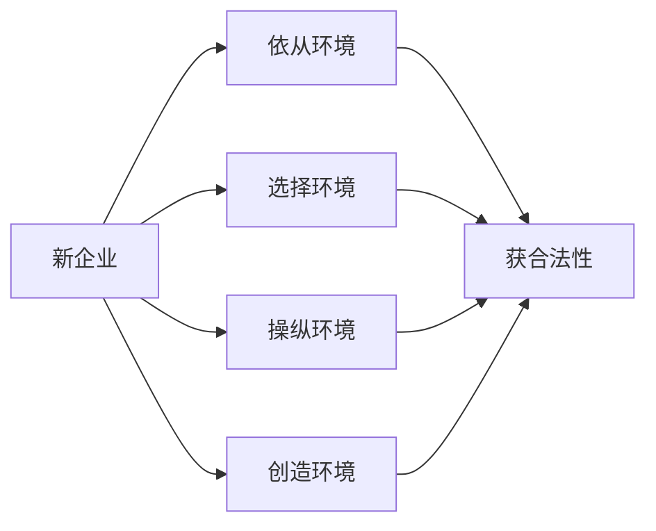

# 构建企业的合法性

## 它是什么

如果你刚创办一家南京的科技公司，产品还不错，但供应商不敢赊账、投资人犹豫、客户说“没听过你们”——问题往往不是技术，而是别人不认为你“该存在”。这就是课件说的**合法性**：在特定社会系统内，对一个实体行动是否合乎期望、恰当合适的一般认识与假定，即外部环境判断你的组织特征或行为是否符合外界价值观、规范与期望。对新企业来说，它直接决定能否活下去。

## 为什么需要

新企业天然背负**新进入缺陷**：内部流程从零建立、外界认可尚未获得，任一环节出错都会放大失败率。没有合法性，就难拿到资源、订单和信任。你可以先想一个问题：如果潜在客户完全不理解你的新商业模式，他为什么要冒险买单？答案通常是要先建立==管制、规范与认知三类合法性==。

| 合法性类型 | 关注“谁认可” | 简单理解 |
|---|---|---|
| 管制合法性 | 政府/监管机构 | 合规、证照、规则 |
| 规范合法性 | 行业/社会价值观 | 做事方式被接受 |
| 认知合法性 | 大众心智 | 大家“知道且理解”你 |

## 怎么做

获取合法性有两条主线：改自己，或改环境。具体战略是==依从、选择、操纵、创造四种途径==。

还有一个省钱办法：**象征性行动**——不实际改做事方式，只是表现得似乎符合期望；它是一种印象管理，但==不是欺骗==。可分层做：创业者个体层（秀人力资本/社会资本）、组织层（展示成就、技术、专业化）、企业间关系层（联盟、担保借势）。

> [!WARNING]
> 别把象征性行动写成“骗人”。它应是传递真实信号，而非捏造。

## 相近概念与常见坑

相近的是**象征性行动 vs 印象管理**：前者是企业层的特殊形式，后者是人/组织控评的广义行为。另一个坑是以为赚钱就有合法性——现金流改善（J 曲线后期）≠外界认可。

## 算对了的例子

简答常问：“合法性的本质？新问题有哪些？”正确答法要先写本质——==外部环境对组织是否符合价值观期望的判断感知==；再写新问题：早期要让消费者、供应商、投资者理解新商业模式，为新生事物建立外在正当性，即赢取管制/规范/认知合法性。答出这两层才算完整。
