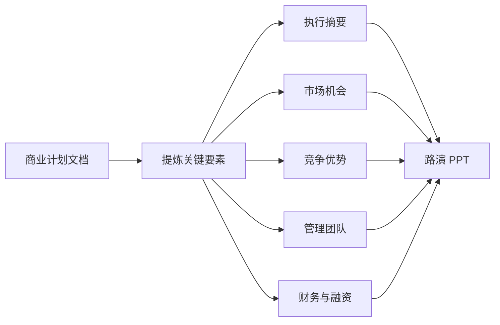
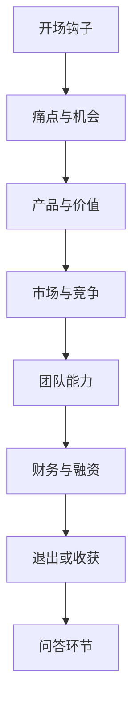

# 商业计划的展示与路演沟通

商业计划写得好，只是拿分的一半——投资人最终"买"的是**人和机会**，这两样要靠展示与路演当场传达出来。所谓路演沟通，是指创业者用口头陈述配合演示材料，把商业计划中的核心信息在有限时间内打动听众，并回应其质询的过程。==它的核心是"讲故事"而非"念 PPT"==。

## 为什么需要专门练展示

投资人每天看几十份 BP，真正进入面对面环节的只有少数。想一想：如果只有 5～10 分钟，你会讲哪几块？几乎必然是 ==执行摘要==（对应"电梯推销"）、==市场机会==、==竞争优势==、==管理团队==、==财务与融资== 这几项——正好对应课件强调的"管理团队与市场机会是两项关键投资要素"。也就是说，路演不是把 BP 全部复述一遍，而是把"关键投资要素"做高压浓缩。

## 路演沟通怎么做

一次完整路演通常按下列流程展开：

其中"开场钩子"即执行摘要，要短而热情，让人想知道更多；"退出或收获"对应商业计划的收获或退出模块，主动讲出来反而显得成熟。

> [!TIP]
> 用"问题—方案—证据"三段式组织每一页：先抛问题（痛点），再给方案（产品），最后给证据（数据、订单、专利），避免只堆功能。

## 与相近概念的区别

| 概念 | 载体 | 时长 | 目的 |
| --- | --- | --- | --- |
| 商业计划（文档） | 书面文件 | 阅读 20～30 分钟 | 系统论证可行性 |
| 路演展示 | PPT+口述 | 5～15 分钟 | 激发兴趣、建立信任 |
| 电梯推销 | 口头 30～60 秒 | 30～60 秒 | 争取下一次深谈机会 |

三者信息同源，但**详略与目标完全不同**：电梯推销求"继续聊"，路演求"愿意投/愿意支持"，文档求"经得起细看"。

## 常见的坑

> [!WARNING]
> - 把 BP 全文贴上 PPT，变成"念稿"，听众抓不住重点。
> - 只讲产品技术，不讲==市场机会==和==管理团队==，违背课件强调的两项关键投资要素。
> - 数据口径前后不一致，或市场预测缺乏现有信息支撑，违背==真实性==原则。
> - 路演结束后回避风险问题；主动呈现"风险因素"并给应对方案，反而加分。

## 一个可用的展示例子

以"校园二手教材循环平台"为例：开场 30 秒用"每学期数百万教材被丢弃"切入痛点；随后 2 分钟给市场规模（以在校生数×人均教材费估算）与竞品对比（书店、闲鱼）；再用 1 分钟讲团队（计算机+经管组合）；最后 1 分钟说明拟融资 30 万、用于小程序开发与校园推广，并给出 3 年内覆盖 20 所高校的里程碑。全程不超 6 分钟，把执行摘要、市场、竞争、团队、财务与时间表这五块讲透——这正是路演沟通的精髓。

> [!IMPORTANT]
> 路演沟通的评分点往往落在：开场是否吸引人、是否突出==市场机会与管理团队==、数据是否==真实==、回答是否自信一致。
