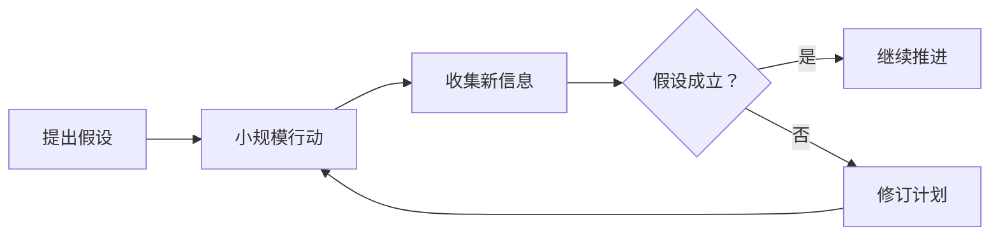
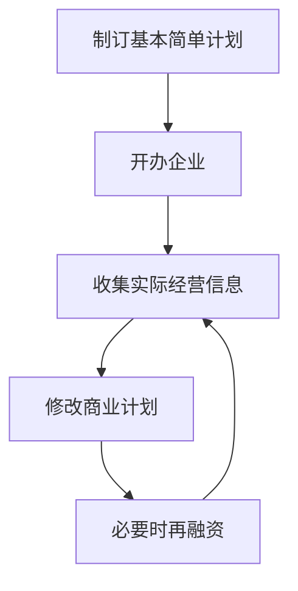

# 撰写商业计划的步骤与技巧

## 为什么必须写商业计划

先想一个问题：直接开干不行吗？为什么非要先写一份"纸上谈兵"的文件？

答案在于商业计划的两大目的：**迫使创业者系统思考创业**，以及**向外部个人或组织介绍创业项目**。写计划的过程远比计划本身重要——它逼着你把市场、团队、财务、风险等要素逐一想清楚，而不是凭一腔热血就冲进去。同时，它还是融资的"敲门金砖"，投资人需要通过这份文件快速判断项目是否值得投。

> [!IMPORTANT]
> 商业计划不能保证创业成功，但==撰写过程能显著加大成功概率==。不计划就创业，就像开车去没有路线图的目的地。

## 核心内容框架

一份完整的商业计划包含 12 个部分，可以用一张图理清逻辑：

其中**执行摘要**是"电梯推销"——必须在极短时间内激起读者兴趣，每句话都要传递丰富信息和创业激情。**管理团队**是投资人最先看的部分之一，他们宁愿投"二流创意+一流团队"，也不愿反过来。

## 关键撰写原则

| 原则 | 含义 |
|------|------|
| 一开始就吸引人 | 执行摘要必须简洁睿智，传达企业价值 |
| 团队与市场机会是核心 | 这是投资人最关注的两项要素 |
| 体现真实性 | 市场预测必须基于目标市场的现有信息分析 |

> [!WARNING]
> 常见误区：为了吸引投资而夸大市场数据、回避风险。实际上，==充分揭示风险因素反而有利于获得投资==，因为睿智的投资人更愿意相信诚实可靠的团队。

## 探索驱动型计划

传统计划方法把假设当事实，要求细节详尽——这在低不确定性环境下有效。但创业者面临的是**高不确定性**，很多假设只是大胆猜测。

**探索驱动型计划（Discovery-Driven Planning）**承认创业初期的判断几乎都是假设，将"伪证"视为计划的关键。它把创业看作持续的计划过程：随着进程推进，不断收集新信息验证假设、修订方案，直到假设都被验证。

## 动态调整：让计划真正有用

商业计划不是写完就锁进抽屉的静态文件，而是一份"活文档"。实用的路径是：

> [!TIP]
> 先做一个基本计划让企==业跑起来，再用真实数据迭代==，比一开始追求完美计划更有效。准备一份有效商业计划通常需要 200~300 个工作小时。

## 平衡热情与真实性

创业者常陷入两难：太冷静显得没激情，太热情又显得不专业。解决方法是：**保持分析的真实性，同时用语言和结构传递热情**。

真实性体现在四个方面：顾客分析基于真实反馈、市场分析基于可获取数据、竞争分析不回避困难、收入计划考虑定价与购买决策。热情则体现在执行摘要的措辞和整体叙事逻辑中——用事实支撑激情，而不是用激情替代事实。
