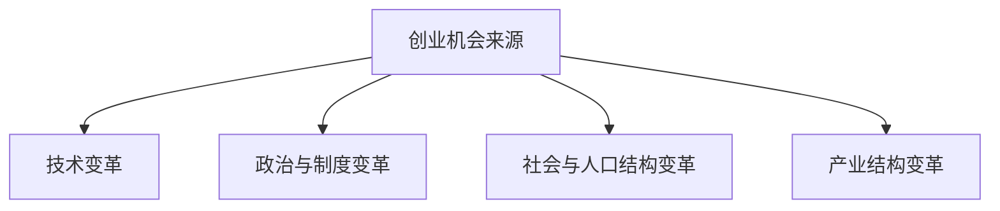

# 创业机会的来源与识别方法

## 什么是创业机会？

在搞清楚创业机会从哪里来、怎么识别之前，先要区分几个课堂上常考的相近概念。

| 概念 | 核心含义 | 一句话记忆 |
|------|----------|------------|
| 创意（Idea） | 具有创业指向的创新性想法 | “想到一个点子” |
| 商业概念（Business Concept） | 找到解决问题的手段，形成可检验的方案 | “这个点子怎么赚钱” |
| 创业机会 | 预期能产生价值的、清晰的“目的—手段”组合 | “需求+方案+时机”三者到位 |

从“点子”到“机会”，中间需要过滤、验证与匹配。创业机会的识别，本质上就是不断回答：**谁的需求？什么方案？为什么是现在？**

> [!IMPORTANT]
> 创业机会是==目的—手段组合==，不是单纯的灵感闪现。创意≠机会。

## 创业机会从哪里来？

德鲁克在《创新与企业家精神》中系统给出了七种来源，但课程主线把来源归纳为四大变革驱动力。

这四类变革打乱了原有的“目的—手段”匹配，从而暴露了新需求或释放了未充分使用的资源。例如，移动互联网（技术变革）加上“双创”政策（制度变革）叠加80后进入职场积累期（人口结构），催生了大量创业机会。

想一想教材里的实践练习：为什么80后成为创业主体？ 因为——
- 有了一定的工作经历和产业经验（==先前经验==）
- 有一定的积蓄（==资源==）
- 面临的创业机会较多（==机会窗口==）

> [!NOTE]
> 机会窗口：创意市场化的时间窗口。别人已经先做成了，窗口就关了。

## 怎么识别创业机会？

课堂给出的五种识别方法，可以配对不同的使用情境。

**新眼光调查**
用“新眼光”观察熟悉领域，不断获取信息建立直觉。关键是学会==问问题==：为什么这个东西要这样做？还有什么没被满足？

**系统分析**
适用于宏观趋势判断。把技术、市场、政策、竞争等要素放在一起，看“目的—手段”能否重新组合。

**问题分析**
从痛点出发：谁在抱怨？什么“不协调”？——事物的状态与“应该”的状态之间的不一致，正是机会的信号。

**顾客建议**
直接向潜在用户要答案。注意：顾客往往说得出“不舒服”，说不清“要什么”，所以需要提炼。

**创造需求**
用户自己都没想到的需求，创业者通过新产品诱导出来。这需要较高的创新能力和市场教育成本。

> [!CAUTION]
> 常见误区：把“顾客说想要”等同于“真实需求”。顾客可能抱怨某个不便，但未必愿意为解决方案付费。==真实需求==必须经过市场检验。

## 识别机会之后：定性评价五问

一旦“感觉”到了机会，创业者需要做初始判断。课程给出了五个基础问题：

1. 机会多大？时间窗多久？成长速度？
2. 潜在利润能否覆盖资本、时间、机会成本？
3. 能否开辟额外的商业机会选择？（走廊原理）
4. 面对竞争和障碍，收益是否持久？
5. 是否真正满足了真实需求？

> [!TIP]
> 走廊原理：一旦在某产业开始创业，就会比外部观察者更容易看到产业内的新机会。机会不是一锤子买卖，而是打开一条走廊。

## 实战：提炼一家企业的初期成长逻辑

回到课程里“中国成长百强”实践练习的要求：选企业、分析快速成长的原因。这个过程本身就是一次完整的识别训练。

**怎么做：**

- **准备阶段** → 搜集目标企业所属行业的结构特征、技术路径和用户画像；
- **孵化阶段** → 反复问：它解决了什么“不协调”？为什么是这个时候？
- **洞察阶段** → 提炼出关键的原因组合（例如：技术变革降低了供给成本 + 人口结构变化释放了新需求）；
- **评价阶段** → 用五个问题自检：市场是否够大？利润是否可持续？优势是否可防守？

识别创业机会，不靠拍脑袋，而是靠==有意识的观察+结构化验证==。创意的价值，最终要由市场来测试。
