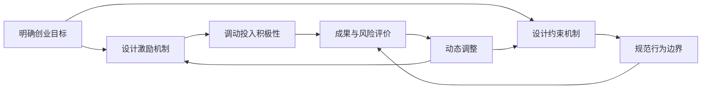

# 创业激励机制与约束机制的设计

## 是什么

创业激励机制与约束机制，是企业为调动创业者、员工等主体的积极性，同时规范其行为、控制经营风险而设计的一组制度安排。前者回答“为什么要做、做了有什么好处”，后者回答“不能做什么、违规有什么代价”。

==核心结论==：激励解决动力问题，约束解决边界问题；二者必须配套，==只有激励没有约束，容易冒险；只有约束没有激励，容易消极==。

## 为什么需要

创业活动具有高投入、高不确定性和利益不一致等特征。如果没有合理激励，关键员工可能不愿投入；如果缺乏约束，企业可能盲目扩张、违规经营或侵害利益相关者。

例如，某科技公司准备进入国际市场。既可以给核心员工项目奖金、销售提成和股权期权，鼓励其开拓市场；也要设置审批权限、预算上限和合规责任，防止员工为追求业绩而承诺做不到的订单。

## 怎么做

设计创业激励机制时，应把报酬与创业成果、长期价值和市场约束结合起来：

- **收益激励**：项目分红、利润分成、股权或期权；
- **荣誉与成长激励**：表彰、晋升、创业项目负责人资格；
- **资源与机会激励**：研发经费、创业训练、优先孵化；
- **长期约束**：设置追索、留任或退出安排，避免只追求短期数字。

设计约束机制时，应做到有依据、有执行、有反馈：

- **权力约束**：建立董事会、股东会与经理层之间的权责关系；
- **财务约束**：预算审批、资金使用权限、绩效审计；
- **法律与合规约束**：遵守公司法、合同、税务及知识产权规则；
- **风险控制**：退出机制、止损线、责任追究；
- **信息约束**：信息披露、绩效公开和内部监督。

可以先问两个问题：**员工完成什么关键行为，企业愿意给予什么回报？**同时，**企业最不能接受什么行为，谁来发现并处理？**这能避免把“发奖金”误当成完整机制。

## 与相近概念的区别

| 概念 | 核心作用 | 典型内容 | 关注重点 |
|---|---|---|---|
| 创业激励 | 增强主体动力 | 分红、股权、认可、机会 | 做什么值得做 |
| 创业约束 | 限定主体行为 | 权限、监督、责任、退出 | 不能做什么 |
| 绩效考核 | 评价经营结果 | 指标、评分、奖惩 | 做得怎样 |
| 企业治理 | 安排权力与监督 | 董事会、审计、问责 | 谁决策、谁监督 |

激励与约束都应进入绩效考核，但绩效考核只是二者共同使用的一种工具，不能替代制度设计。

## 变革成本与切入点

创新创业往往伴随组织变革。成长阶段的企业组织关系相对稳定、业务模式较成熟，实施变革的阻力通常比初创期更大：既得利益可能受损，核心人员也可能担心岗位变化。因此，要善于选择变革切入点，从局部、小范围、可验证的项目推进，以短期成果降低不确定性和内部阻力。

例如，一家南京软件企业不直接全面改组销售体系，而是先选一个产品线试点“项目制+利润分成”，六个月内比较其订单转化率、交付利润和员工积极性。若试点有效，再逐步推广；若无效，则及时调整并控制损失。

## 常见坑

> [!WARNING]
> 把激励等同于奖金、把约束等同于处罚，是最常见的误区。

- 只奖励销售额，导致忽视利润、回款与合规风险；
- 激励指标过短，容易诱发短期行为；
- 约束过严、程序复杂，使员工害怕试错；
- 只设计制度，不明确执行主体、评价周期和申诉机制；
- 认为机制一经确定便长期有效，忽视创业环境变化。

> [!TIP]
> 一个实用检查法：每项激励都要说明“对应什么行为”，每项约束都要说明“违反后由谁处理”；无法回答，就说明制度尚未设计完整。

判断机制是否有效，不能只看是否兑现奖励，还要看关键行为是否改善、经营风险是否可控，以及试错成本是否处在企业可承受范围内。
