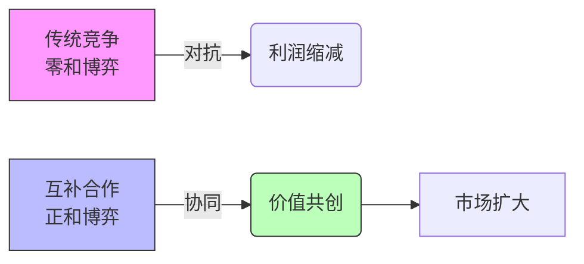

# 变竞争为互补（不同商业模式的竞争对手成为价值创造的合作伙伴）

# 变竞争为互补

在传统的商业思维中，竞争对手往往被视为“零和博弈”的对手。但在《创新与创业管理》的商业模式设计章节中，我们需要转换视角：**拥有不同商业模式的竞争对手，完全可以成为价值创造的合作伙伴。**

## 核心概念解析

==变竞争为互补==是指企业不再单纯通过价格战或功能模仿来争夺存量市场，而是识别出自身与合作伙伴在资源、能力或客户群体上的差异性，通过合作创造新的增量价值。

> [!IMPORTANT]
> 核心定义：不同商业模式的对手 $\rightarrow$ 价值创造伙伴。关键在于“模式差异”而非“产品同质”。

试想一下，如果两家公司的盈利逻辑完全不同（例如一家靠硬件赚钱，一家靠服务订阅赚钱），它们直接对抗是否会造成资源浪费？反之，若结合双方优势，能否为用户提供更完整的解决方案？

## 为什么需要这样做？

1.  **突破增长瓶颈**：单一企业的资源有限，互补合作能快速获取对方渠道或技术。
2.  **降低交易成本**：相比完全并购，战略合作更灵活，风险更低。
3.  **做大蛋糕**：从“分蛋糕”转向“做蛋糕”，共同教育市场。

## 如何实施：从对立到共生

实施这一策略通常遵循以下逻辑：

1.  **识别互补性**：分析对方的商业模式画布，寻找己方缺失的关键业务或渠道。
2.  **界定边界**：明确哪些领域竞争，哪些领域合作（竞合关系，Co-opetition）。
3.  **设计利益分配**：确保双方在合作中都能获得比单独行动更高的收益。

> [!TIP]
> 记忆口诀：找差异、定边界、分利益。不要试图消灭对手，而要利用对手的优势。

## 常见误区与辨析

| 维度 | 传统竞争 | 变竞争为互补 |
| :--- | :--- | :--- |
| **目标** | 击败对手，独占市场 | 合作共赢，扩大生态 |
| **焦点** | 价格、市场份额 | 用户价值、生态系统 |
| **关系** | 敌对、封闭 | 既竞争又合作 |

> [!WARNING]
> 易错点：并非所有竞争对手都能互补。只有当双方**商业模式存在结构性差异**（如线上vs线下、硬件vs内容）时，互补才成立。同质化严重的对手通常只能进行残酷的价格战。

## 典型案例：苹果与三星

这是一个经典的“算对了”的例子。

*   **背景**：苹果（Apple）与三星（Samsung）在智能手机终端市场是激烈的直接竞争对手。
*   **互补逻辑**：
    *   苹果擅长**系统设计、品牌营销与应用生态**（软件/服务导向）。
    *   三星擅长**屏幕制造、芯片代工与供应链整合**（硬件制造导向）。
*   **合作结果**：苹果向三星采购大量OLED屏幕和存储芯片。
*   **价值创造**：苹果获得了顶级硬件支持，无需自建重资产工厂；三星获得了巨额订单，摊薄研发成本。双方在终端卖手机时互不相让，但在供应链上却是紧密伙伴。

$$ \text{总价值} = V_{\text{苹果生态}} + V_{\text{三星制造}} > V_{\text{单独行动}} $$

通过这种安排，双方将原本可能用于重复建设的资源，转化为了各自核心竞争力的护城河。
