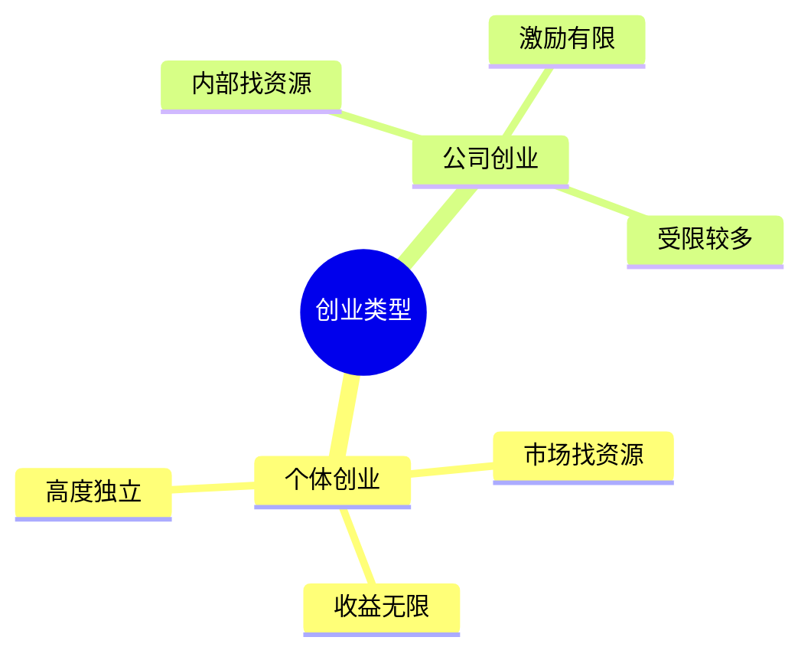

# 既有企业为什么重视创业及公司创业与个体创业活动的差异

## 既有企业为什么重视创业

先想一个问题：一家已经盈利、运转良好的大公司，为什么还要折腾去“内部创业”？

传统工业时代的管理强调计划、控制与秩序。但今天外部环境剧变，老一套不够用了。==创新、变革、速度、学习==已成为企业持续成功的基础。如果大企业只守不攻，很快会被灵活的初创公司颠覆。

因此，既有企业必须将个体层面的创业精神拓展到公司内部，激发管理者的进取心，鼓励开展公司创业活动。

> [!IMPORTANT]
> 核心目的：让具备企业家素质的管理者保持强烈进取心，在公司内部激发创业精神，以应对严峻挑战。

## 公司创业与个体创业的异同

两者本质都是创业，共享以下特征：机会导向、创造性整合资源、价值创造、超前行动、创新和变革。

但由于最初的==资源禀赋、组织形态、战略目标==不同，两者在三个维度上差异显著：

| 差异维度 | 个体创业 | 公司创业 |
| :--- | :--- | :--- |
| **初始条件** | 从市场寻求资源；资金主要来自个人、伙伴及亲友的财产 | 从组织内部寻求未利用或未有效利用的资源 |
| **报酬与风险** | 所有权与控制权合一；潜在收益无限，承担财务、职业等高风险 | 通常无企业所有权；股权激励有限，个人风险相对较低 |
| **独立性** | 独立性高、灵活性强，可迅速决策 | 独立性弱，受行政系统约束，需跨部门沟通并克服层级阻力 |

> [!TIP]
> 记忆口诀：“个找外、公找内；个无限、公有限；个自由、公受限”。

## 常见易错点与辨析

> [!WARNING]
> 易错坑：认为“公司创业者拥有企业所有权”。
> 纠正：公司创业者只是组织成员，即使以独立单位运作，获得的股权激励也是有限的，并不拥有企业所有权。

> [!NOTE]
> 延伸辨析：个体创业者面临的是“生存级”综合风险（财务、职业、生活），而公司创业者依托既有平台，更多面临的是项目失败的职业风险，而非倾家荡产的财务风险。

> [!CAUTION]
> 高危误区：以为公司创业可以像个体创业一样“拍脑袋就干”。实际上，内部创业者必须与其他成员建立互信关系，努力克服层级组织结构对创业行为本质上存在的阻力。

## 典型考题实战

**题目**：简述既有企业为什么重视创业？

**解题思路**：不要只答“为了赚钱”，要踩准课件中的关键词链条。

**标准作答示范**：
近年来，企业面临的外部环境发生重大变化，传统工业时代强调计划、控制、秩序的管理方式受到严峻挑战。==创新、变革、速度、学习==成为企业持续成功的基础。在此背景下，既有企业需要将个体层面的创业精神拓展到公司内部，目的是让具备企业家素质的管理者保持强烈的进取心，在公司内部激发创业精神，鼓励创业活动，从而适应环境变化并保持竞争优势。
