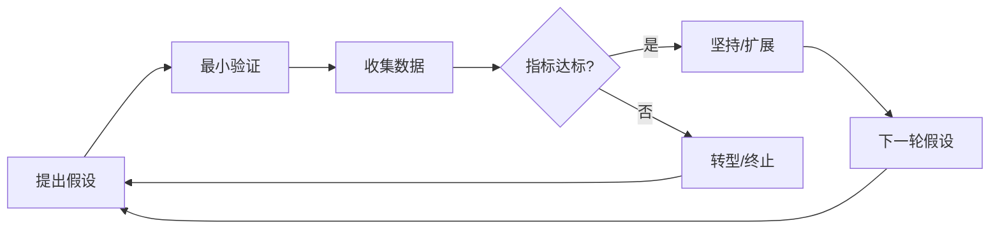

# 创业决策的迭代优化与反馈机制

## 它是什么与为什么需要

创业决策的迭代优化与反馈机制，是指创业者在资源约束下，通过“假设—验证—学习”的循环，将初始决策视为==可证伪的临时假设==而非终极真理，并依据市场真实反馈动态调整方向的过程。

为什么不能一次性制定完美计划？因为新创企业面临的是“极端不确定性”，而非“风险”。风险有历史数据支撑概率分布，而不确定性连结果空间都未知。此时，传统线性规划失效，唯有通过高频、低成本的试错循环，才能用==实证数据替代主观臆断==，避免在错误路径上耗尽资源。

## 怎么做：构建有效反馈闭环

如何确保每次迭代都在逼近真相？关键在于区分“虚荣指标”与“可行动指标”，并建立结构化反馈回路。

> [!IMPORTANT]
> ==反馈必须指向具体行为改变==。若数据仅用于汇报或自我安慰，则不构成有效反馈机制。

操作上需三步走：① 明确待验证的核心假设（如“用户愿为X功能付费”）；② 设计最小可行实验（MVE），控制变量且成本可控；③ 预设成功标准与决策规则，避免事后合理化。例如，南邮某学生团队开发校园二手平台，假设“实名认证提升交易率”，便仅在3个宿舍楼试点实名模块，对比未试点楼栋7日转化率，而非全量上线后看总GMV。

## 与相近概念的区别

| 维度 | 迭代优化与反馈机制 | 传统战略规划 | 敏捷开发 |
| :--- | :--- | :--- | :--- |
| 目标 | 验证商业模式可行性 | 执行既定战略 | 交付可用产品 |
| 反馈源 | 市场行为数据 | 内部KPI达成度 | 用户验收测试 |
| 决策依据 | 实证学习 | 预测分析 | 需求优先级 |
| 失败处理 | 预期内学习机会 | 需规避的偏差 | 待修复缺陷 |

> [!NOTE]
> 敏捷是工程方法，迭代优化是==商业认知方法==。前者解决“怎么做产品”，后者解决“做什么产品”及“为谁做”。

## 常见的坑与正确示例

> [!WARNING]
> 最大误区是将“用户口头好评”当作有效反馈。==只有付出稀缺资源（时间、金钱、社交资本）的行为才是真信号==。

**错误案例**：某团队调研100人，90人说“需要智能课表App”，遂投入3个月开发，上线后日活不足50。问题在于将意愿等同于需求，未验证支付或持续使用行为。

**正确做法**：同一团队改用“预售+押金”验证：在校园群发布原型视频，收取9.9元意向金锁定早鸟资格，7天内收款超200份才启动开发。最终实收237份，转化率28%，远超预设20%阈值，确认需求真实存在。此例中，==9.9元押金即为可行动指标==，避免了沉没成本陷阱。

> [!TIP]
> 记住口诀：“==假设要小，验证要快，指标要硬，转身要决==”。每轮迭代周期压缩至2周内，方能跑赢不确定性。
