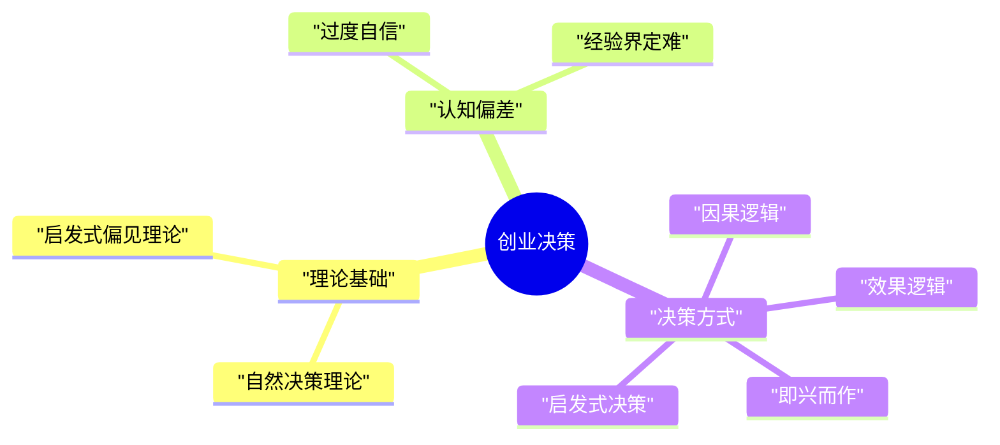
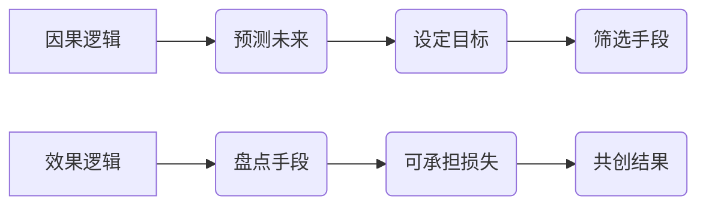

# 创业决策的理论基础与认知偏差

> [!IMPORTANT]
> 创业决策是在高度动态复杂条件下，基于动态行为进行评价、判断和选择的决策过程。

## 它是什么与为什么需要

创业环境充满模糊性与不确定性，创业者不可能等到系统分析所有变量后再行动。因此，理解决策背后的理论基础与认知偏差，是==完善创业决策、避免致命误判==的前提。

支撑创业直觉决策的两大理论视角：

- **自然决策理论**：源于对棋艺大师的观察。专家通过感知技能识别记忆中储存的模式，不必逐一衡量变数便能凭直觉出手好棋。强调老练创业者在直觉判断上的卓越之处。
- **启发式偏见理论**：强调直觉判断的错误或不足，认为统计模型优于专家的直觉判断。提醒创业者正视认知局限。

## 怎么做：基于过程的四种决策方式

面对不同情境，创业者常采用以下决策路径：

| 决策方式 | 核心思路 | 适用情境 |
| :--- | :--- | :--- |
| 因果逻辑 | 目标导向，预测基础，筛选最优方案实现预设目标 | 稳定线性环境 |
| 效果逻辑 | 手段导向，投资可承担损失，利用突发事件创造结果 | 高度不确定情形 |
| 即兴而作 | 想法形成与执行几乎同时完成，不制定商业计划 | 机会稍纵即逝时 |
| 启发式决策 | 采用探试方式快速决策并不断完善 | 时间紧迫且信息不全 |

> [!TIP]
> 记忆口诀：**因**果定目标，**效**果看手段，**即**兴同步做，**启**发快探试。

## 相近概念的区别：因果逻辑 vs 效果逻辑

这是考试中最常考的辨析点：

- ==因果逻辑从给定目标出发，重点在于从现有手段中筛选出最优方案以实现预设目标；效果逻辑通常从一组给定的手段开始，重点在于从这组手段中创造出可能的结果。==
- 因果逻辑关注“应该做什么”（目标已定）；效果逻辑关注“可以做什么”（目标随利益相关者互动不断调整）。

## 常见的坑：认知偏差来源

为什么经验丰富的创业者也会决策失误？主要受主客观因素交织影响：

1. **过度自信**：创业者对自身直觉的来源及质量缺乏判断，容易高估胜算。
2. **经验难以界定**：创业经验和专业技能不像传统学科那样边界清晰，容易产生错误类比。
3. **忽视外部网络**：未能妥善利用创业伙伴、员工等亲近网络中的不同看法来修正直觉。

> [!WARNING]
> 启发式偏见理论明确指出：单凭直觉不够，必须结合外部反馈与数据加工来保障决策可靠性。

## 算对了的例子

**题目**：创业直觉决策可靠吗？为什么？请用实例说明。

**解析**：
1. **结论**：可靠，但需条件保障。
2. **理论依据**：根据自然决策理论，像滴滴创始人程维、美团创始人王兴这类老练创业者，凭借专业训练与实际经验积累，可视为创业领域的“专家”，其直觉判断功不可没。但同时，启发式偏见理论提醒我们直觉存在不足。
3. **如何保障可靠性**（关键得分点）：
   - 通过多种途径积累直接/间接经验；
   - 培养迅速收集、整理数据的能力；
   - 完善迅速加工处理信息的能力；
   - 善于利用外部网络资源（如合伙人意见）改善直觉判断质量，勇于挑战自身权威。

> [!NOTE]
> 答题时切忌只答“可靠”或“不可靠”。必须同时提及两种理论视角，并结合主观特征与客观条件的互动关系展开论述。
