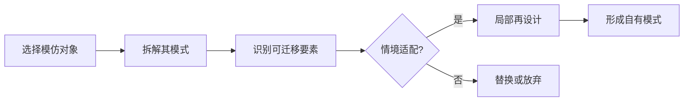

# 如何通过模仿设计商业模式

## 模仿设计商业模式：从“抄”到“超”

### 它是什么

模仿设计商业模式，并不是原封不动地复制别人的产品，而是==以已有成功商业模式为蓝本，通过有选择地借鉴其价值创造、价值传递或价值获取逻辑，结合自身情境进行再设计==的过程。在南京邮电大学《创新与创业管理》课程中，它被视为设计商业模式的一条务实路径：当原创模式难以凭空构想时，从被验证过的模式出发，降低试错成本。

> [!IMPORTANT]
> 核心定义：模仿的对象是**商业模式的逻辑**（如盈利方式、客户关系、渠道结构），而非单纯的产品外观或功能。

### 为什么需要模仿

- **降低不确定性**：被模仿的模式已经过市场检验，失败概率相对较低。
- **节省认知资源**：创业者不必从零构想所有要素，可聚焦于局部创新。
- **快速进入市场**：尤其在窗口期较短的行业，模仿能压缩探索时间。

### 怎么做：模仿的三层路径

**第一步：选择模仿对象。** 优先选择与自身资源、目标市场相近的成功企业。不要只盯着行业第一名，有时区域市场的“隐形冠军”更值得模仿。

**第二步：拆解商业模式。** 用商业模式画布逐一分析原型的九个模块：客户细分、价值主张、渠道通路、客户关系、收入来源、核心资源、关键业务、重要伙伴、成本结构。找出其中==真正支撑其成功的2～3个核心模块==，而不是全盘照搬。

**第三步：情境适配与再设计。** 这是模仿与抄袭的分水岭。问自己三个问题：

- 我的目标客户和原型一样吗？如果不一样，价值主张需要怎样调整？
- 我拥有哪些原型不具备的资源或能力？能否形成差异化？
- 原型的模式在本地市场、政策环境或文化语境下是否存在“水土不服”？

### 模仿与相近概念的区别

| 概念 | 核心动作 | 合法性/风险 |
|------|----------|-------------|
| 模仿设计 | 借鉴模式逻辑 + 局部适配创新 | 合法，风险低 |
| 逆向工程 | 拆解产品还原技术实现 | 视专利与商业秘密而定 |
| 抄袭/山寨 | 直接复制产品与品牌标识 | 违法，高法律风险 |
| 对标改进 | 以领先者为参照持续优化自身 | 合法，强调长期跟踪 |

> [!WARNING]
> 常见的坑：把“模仿商业模式”等同于“模仿产品功能”。例如看到瑞幸做“线上下单+自提”，就只做一个App点单系统，却忽略了瑞幸真正的模式核心是==高密度小店+数据驱动的选址与选品==。只抄表面功能，不抄底层逻辑，必然失败。

### 一个算对了的例子

假设你计划在南京某高校周边开一家轻食店。你选择模仿**瑞幸咖啡**的商业模式，并做如下适配分析：

**瑞幸模式拆解（核心三模块）：**

- 价值主张：高性价比、便捷自提的日常咖啡
- 渠道通路：线上小程序下单，线下高密度自提店
- 收入来源：高频低客单价，走量盈利

**你的情境适配：**

| 模块 | 瑞幸原型 | 你的适配 | 适配理由 |
|------|----------|----------|----------|
| 价值主张 | 高性价比咖啡 | 高性价比学生轻食 | 目标客户是价格敏感的学生 |
| 渠道通路 | 小程序+自提店 | 小程序+教学楼取餐柜 | 学生课间时间碎片化，取餐柜比门店更近 |
| 收入来源 | 高频低客单价 | 套餐订阅制（周卡） | 学生消费频次稳定，订阅锁定复购 |
| 核心资源 | 供应链与数据系统 | 中央厨房+校园配送团队 | 校园内自建配送比外部平台更快更省 |

> [!TIP]
> 模仿设计的关键验证：“你保留了原型的什么，改了什么，**为什么改**？”如果三个问题都答不上来，说明还停留在抄的阶段。

> [!CAUTION]
> 高危误区：模仿时把原型的**所有模块都保留**，只把品牌名称换掉。这不是模仿设计，而是自我欺骗——你没有为任何特定客户群体做过适配，市场不会为“低配复制品”买单。
