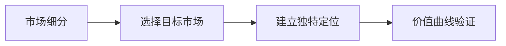

# 分析并确定目标顾客

## 它是什么与为什么需要

> [!IMPORTANT]
> 商业模式设计的第一步，也是最重要的一步，就是==确定你的顾客是谁==。

在创业语境下，“分析并确定目标顾客”并非简单的人口统计学画像，而是识别“谁愿意为你的价值主张付费”。若跳过此步直接开发产品，极易陷入“自嗨式创新”。传统产品开发模式遵循“概念→开发→测试→发布”的线性流程，而创业企业必须采用==顾客开发模式==，将“顾客探索”与“顾客验证”前置，确保产品与市场匹配（PMF）。

## 怎么做：三步定位法

回答“谁是我们的顾客”需严格执行以下三个步骤：

1.  **市场细分**：基于“待完成工作”（Jobs-to-be-Done）理论，挖掘顾客生活中需要借助产品完成的具体任务及痛点。例如，用户买电钻不是为了拥有钻头，而是为了“墙上有个洞”。
2.  **选择目标市场**：比较各细分市场的吸引力（规模、增长率、竞争强度），==选择最具吸引力的市场==作为切入点，而非贪大求全。
3.  **建立独特定位**：利用==价值曲线==工具，通过“剔除-减少-增加-创造”四步动作框架，使企业在顾客心智中占据特殊位置，开创蓝海空间。

> [!TIP]
> 价值曲线四问口诀：剔理所应当，减过剩标准，增核心体验，创行业未有。

## 与传统市场分析的区别

| 维度 | 传统市场分析 | 创业目标顾客分析 |
| :--- | :--- | :--- |
| **核心逻辑** | 现有需求满足 | 待完成工作与痛点挖掘 |
| **验证方式** | 内部/外部测试后发布 | 顾客探索与验证并行 |
| **定位工具** | SWOT、波特五力 | 价值曲线、人物角色 |
| **定价导向** | 成本加成或竞争对标 | ==基于市场+风险偏好== |
| **营销重心** | 大众传播与渠道铺货 | 口碑激发与精准触达 |

> [!NOTE]
> 顾客开发模式包含顾客探索、顾客验证、顾客生成、企业建设四阶段，它与产品开发模式==并行不悖==，而非替代关系。

## 常见的坑

> [!WARNING]
> 最大的误区是将“所有人”当作目标顾客。缺乏反细分（Anti-Segment）思维，即未明确“谁绝对不是你的客户”，会导致资源分散。

另一个高频错误是混淆“产品功能”与“顾客价值”。创业者常沉迷于技术参数，却忽略了顾客购买的是“问题的解决方案”。此外，在未完成“顾客验证”前就大规模投入“顾客生成”阶段的营销活动，是典型的烧钱陷阱。

## 算对了的例子：校园二手教材平台

某南邮创业团队最初将目标顾客定义为“所有在校大学生”，结果推广转化率极低。运用三步定位法重新分析：

1.  **细分**：发现大一新生“找课难、买书贵”是强痛点，而大四学生卖书意愿虽高但频次低。
2.  **选择**：锁定“大一新生”为核心目标市场，因其需求刚性且集中。
3.  **定位**：通过价值曲线，剔除“社交聊天”功能，减少“品类广度”，增加“课程绑定推荐”，创造“学长笔记附赠”服务。

调整后，该平台仅针对大一新生宿舍进行精准地推（顾客探索），首月订单量增长300%。这证明了==先验证再扩张==的顾客开发逻辑有效性。
