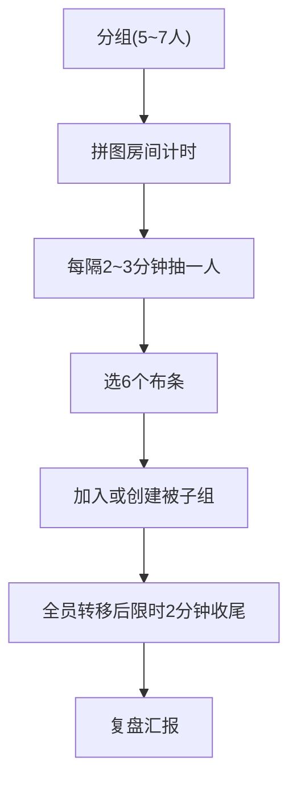

# 拼图与被子设计实践练习（创业者认知差异）

拼图与被子设计是一个体验式练习，通过两个连续任务让学生亲身感受==管理思维与创业思维的差异==。

> [!IMPORTANT]
> 核心结论：拼图代表管理思维（目标明确、资源既定），做被子代表创业思维（目标模糊、资源受限、环境不确定）。

## 它是什么与为什么需要

在商业环境中，不确定性前所未有地高。如果只用“拼拼图”的方式去应对没有图纸的复杂问题，必然会处处碰壁。这个练习通常在课程第一天进行，目的是让你明白：某种思维方式不一定比另一种更好，但==必须理解环境背景==。

试想：如果你拿到的不是300块有固定位置的碎片，而是一堆毫无关联的布条，你还能按图索骥吗？

## 怎么做：练习流程

1. **拼图阶段**：每组300块碎片，目标是尽快拼出盒子上的图像。
2. **转移阶段**：每隔2~3分钟从各组随机抽一人进入空房间。第一批人被任命为“被子领导者”，后续人作为志愿者加入。
3. **被子阶段**：每人只能从散乱的织物桌上选恰好6个布条，不能多不能少，选定不可更换。在地上拼凑构造一床被子。
4. **复盘**：探究两种任务的本质区别。

> [!WARNING]
> 练习开始前绝不能称其为“被子设计练习”，否则会提前泄露奥妙；节奏必须快，慢节奏会削弱不确定感带来的冲击。

## 管理思维与创业思维的区别

| 维度 | 拼图（管理思维） | 被子设计（创业思维） |
| :--- | :--- | :--- |
| **目标** | 明确界定（盒盖图像） | 模糊开放（构建最好的设计） |
| **资源** | 确定且完整（300块碎片） | 受限且不可逆（仅选6个布条） |
| **团队** | 固定小组协作 | 动态重组，跨组自由加入 |
| **成功标准** | 还原预设图像 | 尽己所能创造独特价值 |

> [!NOTE]
> 管理思维适用于确定性环境；若将其生搬硬套到不确定环境中的复杂问题，创业者会遭遇一个又一个障碍。能在被子设计上灵活应付，才能在创业领域施展自如。

## 常见的坑

- **套用旧经验**：试图在做被子时寻找“标准答案”或等待别人分配任务，这是典型的管理思维惯性。
- **资源贪多**：规则要求“不要多也不要少”选6个布条，多选或犹豫不决都会导致违规或错失先机。
- **固守原团队**：被抽出后非要找原拼图小组的成员，忽略了创业中跨边界整合资源的特性。

> [!TIP]
> 记忆口诀：拼图看图找碎片（因果逻辑），被子挑布造图案（效果推理）。

## 算对了的例子：任务复盘分析

在一次标准的60~80分钟课堂练习中，某组学生在拼图阶段用15分钟完成了300块碎片的拼装，因为目标清晰、分工明确（有人找边缘、有人拼色块）。但当成员A被抽走去选布条时，他最初感到极度不适——没有图纸，不知道最终长什么样，且只有6个布条。

A最终放弃了“寻找完美匹配”的想法，根据自己手中6个布条的颜色和形状（现有手段），主动加入了一个正在用暖色调布条铺底的陌生小组，共同拼出了一幅抽象图案。

**正确复盘结论**：
该学生准确识别了思维转换的关键点：拼图是“目标驱动”（先有结果再找路径），而做被子是“资源驱动”（基于手头有限的布条去创造可能的结果）。这正是适应不确定和模糊状况的核心能力。
