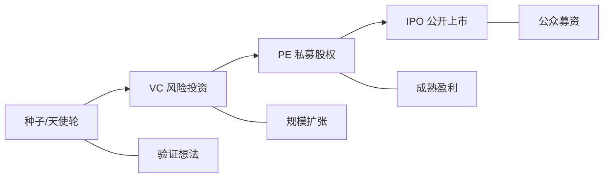

# 创业融资渠道与资金来源（天使投资、VC等）

创业融资，本质上是创业者为获取企业所需资源而在市场上进行的资金筹措活动。但你想过吗：一个刚有想法、连产品原型都没有的个体创业者，凭什么让陌生人掏钱？

> [!IMPORTANT]
> 核心结论：==资金来源的选择取决于创业者的初始条件与所处阶段==。不同阶段的资金成本、风险承受力与对控制权的要求截然不同。

## 初始条件决定起步路径

根据课件定义，创业者按背景可分为两类，其起步资金来源存在根本差异：

| 维度 | 个体创业者 | 公司创业者 |
| :--- | :--- | :--- |
| **资源来源** | 从市场上寻求外部资源 | 通常从组织内部寻求资源 |
| **初期资金** | 个人、伙伴、家庭及亲友的个人财产 | 组织内未利用或未有效利用的资源 |
| **核心痛点** | 缺乏信用背书，外部融资难 | 需突破内部流程壁垒 |

个体创业者在“3F”（Family, Friends, Fools）资金耗尽后，必须转向外部专业渠道。

## 核心融资渠道与演进

当自有资金无法支撑业务扩张时，该找谁？这取决于你的项目成熟度。

- **天使投资（Angel Investment）**：投资于极早期（仅有商业计划书或雏形）。单笔金额较小（如几十万至数百万），看重“人”和“赛道”，风险极高。
- **风险投资（VC, Venture Capital）**：投资于成长期（已有初步产品和数据验证）。单笔金额大（千万级起），追求高倍数回报，通常要求董事会席位和对赌条款。

> [!NOTE]
> 天使投资人多为高净值个人，用自有资金；VC 则是专业机构，管理的是 LP（有限合伙人）的钱，因此 VC 的决策流程更严、退出诉求更强。

## 股权稀释怎么算？

融资不是白拿钱，而是出让公司股份。估值是谈判的核心。

**【计算示例】**
某南邮学生团队开发物联网项目，天使投资人愿出资 $I = 200$ 万元，双方协商确定的**投后估值**（Post-money Valuation）为 $V_{post} = 1000$ 万元。

问：投资人占股比例是多少？创始人团队还剩多少？

**解：**
$$P_{investor} = \frac{I}{V_{post}} = \frac{200}{1000} = 20\%$$
$$P_{founder} = 1 - P_{investor} = 80\%$$

若下一轮 VC 以投前估值（Pre-money）$V_{pre} = 4000$ 万元进入，注资 $I_2 = 1000$ 万元：
$$V_{post2} = V_{pre} + I_2 = 4000 + 1000 = 5000 \text{ 万元}$$
$$P_{VC} = \frac{1000}{5000} = 20\%$$
此时，原天使投资人和创始人的股份将同比例被稀释（即乘以 $1 - 20\% = 80\%$）。

> [!TIP]
> 记忆口诀：“投后估值 = 投前估值 + 融资金额”。算占股时，一定要看清题目给的是投前还是投后！

## 常见的坑

> [!WARNING]
> 易错边界：混淆“债权融资”与“股权融资”。向亲友借钱属于债权，到期必须还本付息；引入天使/VC 属于股权，共担风险，不需要还钱，但要让渡控制权和未来收益。

> [!CAUTION]
> 高危误区：过早出让过多股权。如果在天使轮就为了多拿钱出让 40% 以上股份，后续 VC 轮次中创始人极易丧失控制权，甚至被踢出局。
