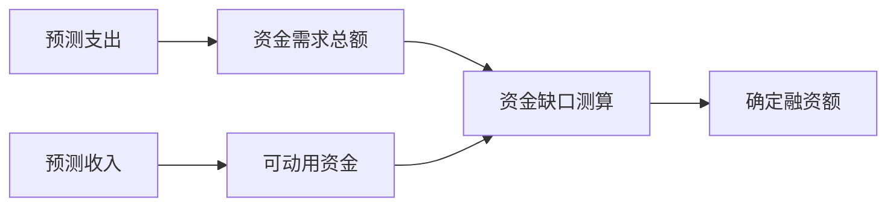

# 创业融资需求分析与资金缺口测算

## 创业融资需求分析

创业融资需求分析，是创业融资的第一步，目的是回答一个问题：**创业到底需要多少钱？**

很多创业者一开始容易凭感觉估算，比如“先融 100 万再说”。但融资不是越多越好，也不是越少越安全。真正需要做的是把创业过程中的各项支出和收入逐项算清楚，判断资金是否够用，以及什么时候会缺钱。

> [!IMPORTANT]
> 创业融资需求分析的核心，是判断企业在未来一段时间内，**资金流入能否覆盖资金流出**，并据此确定融资规模。

---

## 为什么要做资金缺口测算

创业初期通常会出现“先投入、后回款”的情况。即使项目未来能盈利，也可能因为前期现金流不足而失败。

常见资金用途包括：

- 产品研发费用
- 原材料与库存采购
- 人员工资
- 房租、水电、办公费用
- 市场推广费用
- 设备购置与维护

如果只看利润，不看现金流，就容易出现“账面赚钱、手里没钱”的情况。

> [!WARNING]
> 创业企业最常见的风险不是“不盈利”，而是**现金流断裂**。

---

## 怎么做融资需求分析

融资需求分析通常按以下步骤展开：

### 先预测资金流出

把未来一段时间内的支出逐项列出，例如：

- 固定成本：房租、工资、设备折旧
- 变动成本：原材料、包装、物流
- 一次性投入：研发、注册、装修、设备采购

### 再预测资金流入

主要包括：

- 销售收入
- 预收款
- 其他经营回款

### 最后计算资金缺口

资金缺口的基本思路是：

$$
资金缺口 = 资金需求总额 - 可动用资金总额
$$

其中：

- **资金需求总额**：创业过程中预计要花的钱
- **可动用资金总额**：自有资金、经营回款、已有借款等

如果结果为正，说明存在融资缺口；如果为负，说明当前资金基本够用。

---

## 资金缺口测算的思路

可以用一个简单框架理解：

> [!TIP]
> 记忆时可以抓住一句话：**先算要花多少，再算手里有多少，最后看差多少。**

---

## 一个算对了的例子

某创业项目预计第一年资金需求如下：

- 研发费用：20 万元
- 工资支出：30 万元
- 房租及办公费用：10 万元
- 市场推广费用：15 万元
- 原材料及库存：25 万元

则资金需求总额为：

$$
20+30+10+15+25=100（万元）
$$

项目可动用资金包括：

- 创始人自有资金：40 万元
- 预计销售回款：35 万元

则可动用资金总额为：

$$
40+35=75（万元）
$$

因此资金缺口为：

$$
100-75=25（万元）
$$

所以，该项目第一年至少需要融资 **25 万元**，才能基本保证资金链不断裂。

> [!IMPORTANT]
> 这个例子的关键不是“算出 25 万”，而是明白：==融资额应来自缺口测算，而不是凭感觉拍脑袋==。

---

## 和相近概念的区别

### 融资需求分析 vs 融资方式选择

| 概念 | 关注点 | 解决的问题 |
|------|------|------|
| 融资需求分析 | 需要多少钱 | 资金缺口有多大 |
| 融资方式选择 | 从哪里拿钱 | 股权融资还是债权融资 |

先做需求分析，再谈融资方式，顺序不能反。

### 资金需求 vs 资金缺口

| 概念 | 含义 |
|------|------|
| 资金需求 | 创业总共需要投入多少 |
| 资金缺口 | 现有资金不够，还差多少 |

> [!NOTE]
> 资金需求大，不一定缺口大；如果自有资金充足，缺口可能很小。

---

## 常见的坑

> [!CAUTION]
> 创业融资测算中，最容易出错的是**低估支出、高估回款**。

常见问题有：

1. **只算启动资金，不算运营资金**  
   项目启动后，工资、房租、推广费还会持续发生。

2. **把销售收入当成即时现金流入**  
   实际上很多销售存在账期，回款会滞后。

3. **忽略备用资金**  
   创业中常有突发支出，最好预留安全余量。

4. **融资额越高越好**  
   融资过多可能带来股权稀释或还款压力。

---

## 考试与答题提示

如果题目问“如何进行创业融资需求分析”，可以按这个思路答：

1. 预测创业各阶段资金需求  
2. 估算自有资金与经营回款  
3. 计算资金缺口  
4. 结合缺口确定融资规模与融资时机  

> [!TIP]
> 答题时优先写出公式：  
> ==资金缺口 = 资金需求总额 - 可动用资金总额==

如果你愿意，我还可以继续把这个知识点整理成**适合直接放进题库/复习资料**的版本。
