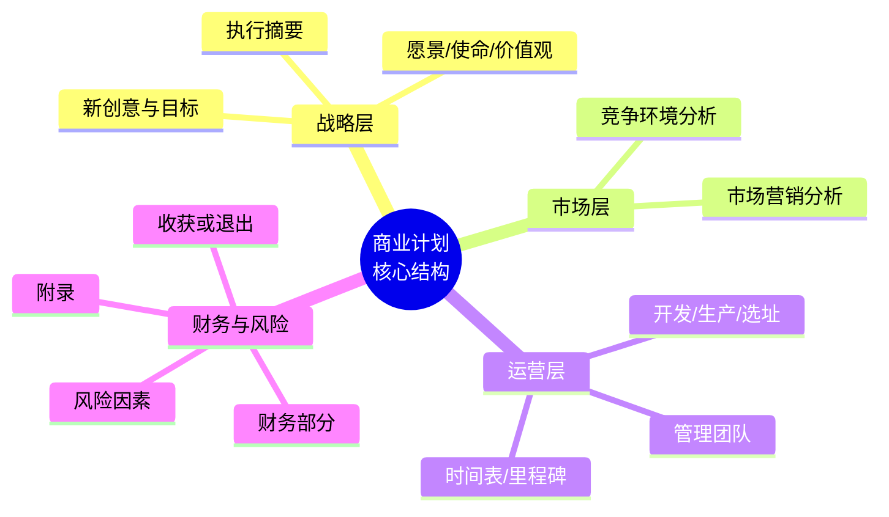

# 商业计划书的核心结构与要素

# 商业计划书的核心结构与要素

商业计划（Business Plan）不仅是一份融资文件，更是描述企业“是什么”及“将成为什么”的故事。其核心作用在于==迫使创业者系统思考==，将模糊的创意转化为可执行的逻辑闭环。

## 为什么需要商业计划？

许多创业者认为计划赶不上变化，因此忽略撰写。然而，不写计划如同无地图航行。
- **内部价值**：梳理思路，明确愿景（Vision）、使命（Mission）与核心价值观，统一团队目标。
- **外部价值**：作为“电梯推销”的延伸，向投资者、合作伙伴展示项目的可行性与投资回报。

> [!IMPORTANT]
> 计划本身的重要性远不如**形成计划的过程**。它是动态的假设检验工具，而非僵化的执行教条。

## 核心结构十二要素

一份标准的商业计划书应包含以下关键模块，逻辑上从宏观愿景落实到微观财务：

1.  **执行摘要**：全篇精华，需在短时间内激起兴趣，类似“电梯推销”。
2.  **愿景与使命**：界定企业长期发展方向及社会责任。
3.  **产品与服务**：阐述价值主张，说明处于创意、原型还是生产阶段。
4.  **市场分析**：基于==真实性==原则，分析目标客户与市场规模。
5.  **竞争分析**：识别现有及潜在竞争者，明确竞争优势。
6.  **运营计划**：涵盖开发流程、生产选址及供应链管理。
7.  **管理团队**：投资人最关注的要素之一，展示团队经验与技能互补性。
8.  **财务计划**：预测收入、成本、现金流及资金需求。
9.  **风险分析**：全面揭示潜在危机及应对策略。
10. **退出机制**：说明投资者如何获取收益（如IPO、并购）。
11. **时间表**：关键里程碑节点。
12. **附录**：支撑性数据与文档。

## 常见误区与辨析

| 维度 | 传统详细计划 | 探索驱动型计划 (Discovery-Driven) |
| :--- | :--- | :--- |
| **假设态度** | 视为既定事实 | 视为待验证的推测 |
| **适用环境** | 低不确定性 | 高不确定性（创业常态） |
| **核心逻辑** | 按部就班执行 | 持续收集信息，修正假设 |
| **灵活性** | 低，易僵化 | 高，动态调整 |

> [!WARNING]
> **切勿忽视“真实性”**。市场预测必须建立在现有信息分析基础上，避免盲目乐观。顾客分析、竞争分析及收入计划均需有据可依。

## 算对了的例子：执行摘要的撰写

**场景**：某低碳创业项目寻求天使投资。
**错误写法**：“我们要改变世界，技术全球领先，预计明年盈利一亿。”（空洞、无数据支撑）
**正确写法**：
> “本项目致力于提供低成本社区光伏解决方案（**价值主张**）。针对城市老旧小区屋顶闲置痛点（**市场机会**），团队拥有5项核心专利及10年能源行业经验（**管理团队**）。目前已完成原型测试，获2家物业意向签约（**进展验证**）。计划融资200万用于量产，预计18个月实现盈亏平衡（**财务与退出**）。”

> [!TIP]
> 投资人宁愿投资**二流创意的一流团队**，也不愿投资一流创意的二流团队。因此在计划中，务必突出管理团队的经验和专业技能。
