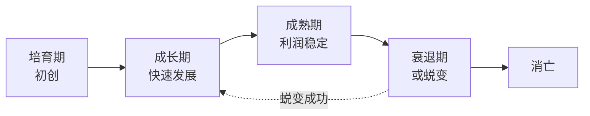

# 企业生命周期理论

## 企业生命周期理论

企业生命周期理论认为，企业的创建与成长过程如同人的寿命一样，存在可预见的规律，==一般要经历从产生到消亡的四个阶段==。理解这一理论，能帮助创业者在不同阶段做出匹配的决策，而不是用管理成熟企业的方法去管初创公司。

### 为什么要关注生命周期

一个新企业刚诞生时，内部流程几乎为零，外部也还没有认可你。这时企业会面临所谓的 ==**新进入缺陷**==——从零开始建立流程、获取客户信任，任何环节出问题都可能直接威胁生存，失败率远高于既有企业。这一阶段，企业迫切需要获取 ==**合法性**==，也就是让外部环境（客户、供应商、投资人）认为“你们做的事是合理的、值得信赖的”。

为了快速获得合法性，创业企业有时会采取 ==**象征性行动**==：并不真的改变做事方式，而是把自己“包装”成符合外界期望的样子。比如租用高档写字楼、聘请知名顾问，让客户觉得“这家公司靠谱”。这在短期有效，但不能替代真正的能力建设。

### 四个阶段的核心特征

**培育期（创业期）**  
创业者刚把企业创建起来，生存能力弱，市场占有率低，管理不规范，随时可能被既有企业挤出市场。此时的关键任务是**活下来**，寻找可行的商业模式。

**成长期**  
企业从培育期存活后，通常快速转入规模扩张。规模经济开始显现，市场占有率上升，主业日益清晰。但高速成长也带来 ==**环境的不确定性和复杂性**==：不确定体现在市场变化快、决策信息不足，复杂性体现在工作与家庭等多方面的压力交织。这一阶段容易出现“成长掩盖管理问题”。

**成熟期**  
成长速度放缓，但利润率提高，企业进入“收获季节”。管理规范，市场地位稳固。==核心隐患在于：如果不能成功蜕变，就会滑向衰退。==

**衰退期**  
企业失去活力，逐渐老化。爱迪思将老化细分为贵族期、官僚化早期、官僚期直至死亡。==在每个阶段转换时，企业必须放弃旧的行为模式、学习新模式，这个过程中出现的“正常问题”可以靠自身能量解决，“不正常问题”则需要外部干预。==

### 用成长的方式解决成长问题

企业在成长中遇到的问题，不能靠“停下来整顿”根本解决。==直接且有效的方法是：用成长的方式解决成长问题==——通过发展新业务、开拓新市场、引入新人才，让增量化解存量矛盾。

成长过程中，还有一个容易忽略的坎：==**创业者承继**==。当企业发展到一定规模，创始人需要把管理权交给继任者，一般有四种类型：

| 类型 | 来源 | 适用场景 |
|------|------|----------|
| **换手型** | 内部人员 | 创业期，创业者仍要保持持续影响力 |
| **援手型** | 外部人员 | 创业者善创业不善管理，需引入专业经理人 |
| **禅让型** | 内部培养 | 成熟期，通过长期考察确定接班人 |
| **空降型** | 外部聘请 | 企业遇到战略瓶颈，用“空降兵”谋求突破 |

### 现金流 J 曲线：一个算对了的例子

新企业早期普遍亏损，==**J 曲线**==描述了现金流的一般规律：最初几年亏损，第二、三年可能亏得更深，随后逐渐改善转正。

假设某初创企业各年现金流如下：

| 年份 | 现金流入（万元） | 现金流出（万元） | 净现金流（万元） |
|------| ---------------- | ---------------- | ---------------- |
| 第1年 | 50 | 100 | -50 |
| 第2年 | 80 | 160 | -80 |
| 第3年 | 200 | 250 | -50 |
| 第4年 | 400 | 380 | +20 |

第2、3年亏损加深，是因为前期投入（厂房、团队、市场开拓）的效应还没释放，而成本已经全部计入。到第4年，早期积累的客户与品牌效应开始转化为收入，现金流转正。==这就是典型的 J 曲线形状：先下探再加升。==

> [!IMPORTANT]
> J 曲线提醒创业者：前几年的亏损不一定是坏事，关键在于亏损是“烧钱买增长”还是“模式跑不通”。

> [!WARNING]
> 高成长企业的应收账款会快速增长，如果客户付款周期拉长，账面利润好看但现金流出问题，照样可能倒闭。“现金王”远比“利润王”重要。

### 延伸：大公司如何保持创业活力

成熟企业要想避免衰退，往往需要 ==**公司创业**==——在大组织内部重新激发创新和创业精神。这包括三种形式：**创新**（把新产品推向市场）、**战略革新**（调整组织架构和战略方向）、**公司新事业**（内部孵化新业务）。

公司创业的执行者叫 ==**内创业者**==。他们借用公司资源做新项目，失败则资源被回收，成功则可能独立上市。

公司还需平衡两种能力：==**探索能力**==（试验、冒险、发现新技术）与 ==**开发能力**==（效率、复制、深耕现有业务）。同时具备二者，才是 ==**战略创业**==——把创业的机会识别和战略管理的持续优势结合起来，实现财富最大化。
