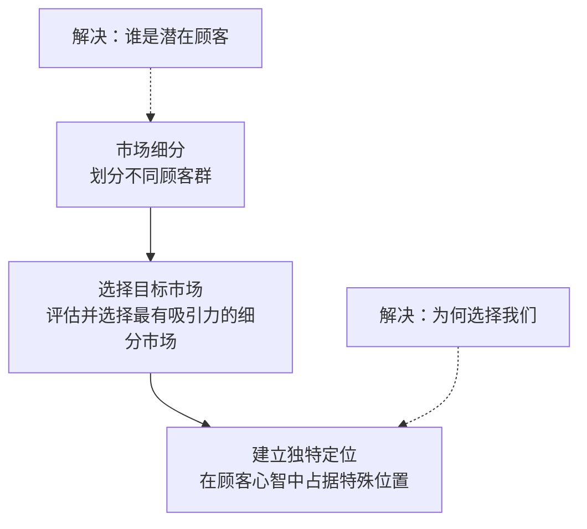

# 市场定位与竞争优势构建

## 市场定位的起点：回答两个核心问题

创业者在进入市场前，必须回答两个看似简单却至关重要的问题：**谁是我们真正的顾客？** 和 **怎样才能吸引他们购买？** 这两个问题直接关系到创业的生死存亡——如果连为谁解决什么问题都无法说清，后续的资源投入和营销活动都是盲目的。

回答这两个问题的系统化路径，就是目标市场定位的三步骤。

## 三步骤的核心逻辑

### 第一步：市场细分
市场细分不是按人口统计指标简单分类，而是按顾客**需要完成的任务**来划分。顾客购买产品，本质上是“雇佣”它来完成某项具体工作——可能是功能性的（如通勤）、情感性的（如彰显身份），也可能是社交性的（如融入圈子）。创业者需要洞察这些“待办任务”，把面临相似任务的人群归为一个细分市场。

### 第二步：选择目标市场
并非所有细分市场都值得追逐。创业者需要评估每个细分市场的规模、增长率、竞争强度、可进入性，以及最关键的——与自身资源和能力的匹配度。==目标市场的选择，本质上是创业者主动决定“为谁服务”以及“放弃谁”的战略取舍。==

### 第三步：建立独特定位
这是三步骤中最具战略决定性的环节。定位的实质是**使本企业与其他企业在顾客认知中严格区分开来**——不是产品功能上的差异，而是顾客脑子里形成的清晰认知差异。当顾客产生特定需求时，第一个联想到的就是你的品牌，这才说明定位真正落地了。

> [!IMPORTANT]
> 定位不是企业对自己产品的描述，而是顾客心中对你形成的认知。创业者能做的，是通过一切触点去引导和强化这个认知，而不是凭空编造。

## 用价值曲线构建“甩开竞争”的定位

传统的竞争思维倾向于和对手硬碰硬，在相同的价值要素上比拼。而价值曲线工具的设计逻辑正好相反：不是聚焦如何打败竞争对手，而是聚焦于 ==**为顾客和企业自身创造价值飞跃**，彻底跳出现有竞争圈，开创“无人争抢”的蓝海市场空间。==

要绘制一条有效的价值曲线，必须用表格框架系统回答四个关键问题，而不是凭直觉随意调整：

| 四个关键问题 | 核心意图 | 行动指向 |
| :--- | :--- | :--- |
| **剔除**：哪些行业认为理所当然的因素可以去掉？ | 消除顾客被迫承担的冗余价值 | 减法，砍掉不再创造价值的惯例 |
| **降低**：哪些因素可降到行业标准以下？ | 针对过度服务做减法，为成本结构松绑 | 缩减投入，释放部分资源 |
| **提升**：哪些因素应拉到行业标准以上？ | 补足行业普遍忽视但顾客真正在意的短板 | 加大投入，聚焦关键体验 |
| **创造**：哪些行业内从未提供过的因素应该被创造？ | 为顾客创造全新需求，彻底改变竞争游戏 | 定义新维度，塑造新市场 |

> [!TIP]
> 记忆四问口诀：“一删二减三提四创”。先做减法（剔除、降低），释放资源；再做加法（提升、创造），把资源集中到真要差异化的维度上。

这四个问题对应的行动完成后，可以用一条折线图直观展示：横轴是行业关键竞争要素，纵轴是各要素的水平等级。传统竞争者的曲线形状往往高度相似，而真正通过价值曲线思维重构后的曲线，在形态上与行业惯常曲线大相径庭——某些要素被拉到远高于标准的位置，部分被压低，甚至完全剔除，同时引入全新的价值维度。

## 最常见的认知陷阱

- **把“产品特征”当成定位**：产品功能容易被模仿，而顾客认知不易被替代。定位要在认知层面建立壁垒，而非仅仅罗列功能。
- **忽略“剔除”和“降低”的力量**：很多创业者只关心“做得更好”，却不敢做减法。但砍掉用户根本不关心的成本负担，恰恰是蓝海思维的关键差异。
- **价值曲线画完不行动**：价值曲线只是诊断工具，真正能落地定位的是后续的商业模式、定价、渠道和成本结构的同步调整。
