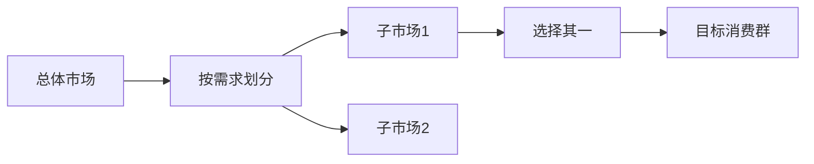

# 市场细分的依据与方法

---
title: 市场细分的依据与方法
requires: [创新与创业管理/目标市场定位]
---

## 它是什么

先问一个问题：如果企业打算卖一款产品，能不能直接面向“所有消费者”？

很难。因为总体市场规模过大，企业资源有限，难以用同一种方式服务所有人。课件中对**市场细分**的定义是：按照消费者欲望与需求，把因规模过大导致企业难以服务的总体市场，划分成若干具有共同特征的子市场；处于同一细分市场的消费群被称为==目标消费群==，相对于大众市场而言这些目标子市场的消费群就是“分众”。

在“目标市场定位”的三步骤里：
1. 市场细分；
2. 选择目标市场；
3. 在目标市场中建立独特定位。

所以，市场细分是回答“谁是我们的顾客，怎样吸引他们”的第一步。

## 为什么需要

新创企业尤其需要市场细分。原因很简单：创业企业资源少、品牌弱，如果像大企业那样面向大众市场铺开，成本高且定位模糊。通过细分，创业者可以先把精力放在一个具体、可触达、有共同需求的人群上，再设计产品、渠道与传播方式。

## 怎么做

课件“实践练习 1：细分市场”给出了很实用的做法，可归纳为四个问题：

| 步骤 | 要回答的问题 | 目的 |
|---|---|---|
| 找痛点 | 客户为什么有这个问题？痛点大不大？ | 判断市场是否存在 |
| 看影响 | 解决问题会怎样改变客户生活？ | 排除无价值创意 |
| 找位置 | 客户在线上、线下哪里逗留？ | 明确触达渠道 |
| 看影响者 | 谁影响他们购买？ | 设计传播与口碑 |

再进一步，可为理想客户建立“人物角色”：包括其场景、需求、购买动机与媒介习惯。同时做一个“反细分”——那些看似理想却从不购买的人，用来校准边界。

## 相近概念区别

- **市场细分**：把大市场切成有共同特征的小市场。
- **目标市场**：从细分结果中选出最具吸引力的一个或几个子市场。
- **市场定位**：在选定市场中建立独特位置，让顾客感到差别。

三者是顺序关系，不是并列关系。

## 常见坑

> [!WARNING]
> 细分不是“分得越细越好”。若子市场太小，无法支撑新企业生存；若只看表面人口特征而忽略真实“痛点”，则易做出无市场产品。

> [!TIP]
> 记忆顺序可用“先切、再选、后定位”来对应三步骤。

## 算对了的例子

某创业者想做校园学习工具。第一步做市场细分：按“考研学生、大一新生、在职自考者”划分。经“实践练习 1”式提问发现：大一新生虽有需求，但痛点小；在职自考者分散难触达；考研学生对“每日计划与答疑”痛点强、影响大、常出没于线上社群，也易受学长推荐影响。于是选择“考研学生”作为目标消费群，并在后续步骤中建立“陪伴式备考工具”的独特定位。

这便完整对应了：细分市场、选择目标市场、再定位。
