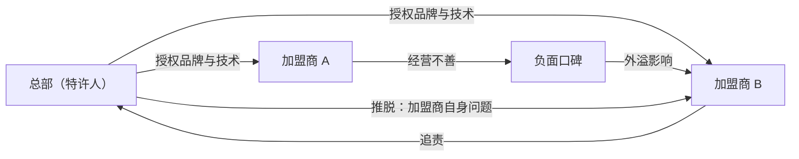

# 特许经营的特点（含加盟商和以往加盟商之间责任不清、相互推脱责任问题）

## 特许经营的特点

先想一个场景：你想开一家奶茶店，但自己没品牌、没配方、没供应链。这时有两个选择——自己从零摸索，或者交一笔钱加入一个成熟品牌。第二种方式，就接近特许经营（Franchising）：==特许人（总部）将品牌、技术、经营模式授权给受许人（加盟商）使用，加盟商支付加盟费和持续的权利金==。

那么，为什么很多人愿意选择加盟而不是独立创业？这就要看特许经营究竟具备哪些特点，以及它背后暗藏哪些风险。

### 核心特点

| 维度 | 对特许人（总部） | 对受许人（加盟商） |
|------|------------------|---------------------|
| 品牌与系统 | 输出成熟品牌和运营体系 | 获得品牌背书，降低试错成本 |
| 资金与扩张 | 用加盟商的钱快速扩张 | 投入自有资金，承担经营风险 |
| 经营权 | 保留重大决策权与标准制定权 | 在合同框架内自主经营 |
| 收入来源 | 加盟费、权利金、供应链利润 | 经营利润减去各项费用后的剩余 |

特许经营的本质是==用他人的钱和精力复制自己的成功模式==。总部省去了自建门店所需的巨额资本，加盟商则省去了从零建立品牌认知的时间。

### 加盟商与总部之间责任不清的问题

听起来双赢，但为什么真题里特别点出“加盟商和以往加盟商之间责任不清、相互推脱责任”？

[!WARNING]
> 特许经营合同往往是总部拟定的格式合同，其中对双方责任的边界划分可能非常模糊。一旦出现经营纠纷、质量事故或品牌声誉受损，很容易陷入“总部说加盟商执行不到位，加盟商说总部支持不给力”的推诿局面。

具体来说，常见的责任不清情形包括：

- **区域保护模糊**：总部承诺“独家区域”，却没有写明具体范围。后来在相邻位置又授权了新加盟商，老加盟商业绩下滑，谁来负责？
- **供应链质量问题**：总部强制要求从指定渠道进货，但原料出了问题导致顾客投诉，责任算谁的？
- **统一促销活动的亏损**：总部要求全国统一降价促销，加盟商利润受损甚至亏损，费用由谁承担？
- **“以往加盟商”的遗留影响**：某一加盟商因经营不善或违规被终止合同，但其之前积累的负面口碑仍然影响同品牌的其他加盟商，新加盟商“无辜背锅”，总部是否要对此负责？

上图揭示了一个关键问题：==特许经营体系中，品牌是共享的，但经营主体是独立的==。品牌声誉具有公共品性质——任何一家加盟商的失误都会损害整个品牌，而总部和其他加盟商都无法完全规避这种“连坐”效应。

[!IMPORTANT]
> 特许经营最核心的治理难点在于：**法律上各加盟商是独立法人，但市场上消费者感知的是同一个品牌**。这种“法律独立、形象一体”的错位，正是责任推诿滋生的土壤。

### 与相近概念的区别

| 概念 | 资本关系 | 经营控制权 | 利润归属 |
|------|----------|------------|----------|
| 直营连锁 | 总部全资 | 总部直接管理 | 总部 |
| 特许经营 | 加盟商出资 | 合同约束下的自主经营 | 加盟商（扣除总部费用） |
| 自由连锁 | 各店出资 | 协商共治、较松散 | 各店 |
| 品牌授权 | 被授权方出资 | 授权方控制较弱，只管品牌使用 | 被授权方 |

特许经营与直营连锁最本质的区别是：==直营连锁是“同一笔钱”，特许经营是“同一张脸”==。

### 常见的坑

- 加盟前考察不足，轻信总部“零风险、高回报”的承诺。
- 合同中没有明确**区域排他条款**的具体边界（如半径多少公里、是否包括线上渠道）。
- 对**退出机制**约定不清：合同终止后，加盟商是否还有权使用品牌？库存如何处理？竞业禁止范围多大？
- 忽视**“以往加盟商”的诉讼记录**——如果总部历史上与多名加盟商都有责任纠纷，说明其合同设计或管理体系本身就存在问题。

[!TIP]
> 判断一个特许经营体系是否健康，不要只去总部安排的“样板店”参观，而要去随机走访几家已运营两年以上的加盟商，问同一个问题：“**总部在你遇到困难时，是帮你解决问题，还是先撇清责任？**”

### 一个算对了的例子

某品牌咖啡特许经营，总部对加盟商收取两项费用：一次性加盟费 20 万元，以及按月营收 5% 收取的品牌权利金。加盟商 A 月均营收 30 万元，毛利率 65%，月租金与人工等固定成本合计 12 万元。

**分析加盟商 A 的月利润：**

品牌权利金 = $300000 \times 5\% = 15000$ 元

毛利 = $300000 \times 65\% = 195000$ 元

月利润 = $195000 - 15000 - 120000 = 60000$ 元

看起来月赚 6 万元，年化约 72 万元。但若计入一次性加盟费 20 万元在首年摊销，首年月均利润降为 $60000 - 200000/12 \approx 43333$ 元。再看回本周期：总投入（含装修、设备等假设 80 万元）÷ 月均利润 ≈ $800000 / 60000 \approx 13.3$ 个月。

[!CAUTION]
> 以上计算没有考虑总部强制采购的溢价、统一促销活动分摊的费用，以及品牌声誉受其他加盟商拖累的隐性成本。==加盟商的真实利润往往低于纸面测算，因为特许合同中的费用条款远不止加盟费和权利金两项。==

所以，特许经营不是“躺赚”模式，而是==以放弃部分自主权为代价，换取品牌和系统的起步优势==。理解其特点，尤其是责任边界模糊带来的风险，是判断一个特许项目是否值得加入的关键。
