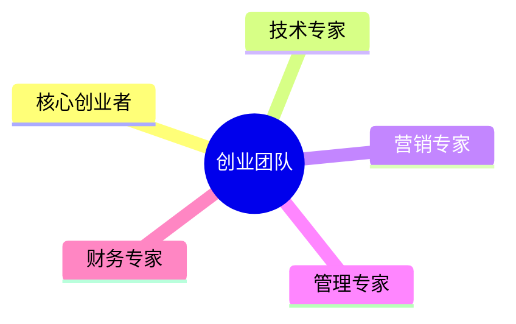

# 创业团队经常包括的成员构成

一个创业项目从想法到落地，单靠一个人能搞定所有事吗？显然不能。那么，一个完整的创业团队到底需要哪些角色？

> [!IMPORTANT]
> 创业团队经常包括的成员构成通常分为五类：==核心创业者（领导者）==、技术专家、营销专家、管理专家、财务专家。

## 它是什么与为什么需要

创业团队是由少数具有互补技能的人组成，为实现共同的创业目标而相互承担责任的群体。

为什么需要这五类人？因为新创企业面临“资源高度约束”的环境，任何单一技能都无法支撑企业存活。各成员必须能力互补，才能覆盖“研发—生产—销售—运营—资金”这条完整价值链。

## 怎么做：各成员的核心职责

| 成员角色 | 核心职责 | 关键能力要求 |
| :--- | :--- | :--- |
| **核心创业者** | 把握方向、整合资源、最终决策 | 领导力、战略眼光、抗压能力 |
| **技术专家** | 产品研发、技术攻关、迭代升级 | 专业技术深度、创新思维 |
| **营销专家** | 市场开拓、客户获取、品牌推广 | 市场敏锐度、沟通谈判能力 |
| **管理专家** | 内部运营、制度建设、流程优化 | 组织协调、执行力 |
| **财务专家** | 融资规划、现金流控制、成本核算 | 财务分析、风险把控 |

> [!TIP]
> 记忆口诀：“核技营管财”。想象造一辆车：核心创业者是方向盘，技术是发动机，营销是车轮，管理是底盘，财务是油箱。缺一样车都跑不起来。

## 与相近概念的区别

很多同学容易把“创业团队”和“普通工作群体”混为一谈。两者的本质区别在哪？

| 维度 | 创业团队 | 普通工作群体 |
| :--- | :--- | :--- |
| **目标** | 共同创业目标（高风险高回报） | 完成上级分配的部门任务 |
| **责任** | ==相互承担责任==，共担风险 | 个人对各自岗位负责 |
| **技能** | 强调高度互补 | 多为同类专业技能集合 |
| **利益** | 共享股权/收益 | 领取固定薪酬 |

## 常见的坑

> [!WARNING]
> **同质化陷阱**：几个同专业的同学一起创业，全懂技术却没人懂营销和财务，导致产品做出来卖不掉。团队成员技能必须互补。

> [!CAUTION]
> **核心缺失或越位**：没有明确的核心创业者会导致决策瘫痪；反之，若核心创业者大包大揽，不信任其他专家，团队就会退化为“老板与打工者”的关系，丧失创业团队的凝聚力。

## 算对了的例子

假设南邮某学生团队开发一款校园闲置物品交易小程序，初期评估需要以下工时投入：

- 前后端开发与维护：$40\%$
- 市场推广与地推：$25\%$
- 平台日常运营与客服：$20\%$
- 资金预算与盈利测算：$15\%$

如果团队总共只有 $4$ 名成员，且每人每周最多投入 $20$ 小时，问如何配置角色最合理？

**解析：**
总需求工时比例映射到角色：
- 技术占比最高（$40\%$），需配备 $1 \sim 2$ 名**技术专家**。
- 营销（$25\%$）与管理（$20\%$）次之，需各配 $1$ 名**营销专家**和**管理专家**。
- 财务（$15\%$）占比最小，早期可由**核心创业者**兼任或外包，不必单独占一个全职名额。

因此，合理的 $4$ 人配置为：$1$ 名核心创业者（兼统筹/财务） + $1$ 名技术专家 + $1$ 名营销专家 + $1$ 名管理专家。

> [!NOTE]
> 在初创期，一人身兼数职很常见，但“角色功能”不能缺失。即使没有专职财务专家，也必须有人承担财务规划的职责。
