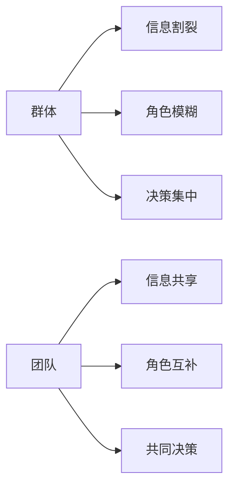
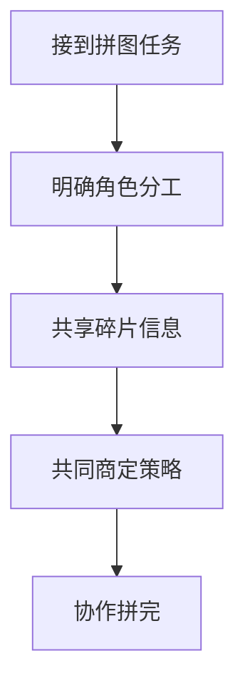

# 团队较之群体在信息共享、角色定位、参与决策等方面的进步

## 什么是"团队较之群体的进步"

组建创业团队时，需要先辨清 **群体（group）** 和 **团队（team）** 的差别。一群同班同学坐在一起完成作业，是一个群体；而创业团队成员为同一个商业模式负责、互相补位、共同决策，则是团队。团队在 ==信息共享、角色定位、参与决策== 三个方面明显比群体"进了一步"。

> [!IMPORTANT]
> 判断题干给的是不是团队，关键看三条：信息是否互通、角色是否明确、成员是否真正参与决策。缺一条就还是群体。

## 三个维度的对比

| 维度 | 群体 | 团队 | 进步点 |
| --- | --- | --- | --- |
| 信息共享 | 各自为战，信息孤岛 | 主动同步、共同持有信息 | 决策依据更完整 |
| 角色定位 | 临时分工，责任模糊 | 明确互补的角色与职责 | ==减少内耗与重复== |
| 参与决策 | 领导拍板，成员执行 | 成员共同讨论、共同决策 | 承诺度更高、执行更顺 |

## 为什么要区分

思考一下：为什么新进入缺陷中提到"稳定性较低、学习成本高"，组建团队却仍然是更好的选择？

答案是，**创业任务本身是不确定的**，靠临时拼凑的群体无法快速试错。只有真正意义上的团队才能：

- **信息共享**：降低沟通与学习成本，减少新进入缺陷中的学习成本。
- **角色定位**：界定新角色、建立员工关系，缓解"稳定性低"问题。
- **参与决策**：提升成员承诺与信任，抵御"交易成本高、社会联系弱"的先天劣势。

> [!TIP]
> 记忆口诀：**信、角、共**——信息共享、角色定位、参与决策，三者齐全才算团队。

## 怎么做到这三点

结合课堂"拼图"实验可以验证：把 300 块拼图丢给一组陌生人，5 分钟内拼完几乎不可能；但如果在开始前**明确谁看图、谁分类、谁拼边框**（角色定位），**把碎片形状实时告知队友**（信息共享），**遇到分歧时一起商量**（参与决策），效率会显著提升。

## 常见的坑

> [!WARNING]
> 把"坐在一起工作"当成"团队"是最常见误区。只有物理靠近，没有信息互通、没有角色分工、决策仍是一言堂，那仍是群体。

> [!CAUTION]
> 角色定位 ≠ 固定不变。创业任务多变，团队角色可以在早期"一人多岗"，但**必须明确**，否则会退回群体状态。

> [!NOTE]
> 和"新进入缺陷"的区别：新进入缺陷讲的是**新企业本身的先天劣势**（临时性、学习成本、稳定性、交易成本、社会联系），而本知识点讲的是**组织形态层面**——只有团队形态才能部分对冲这些劣势。

## 一个对了的例子

某创业小组接到"5 分钟内拼完 300 块拼图"的任务。A 负责看图、B 负责分边框、C 负责分色块、D 负责拼内芯、E 负责汇报进度（角色定位）；A 把图案实时告诉其他人，C 把"这片蓝色在左下角"回传给 A（信息共享）；中途发现颜色区分效果差，全组一起商量换成按形状分类（参与决策）。结果 4 分 20 秒完成。

反之，若只是每人埋头各拼各的、没有分工、没人同步信息、出了分歧没人拍板——这只是群体，结果是拼不完。==由群体升级为团队，是创业初期降低"新进入缺陷"的关键动作。==
