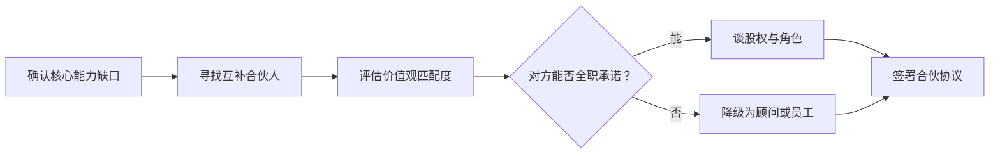
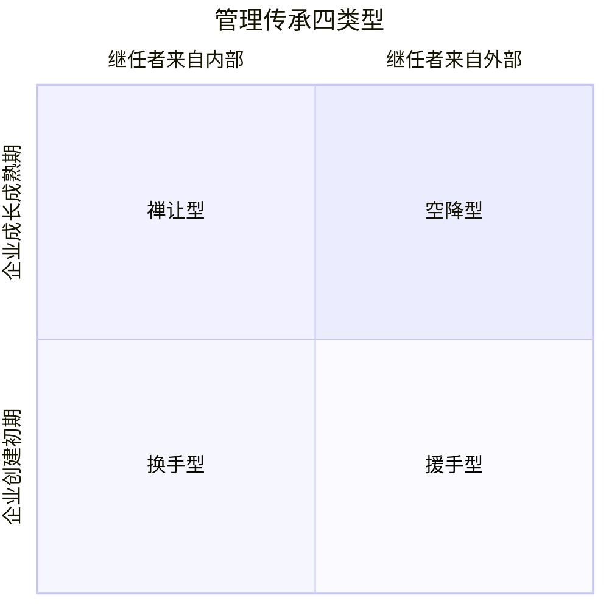

# 创业团队的组建策略与股权分配

## 创业团队的组建策略与股权分配

### 它是什么

创业团队组建策略，解决的是“找谁一起干、怎么走到一起”的问题；股权分配，解决的是“蛋糕怎么切、以后怎么调”的问题。二者共同决定了一家企业早期的稳定性与后续的成长空间。

> [!IMPORTANT]
> 股权分配的核心不是“分钱”，而是==用股权结构锁定团队预期、绑定长期承诺、并为未来调整留出余地==。很多创业企业死在“平均分股权—没人说了算—争吵散伙”这条路上。

### 为什么需要

创业初期资源极度有限，团队是创业者手中最重要、也是最不稳定的资产。合理的组建策略能在短时间内把互补型人才聚在一起；合理的股权分配能让这些人才在“看不清回报”的阶段仍然愿意投入。反之，股权争议是初创企业最常见的“内部死因”——不是市场淘汰，而是合伙人分裂。

### 怎么做：组建策略

从实践来看，组建策略可以围绕**互补性、价值观、承诺程度**三个维度展开：

[!TIP]
记忆口诀：==“先互补，再价值观，最后谈承诺”==。顺序颠倒的典型后果是：聊得来（价值观匹配）但能力重叠，或者能力很强但只是兼职心态。

### 怎么做：股权分配

南邮课件中强调，股权分配要区分**创始人、联合创始人、期权池**三类主体，且不能脱离“贡献”空谈公平。一条常用且可操作的思路是：

1. **先留期权池**：一般预留 10%～20% 给未来的核心员工与高管。
2. **再做贡献评估**：从资金投入、全职时间、技术专利、市场资源、创始角色等维度打分。
3. **设置兑现机制**：股权通常分 3～4 年兑现（vesting），比如每年兑现 25%，防止联合创始人拿了股权就走。
4. **明确退出规则**：回购价格、回购条件要提前写在协议里。

### 与相近概念的区别

| 概念 | 关注点 | 常见混淆 |
|---|---|---|
| 管理传承 | 企业成长中领导权如何交接 | 常被误认为只发生在成熟期，其实早期“援手型”传承也很常见 |
| 股权分配 | 所有权与控制权的初始配置 | 常被误认为“平均即公平”，但平均往往意味着无人负责 |
| 期权激励 | 面向未来贡献的延迟回报 | 常被误认为股权分完后还能随意追加，实际需要提前预留 |

### 管理传承的四种类型

管理传承是股权分配之后的延伸命题：当创业者不再适合继续掌舵时，谁来接？结合**企业成长阶段**与**继任者来源**两个维度：

| 类型 | 阶段 | 继任者来源 | 要点 |
|---|---|---|---|
| 换手型 | 创建初期 | 内部人员 | 创业者仍保持持续影响力，处理不好易“任人唯亲” |
| 援手型 | 创建初期 | 外部人员 | 创业者善创业不善管理，早期常见选择 |
| 禅让型 | 成长成熟期 | 内部人员 | 长期考察培养，如联想柳传志→杨元庆 |
| 空降型 | 成长成熟期 | 外部人员 | 高薪外聘“空降兵”，谋求突破 |

### 一个算对了的例子

假设三位创业者共同创办一家互联网公司。他们预留 **15% 期权池**，剩余 85% 在三人之间按贡献分配：

- 甲：全职 CEO，出资 30 万，带来核心技术——评分最高
- 乙：全职 CTO，技术合伙人，未出资——评分次高
- 丙：兼职市场顾问，未出资——评分较低

最终分配：甲 50%，乙 27.5%，丙 7.5%，期权池 15%。丙因为非全职，股权少且设置 4 年兑现。这样既保证了核心创业者的控制权，又为未来人才留下空间。

> [!WARNING]
> 常见坑一：三人各 1/3，没有兑现机制，半年后丙离开，股权却拿不走，甲和乙感觉“白干了”。  
> 常见坑二：期权池不留，等融资时投资方要求设立，创始人被迫按比例稀释，反而更被动。

### 常见的高危误区

> [!CAUTION]
> 千万不要把“管理传承”和“股权分配”混为一谈。前者回答“谁来管”，后者回答“归谁有”。实践中，创始人可能让出管理权（援手型传承）却仍是大股东；也可能保留职位但股权被严重稀释。两者必须分开设计。
