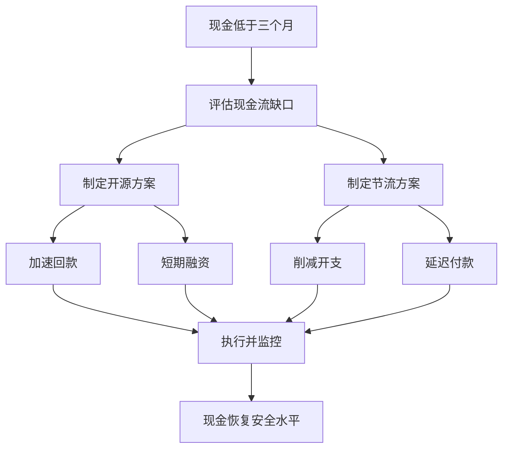

# 创业公司账上现金低于三个月时的应对措施

## 它是什么

创业公司在经营中会出现现金流入不敷出的阶段，==账上现金低于三个月固定开支==（俗称“现金跑道过短”）是创业公司最危险的信号之一。此时若不迅速应对，企业可能因资金链断裂而倒闭。应对措施的核心是**开源节流**，即在增加现金流入的同时减少现金流出，确保企业能撑到盈亏平衡或获得新融资。

## 为什么需要

现金流是企业的生命线。当账上现金低于三个月固定开支时，企业面临以下风险：

- 无法支付员工工资、房租等刚性支出
- 供应商断供，影响正常运营
- 错过市场机会，被竞争对手超越
- 被迫低价出售资产或接受不利融资条款

因此，及时采取应对措施是创业企业生存的关键。

## 怎么做

应对现金危机的措施可分为两大类：

### 增加现金流入（开源）

| 措施 | 说明 |
|------|------|
| 加速应收账款回收 | 催收欠款，提供现金折扣鼓励提前付款 |
| 拓展销售渠道 | 增加市场推广，开发新客户 |
| 出售闲置资产 | 处置非核心资产，快速变现 |
| 寻求短期融资 | 向银行申请流动资金贷款，或寻求股东借款 |

### 减少现金流出（节流）

| 措施 | 说明 |
|------|------|
| 削减非必要开支 | 暂停非核心项目，减少差旅、培训等费用 |
| 延迟付款 | 与供应商协商延长付款周期 |
| 降低库存 | 减少库存积压，降低资金占用 |
| 精简人员 | 必要时进行人员优化，降低人力成本 |

## 应对措施选择流程

> [!IMPORTANT]
> 应对现金危机时，==开源与节流需双管齐下==，单纯依赖一方面效果有限。同时，措施应具有可执行性，避免过度削减影响企业核心竞争力。

## 常见的坑

> [!WARNING]
> 只关注节流而忽视开源。过度削减开支可能损害产品质量和客户关系，导致收入进一步下降，形成恶性循环。

> [!CAUTION]
> 忽视与利益相关者的沟通。延迟付款或精简人员时，若未与供应商、员工充分沟通，可能引发法律纠纷或人才流失，加剧企业危机。

## 算例

某创业公司每月固定开支为 20 万元，账上现金仅剩 50 万元，现金跑道为：

$$
\text{现金跑道} = \frac{\text{账上现金}}{\text{月固定开支}} = \frac{50}{20} = 2.5 \text{ 个月}
$$

由于现金跑道低于 3 个月，公司采取以下措施：

- 加速应收账款回收，预计每月增加现金流入 8 万元
- 削减非必要开支，每月减少支出 5 万元

调整后每月净现金流出为：

$$
20 - 8 - 5 = 7 \text{ 万元}
$$

新的现金跑道为：

$$
\frac{50}{7} \approx 7.14 \text{ 个月}
$$

通过上述措施，公司现金跑道从 2.5 个月延长至约 7.14 个月，成功化解了短期现金危机。
