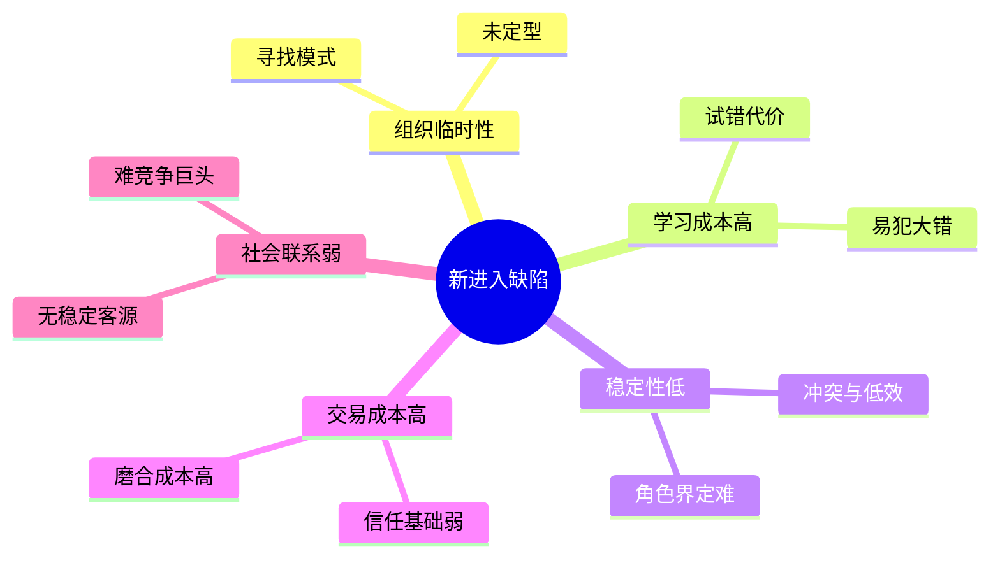

# 新进入缺陷及产生的原因

# 新进入缺陷及产生的原因

## 它是什么：新企业的“先天不足”

==新进入缺陷==是指新企业在从无到有的展开过程中，因缺乏内部流程、外部认可及资源积累，导致其失败率显著高于既有企业的现象。

> [!IMPORTANT]
> 核心定义：新企业运营需建立流程并获得外界认可，任何环节出错都会带来巨大麻烦，导致高失败率。

想象一下，如果你突然接手一家成熟公司，制度、客户、团队都已就绪；而创业则是从零搭建一切。这种“临时性”和“不确定性”就是缺陷的根源。

## 为什么会产生：五大成因解析

新进入缺陷并非偶然，而是由以下五个结构性因素共同作用的结果：

1.  **组织的临时性**：新企业本质上是寻找可重复、可盈利商业模式的**临时组织**。在过渡到成熟企业前，它处于不断试错的状态。
2.  **学习成本较高**：新角色到位和执行任务期间，容易犯大错误，需支付高昂的学习成本。
3.  **稳定性较低**：界定新角色、建立关系和薪酬体系耗时耗力，初期常伴随冲突和低效率。
4.  **交易成本较高**：成员多为新人，信任基础薄弱，适应新价值观和行为规范的磨合成本高。
5.  **社会联系较弱**：缺乏与顾客、供应商等利益相关者的稳定联系，难以像既有企业那样利用资源网络竞争。

## 怎么做：克服机制与合法性获取

面对缺陷，创业者不能坐以待毙，核心策略是获取**合法性（Legitimacy）**，即让外部环境认为你的行为是恰当且符合期望的。

> [!TIP]
> 获取合法性的四种途径：**依从、选择、操纵、创造**。

其中，**象征性行动**是一种高效策略。它不是欺骗，而是通过“描绘”与利益相关者期望一致的形象来降低认知门槛。

| 层面 | 象征性行动示例 | 目的 |
| :--- | :--- | :--- |
| **个体层面** | 展示创业者人力/社会资本 | 改变对创始人的认知 |
| **组织层面** | 展示技术/市场能力 | 证明专业性与潜力 |
| **关系层面** | 建立战略联盟/担保 | 借用既有实体信誉 |

## 常见坑：现金流断裂与 J 曲线误区

许多学生认为只要产品好就能活下来，却忽视了**现金流**的致命性。

> [!WARNING]
> 高危误区：忽视 J 曲线效应，在亏损加剧期（第2-3年）耗尽资金且无法再融资。

新企业通常呈现 **J 曲线** 特征：初期亏损，第2-3年亏损加剧，随后才逐渐改善。由于缺乏信用记录，银行不愿贷款，若此时资金提供者中断投资，企业将因“失血”过多而死亡。

## 算对了的例子：凡客诚品的反思

以凡客为例，其在快速成长期忽视了**新进入缺陷**中的“稳定性较低”和“社会联系较弱”。

*   **问题**：盲目扩张 SKU，导致库存积压（成本控制失效）；品牌定位模糊，未能通过有效的象征性行动建立稳固的客户合法性认知。
*   **结果**：在现金流紧张的 J 曲线底部，无法获得持续输血，最终陷入困境。
*   **启示**：克服缺陷不仅要靠营销（象征性行动），更要夯实内部流程（降低交易成本）和建立稳定的供应链关系（增强社会联系）。
