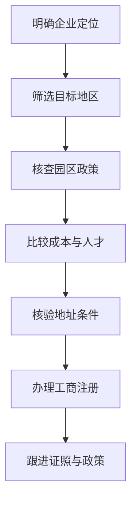

# 新企业注册选址应该考虑的因素与具体步骤

## 什么是新企业注册选址

新企业注册选址，是指创业团队在创办企业时，对经营场所、注册地址及相应政策环境进行综合判断，并据此确定企业依法登记住所的过程。它不仅是“租一间办公室”，还关系到后续的税收优惠、人才吸引、资金支持以及经营成本。

> [!IMPORTANT]
> 注册选址不是单看房租，而是比较==政策、成本、人才和便利性==，选择与企业商业模式匹配的地区。

## 为什么要考虑选址

不同地区的产业基础、政府政策、税率水平、资源禀赋和办事效率不同。相同的企业在不同地区注册，发展条件可能差异很大。合理选址可以：

- 获得产业园区、税收减免或创业补贴；
- 靠近客户、供应商、合作伙伴和金融机构；
- 便利招聘人才、技术成果转化及工商注册；
- 控制租金、税费、用工和交通等经营成本。

因此，选址应服务于企业战略，而不是仅追随“低租金”或“热门城市”。

## 应考虑哪些因素

| 因素 | 主要判断内容 | 对创业企业的影响 |
|---|---|---|
| 产业政策 | 行业定位、扶持方向、补贴条件 | 决定能否获得政策资源 |
| 区位条件 | 市场、交通、产业链、配套 | 影响经营和协作效率 |
| 成本水平 | 租金、税费、用工、生活成本 | 影响现金流和利润 |
| 人才条件 | 高校、技术人才、招聘难度 | 影响研发与团队扩张 |
| 创新环境 | 孵化器、融资、技术转化平台 | 影响创新与资源获取 |
| 行政服务 | 注册流程、办理效率、政策稳定性 | 影响创业落地速度 |
| 注册要求 | 场地证明、地址真实性、行业许可 | 影响注册能否顺利完成 |

> [!TIP]
> 可用“==政策有红利、区位有客户、成本能承受、人才跟得上、注册可落地==”快速检查选址是否合理。

还要注意，部分地区对注册地址、房屋用途和实际经营地有一致性要求。虚拟注册地址、集群注册地址虽然成本低，但不一定适合需要场地经营、许可审批或客户到访的企业。

## 怎么确定注册地址

可按以下流程推进：

### 第一步：明确企业定位

先确定企业所属行业、核心业务、主要客户、预计规模和是否需要研发或生产经营场地。例如，研发型企业更关注高校人才和技术转化，制造业更关注园区配套与供应链，生产型服务业则往往需要稳定的客源区位。

### 第二步：筛选并比较候选地

收集候选地区的政策、租金、税费、交通和人才信息，按照企业最关键的经营需求进行比较。比较时不能只看绝对数字，还要看政策能否真正申报、补贴是否与企业的成立时间、营收或研发投入等条件相匹配。

### 第三步：核验地址和注册条件

重点核查：

1. 地址是否合法、真实，能否提供所需证明；
2. 房屋用途是否允许注册和开展相应业务；
3. 是否需要园区入驻证明、房屋租赁或产权材料；
4. 企业名称核准、章程、股东及负责人信息是否一致；
5. 是否涉及前置或后置许可。

### 第四步：完成注册并复核政策

注册后仍要持续核查税费申报、统计登记、银行开户、社保公积金以及行业许可等事项。注册地确定了，但实际经营地与其不一致时，可能影响政策享受和合规管理。

## 相近概念的区别

| 概念 | 关注重点 | 主要依据 |
|---|---|---|
| 企业注册选址 | 在哪里依法登记住所 | 工商登记与政策条件 |
| 经营场所选择 | 在哪里实际开展业务 | 客户、成本、交通、场地 |
| 公司注册地址 | 营业执照上登记的住所 | 法律法规与地址证明 |
| 总部或办公选址 | 企业核心团队长期办公地点 | 人才、成本、品牌和效率 |

> [!NOTE]
> 注册地址、实际经营地址和办公地址可能一致，也可能不同。分析时先看题目问的是“注册选址”还是“经营选址”。

## 常见坑

> [!WARNING]
> 不要把“注册在低租金地区”直接理解为“经营成本一定最低”，也不要只看一次性补贴。

- **只看补贴，不看条件**：企业规模、行业、营收或存续年限可能不满足要求。
- **只看租金，不看综合成本**：税费、用工、通勤和客户获取成本可能更高。
- **忽视地址真实性**：无法提供合法证明或地址用途不符，可能无法注册。
- **注册地与经营地分离过度**：可能带来政策、税务、许可和工商核查风险。
- **把注册地址当办公地址**：注册地址通常不等于适合团队长期办公的场所。

## 算对了的例子

某大学生创业团队计划研发一款物联网设备，团队成员主要来自南京高校，产品需要对接电子元器件供应商，并在两年内申请高新技术企业。

如果只在低租金地区注册，表面上每年可节省办公租金 $10$ 万元，但可能面临研发人员通勤成本高、缺少技术转移服务、供应商距离远等问题。进一步测算发现，迁往核心研发区后，新增租金与人才补贴后的净成本为 $4$ 万元/年，但可对接两所高校的研发资源，使产品测试周期预计缩短 $20\%$，并满足高企认定的研发机构条件。

因此，团队选择靠近高校和产业链、且提供创业工位及研发补贴的园区注册。其决策逻辑是：先匹配“研发型企业”的定位，再综合比较政策、人才、供应链和成本，而不是简单选择房租最低的地址。
