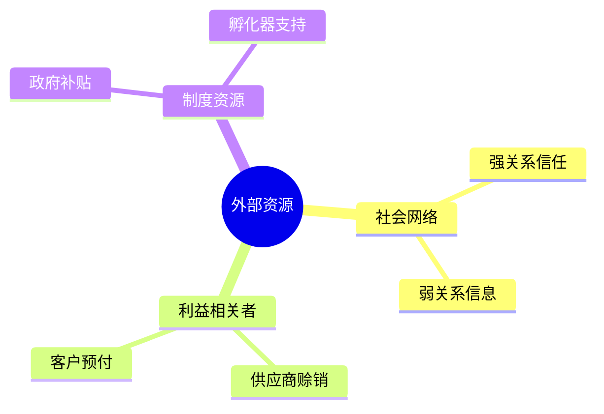

# 新企业获取外部资源的途径

新企业为何难以像成熟企业那样直接“购买”资源？因为初创期面临严重的==资源约束==与==合法性缺失==。因此，获取外部资源不能仅靠市场交易，更需依赖社会网络与创造性整合策略。

## 核心获取途径

新企业获取外部资源主要依靠以下三条路径，它们往往交织使用：

> [!IMPORTANT]
> ==非财务资源往往比资金更关键==。早期创业者应超越纯粹的融资目标，通过谈判获取技术许可、渠道准入、品牌背书等隐性资源，这些才是构建竞争壁垒的基础。

## 资源整合的创造性策略

单纯“获取”只是起点，真正的能力在于“整合”。结合《卓有成效的创业》中的方法，创业者需掌握以下转化逻辑：

| 策略类型 | 核心逻辑 | 典型示例 |
| :--- | :--- | :--- |
| 转化与创造 | 固定成本 $\to$ 可变成本 | 租设备代替购买；外包非核心业务 |
| 利用闲置 | 激活沉没/应急资源 | 借用高校实验室；利用政策漏洞 |
| 嫁接重组 | 旧要素 $\to$ 新用途 | 军用技术转民用；跨界组合创新 |
| 一专多能 | 单一资源多重效用 | 门店兼作仓储与体验中心 |

> [!TIP]
> 记忆口诀：==转闲嫁专==。即“转化成本、利用闲置、嫁接重组、一专多能”，这是应对资源匮乏的四把钥匙。

## 实践案例：资源整合谈判

在“资源整合谈判”练习中，某学生团队为校园文创项目寻求场地支持。若直接谈租金（财务目标），极易因预算不足被拒。正确的做法是：

1.  **识别对方痛点**：学校后勤处需要提升校园文化氛围与学生满意度。
2.  **设计创造性方案**：提出“免费场地+利润分成+定期举办文化展”的组合要约。
3.  **达成非财务交换**：以承担部分公共服务职能，换取场地使用权及官方宣传渠道。

此案例中，创业者未投入现金，却通过==资源置换==获得了比租金更有价值的合法性背书与流量入口。

## 常见误区辨析

> [!WARNING]
> ==混淆“资源拥有”与“资源控制”==。新企业不必追求所有权，控制权与使用权更为实际。例如，通过战略联盟共享专利，远比独自研发或高价买断更可行。

> [!CAUTION]
> 忽视==互惠原则==。资源整合不是单向索取，必须明确“我能为资源方提供什么价值”。缺乏价值交换基础的“刷脸”行为，会迅速透支社会资本，导致后续合作断裂。

> [!NOTE]
> 区别于成熟企业的“资源规划”，新企业的资源整合具有==拼凑（Bricolage）==特征：即在有限条件下，对现有资源进行即兴重组与创造性利用，而非等待最优配置。这种“将就”恰恰是早期创新的重要来源。
