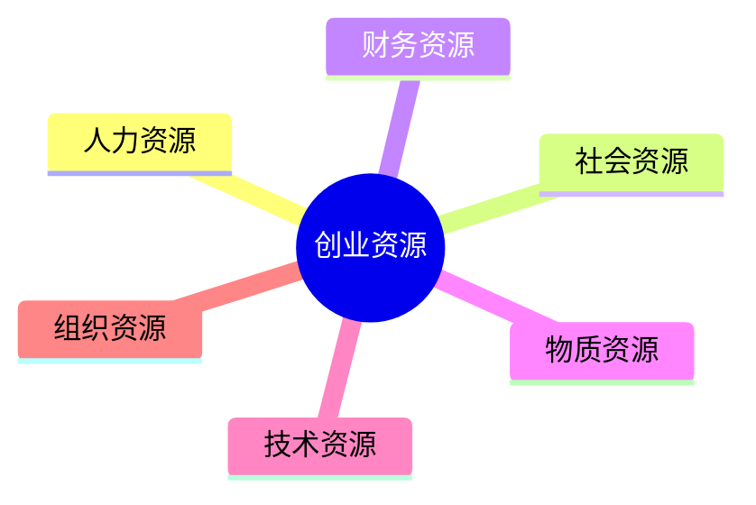

# 创业资源的类型与分类

> [!IMPORTANT]
> ==资源基础理论==将企业描述成一组异质性资源的组合，创业因而可以看作整合异质性资源的过程。

为什么需要对创业资源进行分类？想象你面前有一大堆散乱的织物碎条（如课件中那个房间练习），如果不按尺寸、颜色等维度分类，你根本无法有效利用它们。同理，对资源分类有助于理解并执行“资源整合”这一复杂动态过程。

## 按性质划分的六种资源

结合多方面研究成果，根据资源性质可将创业资源分为六类：

- **人力资源**：创业者及团队的知识、技能与经验。
- **社会资源**：人脉网络、信任关系及利益相关者支持。
- **财务资源**：启动资金、现金流及融资渠道。
- **物质资源**：厂房、设备、原材料等有形资产。
- **技术资源**：专利、工艺、专有知识。
- **组织资源**：企业的管理系统、流程与文化。

> [!TIP]
> 记忆口诀：“人、社、财、物、技、组”。考试若要求列举，这六个词是标准得分点。

## 合法性分类

除了按性质划分，创业资源获取还受“合法性”制约。新创企业常面临“新进入缺陷”，必须建立三种合法性才能顺利获取外部资源：

| 合法性类型 | 含义 | 举例 |
| :--- | :--- | :--- |
| **管制合法性** | 符合法律法规和政府规章 | 取得营业执照、行业许可证 |
| **规范合法性** | 符合行业道德规范与社会价值观 | 采用环保材料、保障员工权益 |
| **认知合法性** | 被公众理解和接受为理所当然 | 商业模式通俗易懂，无需费力解释 |

## 相近概念辨析：个体创业与公司创业的资源差异

同样是整合资源，个体创业和公司创业在初始条件上截然不同：

| 差异维度 | 个体创业 | 公司创业 |
| :--- | :--- | :--- |
| **初始条件** | 从市场寻求资源；资金多来自个人、家庭或亲友财产 | 从组织内部寻求未被有效利用的资源 |
| **独立性** | 较高，所有权与控制权合一，决策灵活 | 较弱，受现有行政和控制系统约束 |
| **报酬与风险** | 潜在收益无限，承担财务与生活等多重风险 | 通常不拥有所有权，股权激励有限 |

> [!NOTE]
> 个体创业者更多依赖“步步为营”（Bootstrapping）和“拼凑”（Bricolage）来克服资源局限；而公司创业者则需要花大量精力与其他组织成员沟通，克服层级结构对创业行为的阻力。

## 常见误区与避坑

> [!WARNING]
> 不要将“社会资源”简单等同于“认识很多人”。社会资源的核心在于“信任”——一种涉及交易或交换关系基础的稳定信念。没有信任的人脉无法转化为有效的创业资源。

> [!CAUTION]
> 拼凑（Bricolage）不是盲目凑合。全面拼凑可能导致企业长期陷入低效循环；成熟的创业者应采用“选择性拼凑”，只在早期资源紧缺时在一两个领域将就使用，随企业发展逐渐放弃。

## 实战应用：毕海德研究的启示

**问题**：《有限公司》500强的创办者在创业时往往没有新奇想法或稀有资产，为何资源局限没有限制他们的绩效？

**解析**：
1. 这些“有前途的”新企业意识到有利可图的经营所需规模较小，能通过内部资金积累为其高速发展融资（降低了对庞大财务资源的依赖）。
2. 市场动荡及对领导人依赖的双重不确定性，反而让缺少大量资本支持的创业者有了获利空间。

这说明：即使缺乏某几类关键资源（如巨额财务资源或稀缺技术资源），只要善于识别利益相关者、构建共赢机制并维持信任，依然能高效完成资源整合。
