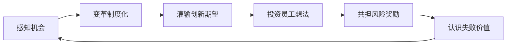
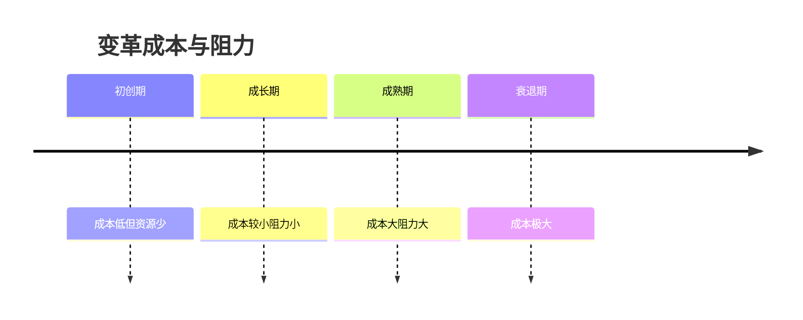

# 支持持续创新的组织机制与文化保障

## 支持持续创新的组织机制与文化保障

先问一个问题：一家公司靠一个爆款产品成功了，接下来最怕什么？最怕的是全公司都变成了“守护这个产品”的人，而不是“寻找下一个机会”的人。持续创新不是靠某几个天才，而是靠一套机制和文化，让创新成为日常动作而非偶然事件。

### 为什么需要组织机制来支持创新

创业型企业进入成长阶段后，规模扩大、层级增多，自然会滋生两种“创新杀手”：一是**路径依赖**——既然现有产品还在赚钱，为什么要冒险；二是**风险厌恶**——员工的绩效考核和薪酬都绑定在稳定产出上，创新失败的成本由个人承担，而收益归公司所有。

因此，支持持续创新不能只靠口号，必须从结构上回答三个问题：**机会怎么被发现？想法怎么被投资？失败怎么被对待？**

> [!IMPORTANT]
> 持续创新的组织保障核心是三件事：==提高机会感知能力==、==使变革成为制度==、==与员工共担风险与奖励==。

### 关键机制：让变革“制度化”

课件中提出促进公司创业的战略策略，可以归纳为一条闭环：

这个闭环的关键不是“鼓励创新”，而是把创新嵌入管理流程。如果“使变革成为一种制度”，意味着创新不是额外任务，而是岗位职责的一部分；如果“致力于员工想法的投资”，意味着公司必须拿出真实的预算、时间和人力来孵化内部创意，而不是让员工下班后自发“业余创新”。

> [!WARNING]
> 很多公司设立了“创新奖”却没有投入机制，结果是员工提了想法无人跟进，第一次失望、第二次沉默。==没有资源配置通道的创新倡议，比没有倡议更伤害文化==。

### 变革成本与切入时机

创新往往伴随组织变革，而变革最大的阻力来自内部既得利益。课件中给出的判断是：==在成长阶段实施变革的成本较小==。原因是此时企业规模尚可、层级不深、资源相对充裕，且员工对变化的接受度高于成熟期。另一个实用策略是==从局部切入==——不要一开始就全公司推倒重来，而是选一个部门或一个产品线做试点，短期见效后再推广，用成果消解阻力。

### 管理传承：持续创新的领导力基础

组织机制可以设计，但谁来推动它运转？这涉及企业成长中的管理传承。课件按两个维度划分四种类型：

| 类型 | 接替者来源 | 适用阶段 | 典型风险 |
|------|-----------|---------|---------|
| 换手型 | 内部人员 | 创建初期 | 任人唯亲，创业者仍在幕后干预 |
| 援手型 | 外部人员 | 创建初期 | 外来者与创始团队磨合难 |
| 禅让型 | 内部人员 | 成长后期 | 继任者缺乏变革魄力 |
| 空降型 | 外部人员 | 成长受阻时 | 薪酬倒挂引发内部不满 |

> [!TIP]
> 记忆口诀：**“初内换，初外援，成内禅，成外空”**——初期内部接替是“换手”，初期外部接替是“援手”，成长期内部培养是“禅让”，成长期外部聘请是“空降”。

联想柳传志选拔杨元庆属于**禅让型**：先让继任者在内部多个岗位“缝鞋垫”式历练，再委以“做西服”式的重任，最终在合适时机完成交接。这种方式的好处是继任者认同企业文化、团队信任度高，适合以持续创新为战略的企业。

### 一个容易踩的坑

把“支持创新”等同于“容忍失败”，结果变成了“不追究任何失败”。课件强调的是“认识到失败的重要性”，而不是“鼓励失败”。两者的区别在于：==有价值的失败是能产生学习产出的失败==——知道此路不通以及为什么不通；无价值的失败是重复性、低级失误。创新文化要宽容前者，追责后者。

### 企业成长管理重点与创新的衔接

持续创新不是孤立的管理模块，它嵌入在企业成长的管理主线中：确立愿景使命为创新提供方向；战略规划能力决定资源往哪些创新方向倾斜；整合外部资源可以弥补内部创新的能力缺口；人力资本管理决定创新人才的获取与保留；组织学习让失败经验转化为组织知识；从追求速度转向价值增加，本质上是把创新的衡量标准从“做了多少新东西”变成“创造了多少新价值”。

> [!NOTE]
> 辨析：**创业型领导力**与一般管理领导的差异在于，前者同时承担机会识别、资源动员和不确定性决策三重职能，而后者更多是在既定框架内优化执行。支持持续创新的组织，需要的是前者而非后者。

**算对了的例子**：某企业在成长期发现原有产品增速放缓，管理者没有等到衰退期才动手，而是在成长阶段末期就成立了一个内部创新小组（局部切入），拨出年营收的5%作为创新基金（投资员工想法），规定每个季度必须有两个内部创意进入原型测试（变革制度化），测试失败但产出技术报告的不影响年终绩效（认识失败价值）。三年后该企业新增业务线贡献了总营收的30%。这个案例同时用上了“成长期变革成本小”“局部切入”“投资想法”“共担风险”“失败有价值”五个要点。
