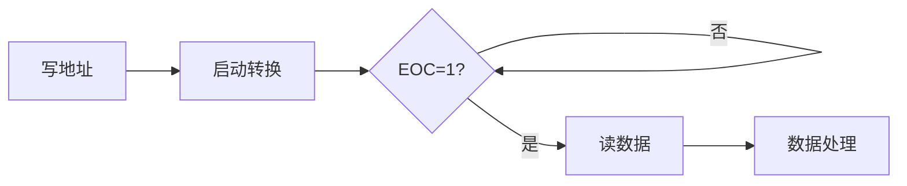

# A/D与D/A转换接口设计

## 为什么需要A/D与D/A转换

单片机内部处理的是数字量，而温度、压力等物理信号本质是模拟量。若要让单片机“感知”现实世界或“控制”模拟设备，就必须解决==数模之间的桥梁问题==。A/D转换器（ADC）将模拟电压转为数字代码供CPU读取；D/A转换器（DAC）则将数字代码还原为模拟电压去驱动执行机构。没有这两个接口，单片机就只是一个孤立的数字逻辑器。

## 核心参数与选型依据

设计接口前，必须明确两个关键指标：分辨率与转换时间。分辨率决定精度，通常用位数 $n$ 表示，其最小量化单位（LSB）对应的电压为：

$$
\text{LSB} = \frac{V_{\text{REF}}}{2^n}
$$

例如8位ADC在5V基准下，LSB ≈ 19.5mV；而10位ADC同样基准下LSB ≈ 4.9mV。转换时间则决定系统能否跟上信号变化速率。

> [!IMPORTANT]
> ==分辨率≠精度==。分辨率是理论最小步进，精度还受非线性误差、温漂等影响。考试中常以分辨率作为计算依据，但工程设计需查器件手册的INL/DNL指标。

| 参数 | ADC关注点 | DAC关注点 |
| :--- | :--- | :--- |
| 分辨率 | 输入量化等级 | 输出平滑度 |
| 转换时间 | 采样率上限 | 建立时间 |
| 接口方式 | 并行/串行/SAR | 并行/串行/R-2R |
| 典型芯片 | ADC0809, TLC2543 | DAC0832, MAX517 |

## 接口设计怎么做

以经典ADC0809为例，它是8位逐次逼近型ADC，采用==分时复用地址锁存==方式与51单片机连接。设计步骤如下：

1. **地址译码**：通过74LS138等译码器选中ADC0809的片选端；
2. **启动转换**：向该地址写任意数据，WR脉冲触发START；
3. **等待完成**：查询EOC引脚或采用中断方式；
4. **读取结果**：对同一地址读操作，RD有效时输出数字量。

> [!TIP]
> ADC0809的ALE与START可短接，实现==地址锁存与启动同步==，简化时序控制。这是南邮实验课和考题中的高频设计点。

## 常见坑与易错辨析

> [!WARNING]
> ==未加采样保持电路==会导致转换期间输入电压变化，结果失真。尤其当信号源阻抗高或变化快时，必须外接SHA或使用内置SHA的ADC。

> [!CAUTION]
> DAC0832是电流输出型，==必须外接运放转电压==。直接测OUT1/OUT2引脚得不到正确电压值，这是实验和答题中最常见的错误。

## 计算示例验证

某系统使用ADC0809测量0~5V温度信号，若读得数字量为0x9A，求实际电压值。

解：0x9A = 154，8位ADC满量程对应255级，故：

$$
V_{\text{in}} = \frac{154}{255} \times 5 \approx 3.02\,\text{V}
$$

> [!NOTE]
> 注意分母是 $2^n - 1 = 255$ 而非256。因为0x00对应0V，0xFF对应满量程5V，共256个点但255个间隔。==用256算会系统性偏低==，是历年试卷高频扣分点。
