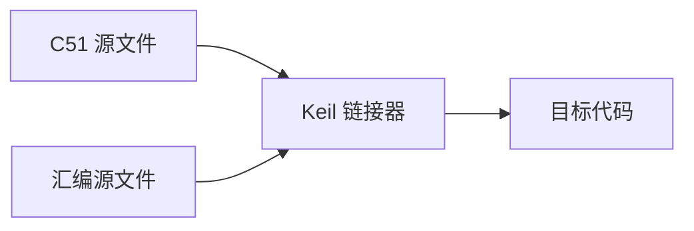

# C51与汇编语言混合编程

## 为什么需要混合编程

纯 C51 写起来方便，但有些场合效率不够高：==精确的定时/延时==、==位级时序控制==（如模拟 I²C/SPI 的位脉冲）、==已有成熟汇编子程序的复用==（如浮点运算库、LCD 驱动）。反过来，纯汇编难以管理复杂数据结构。所以 Keil C51 允许在同一个工程里让 C 与汇编各做擅长的事，这就是 **C51 与汇编语言混合编程**。



## 两种混合方式

| 方式 | 做法 | 适用 |
|---|---|---|
| 内嵌汇编 | 在 C 函数体内用 `__asm` / `_endasm` 写汇编块 | 少量、局部的时序优化 |
| 模块级混合 | C 文件调用外部汇编子程序，或汇编调用 C 函数 | 大段复用汇编代码库 |

> [!TIP]
> 优先考虑模块级混合：汇编写成独立 `.ASM` 文件，用 `EXTRN`/`PUBLIC` 与 C 互相调用，比内嵌汇编更容易维护。

## 关键：调用规则与参数传递

混合编程的真正难点不是语法，而是 ==C51 编译器的调用约定==。汇编必须按约定去取参数、放返回值，否则"接口错一个字节，数据全乱"。

常见参数传递约定（Keil C51）：

| 参数个数 | 传递方式 | 返回值 |
|---|---|---|
| 1 个（≤1 字节/位/指针） | 寄存器 R7 / R6R7 / R1R2R3 | R7 或 R4–R7 |
| 2 个（短参数） | R5R6、R3R4 等 | 同上 |
| 3 个及以上 | 通过 ==内部 data 堆栈==传 | 寄存器 |

> [!WARNING]
> C51 至少占用 8 字节的 data 区作参数传递区和堆栈，编译汇编时要与 C 的存储模式（`SMALL`/`COMPACT`/`LARGE`）保持一致，否则栈顶指针 `SP` 对不上。

## 怎么做：汇编调用 C 函数

汇编侧要声明外部符号并按约定传参：

```asm
EXTRN  CODE (_Delay)      ; 声明外部 C 函数
PUBLIC  _MainLoop
_MainLoop:
        MOV   R7, #10      ; 参数 10 送 R7
        LCALL _Delay       ; 调用 C 函数
        RET
```

## 怎么做：C 调用汇编子程序

C 侧只需声明函数原型，链接器负责找符号：

```c
extern void Delay_ASM(unsigned char n);
void main(void) {
    Delay_ASM(10);
}
```

汇编侧：

```asm
PUBLIC _Delay_ASM
?PR?_Delay_ASM?ASM SEGMENT CODE
RSEG  ?PR?_Delay_ASM?ASM
_Delay_ASM:
        ; R7 = n
        ; ……延时循环……
        RET
```

## 算一个完整的例子

设 C 调用汇编延时 `Delay_ASM(n)`，要求汇编里实现约 `n × 1 ms` 延时（12 MHz 晶振）。

- C 文件 `main.c`：
```c
extern void Delay_ASM(unsigned char n);
void main(void) {
    Delay_ASM(5);        // 延时 5 ms
    while(1);
}
```
- 汇编文件 `delay.asm`：
```asm
PUBLIC _Delay_ASM
?PR?_Delay_ASM?ASM SEGMENT CODE
RSEG  ?PR?_Delay_ASM?ASM
_Delay_ASM:              ; 入口时 R7 = n
D1:     MOV   R6, #250
D2:     DJNZ  R6, D2
        DJNZ  R7, D1
        RET
END
```

分析：`R7 = 5` 被 C 按约定送入；内层 `DJNZ` 循环 250 次 ≈ 1 ms（12 MHz 下每 `DJNZ` 2 µs）；外层执行 5 次 → 5 ms。返回值 void，不需要写回 R7。

## 常见的坑

> [!CAUTION]
> - C 函数名编译后加前导下划线 `_`，汇编里引用必须写 `_Name`。
> - 汇编子程序若用到工作寄存器组 R0–R7，必须按 C51 的 `using n` 约定保存/恢复。
> - 位变量（`bit` 类型）不能用指针传递，混合编程时直接传字节更安全。
> - 中断服务程序（`interrupt`）里调用汇编时，==上下文压栈==（`ACC`、`PSW`、`B` 等）必须由汇编自己保证完整。
> - C 与汇编模块的存储模式必须一致，否则 `SMALL` 模式下 C 用 `R0/R1` 作 data 指针而汇编用别的寄存器，会互相破坏。
