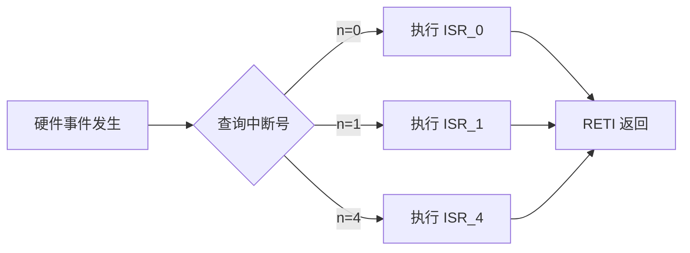

# C51中断函数定义（interrupt关键字）

## 什么是 C51 中断函数

在标准 C 语言中，函数由主程序或其他函数调用。但在单片机系统中，**中断服务程序（ISR）**是由硬件异步触发的。C51 编译器通过扩展关键字 `interrupt` 和中断号，让程序员能用 C 语言编写 ISR，而无需手动处理汇编层面的现场保护与入口跳转。

> [!IMPORTANT]
> **核心定义**：`interrupt` 是 C51 特有的关键字，用于声明一个函数为中断服务程序。编译器会根据指定的**中断号**自动生成入口代码（如 `RETI` 指令和寄存器压栈/出栈）。

## 为什么需要 interrupt 关键字

如果没有 `interrupt`，编译器会将该函数视为普通函数。当硬件事件发生时，CPU 跳转到固定向量地址，若此处没有正确的 ISR 入口逻辑，系统将跑飞或执行错误代码。

使用 `interrupt` 的好处在于：
1. **自动现场保护**：编译器自动插入代码保存/恢复 ACC、B、DPTR 等寄存器。
2. **正确返回**：自动生成 `RETI` 指令而非普通的 `RET`，确保中断嵌套和优先级逻辑正确。
3. **入口绑定**：将 C 函数地址映射到 MCS-51 固定的中断向量表位置。

## 怎么做：语法与中断号映射

定义格式如下：
```c
void 函数名(void) interrupt n [using m]
```
其中 $n$ 为中断号（0~31），$m$ 为寄存器组（可选）。

MCS-51 标准中断源与中断号的对应关系是考试重点：

| 中断源 | 中断号 (n) | 默认入口地址 | 触发条件 |
| :--- | :---: | :---: | :--- |
| 外部中断 0 | **0** | 0003H | INT0 引脚有效电平/边沿 |
| 定时器 0 | **1** | 000BH | T0 计数溢出 |
| 外部中断 1 | **2** | 0013H | INT1 引脚有效电平/边沿 |
| 定时器 1 | **3** | 001BH | T1 计数溢出 |
| 串口 UART | **4** | 0023H | RI 或 TI 置位 |



> [!TIP]
> **记忆口诀**：外零定时零，外一定时一，串口排最后。即：0(外0), 1(T0), 2(外1), 3(T1), 4(串口)。

## 常见坑与辨析

==严禁在中断函数中传递参数或返回值==。因为 ISR 不是被“调用”的，而是被“触发”的，堆栈中不存在调用者传递的参数帧。

| 特性 | 普通 C 函数 | C51 中断函数 |
| :--- | :--- | :--- |
| 调用方式 | 软件调用 | 硬件异步触发 |
| 参数/返回值 | 支持 | ==禁止== |
| 返回指令 | `RET` | `RETI` |
| 寄存器保护 | 编译器优化决定 | 强制自动保护 |

> [!WARNING]
> **高危误区**：不要在中断函数中执行耗时操作（如长延时 `delay()`）。中断应“快进快出”，否则会影响主程序实时性甚至导致数据丢失。

## 算对了的例子

假设要求编写定时器 T0 的中断服务程序，每次溢出使 P1.0 取反。

```c
#include <reg52.h>

sbit LED = P1^0;

// 中断号 1 对应定时器 0
void Timer0_ISR(void) interrupt 1 
{
    LED = !LED;      // 取反操作
    TH0 = 0xFC;      // 重装初值
    TL0 = 0x18;
}
```

**解析**：
1. `interrupt 1` 告诉编译器此函数绑定到 T0 溢出中断（入口 000BH）。
2. 编译器自动处理 `push/pop` 和 `RETI`。
3. 若在 main 中开启 `ET0=1; EA=1; TR0=1;`，则每当 T0 溢出，硬件自动跳转至此函数执行。
