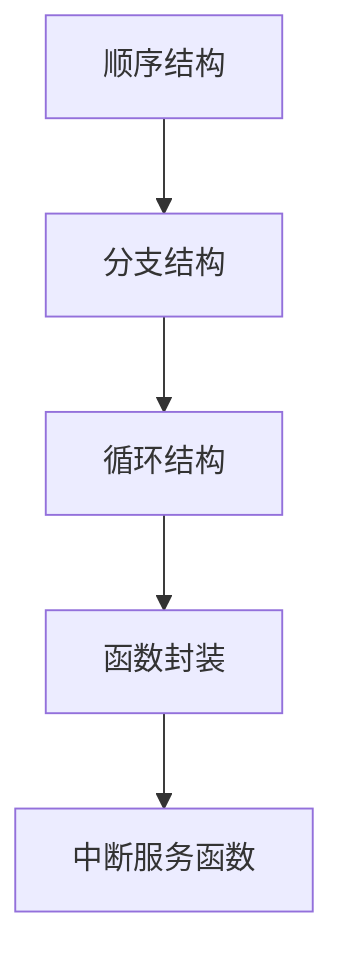

# C51基本程序结构（顺序、分支、循环、函数）

## C51基本程序结构

C51程序在结构上完全遵循标准C语言：由若干函数组成，其中有且仅有一个`main()`函数作为程序入口。但51单片机资源极其有限（片内RAM仅128/256字节），因此==同样的结构，在C51里写法要"抠资源"==。程序流程仍归结为三种基本结构加函数封装：

## 顺序与分支

顺序结构按语句先后执行。分支结构用`if-else`或`switch-case`实现。51单片机**不支持符号运算**，条件判断若涉及有符号数比较，编译器需调用库函数，代码量和执行时间都会增加。

> [!WARNING]
> 编程者应根据应用具体情况，==尽量不使用带符号的变量==。能用`unsigned char`就不用`int`，能用`unsigned int`就不用`long`。

## 循环结构

`while`、`do-while`、`for`三种循环在C51中均可用，但循环控制变量的类型直接影响代码效率。

> [!TIP]
> 提高代码效率的最基本方式是**减小变量的字长**。若循环次数在255次以下，==应使用`unsigned char`型变量作为循环控制变量==，而非习惯上的`int`。

## 函数与存储模式

C51函数定义与ANSI C一致，但需注意：

- **参数传递**：C51默认使用寄存器组传递函数参数，因此`data`区至少被占用8字节。
- **存储空间**：只要不超过内部`data`区范围，系统变量和用户变量均可存放其中，编译器会自动处理堆栈空间。
- **中断服务函数（ISR）**：可声明为`void ISR(void) interrupt n using m`。若指定了寄存器组`m`，==ISR入口处不再产生压栈代码==，响应更快；但副作用是ISR中调用的所有函数、使用的变量都必须基于同一寄存器组，否则出错。

## 内联函数与宏

对于简单操作，C51提供直接对应汇编指令的内联函数，可重入且可在任何地方安全调用：

| 内联函数 | 对应汇编指令 | 功能 |
|---------|------------|------|
| `_crol_`, `_cror_` | `RL A`, `RR A` | 单字节循环左/右移 |
| `_irol_`, `_iror_` | — | `int`型循环左/右移 |
| `_lrol_`, `_lror_` | — | `long`型循环左/右移 |
| `_testbit_` | `JBC` | 测试位并清除，置位返回1 |

> [!IMPORTANT]
> `sizeof`是**表达式而非函数**，其值在编译时已由编译器计算，不占用运行时资源。

对于小段频繁使用的代码（如使能电路、读锁存器），建议用**宏替代函数**，避免频繁调用带来的开销，同时提高可读性。
