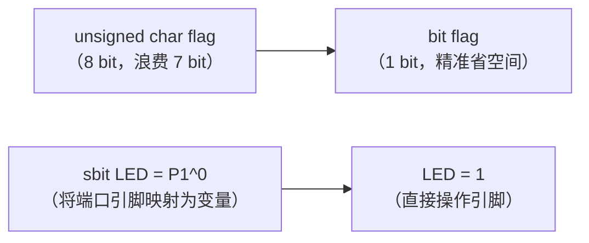

# C51扩展数据类型（bit、sbit、sfr、sfr16）

## 为什么需要 C51 扩展数据类型

在设计单片机程序时，我们经常需要直接操控硬件。比如，要让一个 LED 亮灭，实际上只需要改变某个寄存器里的某一位；要配置串口，就需要改写整个控制寄存器。标准 C 语言里的 `int`、`char` 无法直接做到“直达硬件某一位”或“访问某个固定地址的寄存器”。C51 编译器为 8051 的硬件量身定制了 `bit`、`sbit`、`sfr`、`sfr16` 这四种扩展类型，解决了这个问题。

> [!IMPORTANT]
> C51 扩展数据类型的本质，是将 8051 硬件中的**位**和**特殊功能寄存器（SFR）**映射为 C 语言可以直接操作的变量，使程序兼具 C 语言的抽象能力和汇编语言的硬件操控力。

## 从位到位变量：`bit` 与 `sbit`

先思考一个问题：如果只需要记录“开”或“关”两种状态，用一个 `unsigned char`（8 位）是不是太浪费了？8051 内部 RAM 有一个**位寻址区**（20H~2FH），每个位都有独立地址，允许直接对一位进行置 1、清 0 或判断。



- **`bit`**：定义一个存储在片内位寻址区的位变量，只能取 0 或 1。它不能定义指针，也不能作为数组元素。
- **`sbit`**：用于定义**可位寻址的 SFR**（如 P0、TCON、SCON）的某一位。它不是一个独立存储单元，而是某个寄存器中的一位。

`bit` 和 `sbit` 很易混，区别在于：`bit` 定义一个位变量；`sbit` 则是给**已经存在**的寄存器位起一个别名。

> [!WARNING]
> `sbit` 只能用于那些**地址能被 8 整除**的 SFR（如 80H、88H、90H、98H…）。若试图对一个不可位寻址的 SFR 用 `sbit`，编译会报错。另外，`bit` 变量不能声明指针——编译器无法生成指向单个位的地址。

## 给寄存器起名字：`sfr` 与 `sfr16`

标准 C 里，你可以写 `int *p = (int *)0x80;` 去访问地址 0x80。但 8051 编译器不把 0x80 当作内存，而是当作特殊功能寄存器 P0。直接用指针强转容易出错，且可读性差。`sfr` 就是用来为 8 位 SFR 定义名字的。

```c
sfr P0 = 0x80;    // 将 0x80 地址定义为 P0 口
sfr SCON = 0x98;  // 串口控制寄存器

// 现在可以直接读写：
P0 = 0x55;        // 将 55H 写入 P0 口
```

对于 16 位的 SFR（只有 DPTR，即数据指针），用 `sfr16` 定义：

```c
sfr16 DPTR = 0x82; // DPTR 由 DPH（0x83）和 DPL（0x82）组成
```

> [!TIP]
> 定义 `sfr` 时，等号右边必须是**常量地址**，取值范围 0x80~0xFF。`sfr16` 定义时写的是**低字节地址**。这些定义通常已写在头文件（如 `reg51.h`）中，实际编程只需 `#include <reg51.h>` 即可。

## 检视位并清除：`_testbit_` 内联函数

很多标志位（如定时器溢出 TF0）需要在检测后立即清除。汇编里有 `JBC` 指令一步完成。C51 的内联函数 `_testbit_` 正是这一行为的高效封装（需包含 `intrins.h`）。

```c
if (_testbit_(TF0)) {   // 若 TF0 为 1，返回 1 并自动将 TF0 清 0
    // 处理溢出
}
```

## 一个算对了的例子

**题目**：用 `sbit` 定义 P1 口第 0 位，控制一个 LED 闪烁（低电平亮）。写出定义和翻转控制的代码片段。

**解答**：
```c
#include <intrins.h>

sfr P1 = 0x90;          // 定义 P1 口 SFR
sbit LED = P1 ^ 0;      // 将 P1.0 命名为 LED

void delay() {
    unsigned int i;
    for (i = 0; i < 10000; i++);
}

void main() {
    while (1) {
        LED = 0;        // 亮
        delay();
        LED = 1;        // 灭
        delay();
    }
}
```

这里 `P1 ^ 0` 中的 `^` 不是异或，是 Keil C51 里 **`sbit` 定义的语法**：`sfr_name ^ bit_position`。变量 `LED` 就精确映射到了硬件的 P1.0 引脚上。`LED = 0` 这条 C 语言语句，会被编译成 `CLR P1.0`，一条指令完成任务——这就是 C51 扩展数据类型的强大之处：==用 C 语言语句实现精确、高效的硬件操控==。
