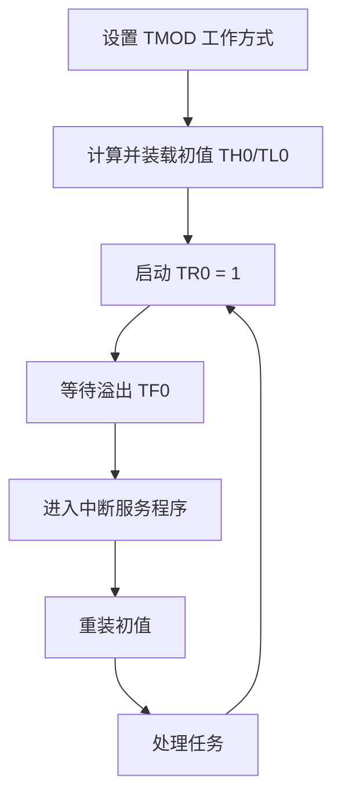

# C51典型程序设计实例（定时器、中断、I/O控制）

## 为什么需要典型程序设计实例

学到这里，你已经会写 C51 的基本语句，但单片机开发的真正难点不在“语法”，而在==如何驱动片上的定时器、中断与 I/O 硬件==。汇编语言在时间与速度敏感场合（如中断处理）仍不可替代，但日常开发中，用 C51 编写这些典型程序，既能保证效率，又便于维护。掌握这几个实例，是后续做课程设计、竞赛项目的基础。

## 定时器：从初值到溢出

定时器/计数器的核心思想是：==对机器周期计数，计满溢出后触发中断==。假设系统晶振为 $12\,\text{MHz}$，则一个机器周期为 $1\,\mu\text{s}$。若定时器工作在方式 1（16 位计数），要定时 $T$ 毫秒，则计数初值 $X$ 满足：

$$
X = 65536 - \frac{T \times 10^{-3}}{1 \times 10^{-6}} = 65536 - 1000T
$$

例如要定时 $50\,\text{ms}$，则 $X = 65536 - 50000 = 15536$，换算成十六进制为 $0x3CB0$，因此 `TH0 = 0x3C; TL0 = 0xB0;`。



## 中断：C51 的声明与现场保护

C51 用 `interrupt` 关键字加中断号声明服务程序，编译器自动计算入口地址并==在 ISR 入口保护现场、出口恢复现场==。常用中断号对应关系如下：

| 中断号 | 中断源 |
|--------|--------|
| 0 | 外部中断 0 |
| 1 | 定时器/计数器 0 溢出 |
| 2 | 外部中断 1 |
| 3 | 定时器/计数器 1 溢出 |
| 4 | 串行口中断 |
| 5 | 定时器/计数器 2 溢出 |

> [!IMPORTANT]
> 中断服务程序应尽量短小，避免在其中调用复杂函数或进行长时间延时，否则会丢失后续中断。

> [!WARNING]
> 若使用 `using` 指定寄存器组，ISR 中调用的函数和变量必须基于同一寄存器组，否则因参数传递使用寄存器间接寻址而出错。

## I/O 控制：让引脚“听话”

I/O 控制的本质是==通过读写特殊功能寄存器（SFR）改变引脚电平==。例如，将 P1.0 置 1 点亮 LED：

```c
#include <reg51.h>
sbit LED = P1^0;

void main() {
    LED = 0;  // 低电平点亮（共阳）
    while(1);
}
```

结合定时器中断，可实现 LED 每 500 ms 闪烁一次：

```c
void timer0_isr() interrupt 1 {
    static unsigned char count = 0;
    TH0 = 0x3C; TL0 = 0xB0;   // 重装 50 ms 初值
    if(++count >= 10) {       // 10 × 50 ms = 500 ms
        count = 0;
        LED = ~LED;
    }
}
```

## 常见坑与辨析

> [!CAUTION]
> 忘记重装定时器初值会导致定时长度错误；16 位方式下必须同时写 `TH0` 和 `TL0`。

> [!TIP]
> 记忆口诀：==“先方式、后初值、再启动、中断里重装”==。

| 易混点 | 正确做法 |
|--------|----------|
| 中断号写错 | 对照上表，如定时器 0 用 `interrupt 1` |
| 初值计算忽略晶振 | $12\,\text{MHz}$ 时机器周期 $1\,\mu\text{s}$，$11.0592\,\text{MHz}$ 时约 $1.085\,\mu\text{s}$ |
| ISR 中未清中断标志 | 部分中断（如串行口）需软件清 `TI`/`RI` |

## 一个算对了的例子

**题目**：晶振 $12\,\text{MHz}$，要求 P1.0 输出周期为 $1\,\text{s}$ 的方波。

**解**：方波周期 $1\,\text{s}$，则每 $500\,\text{ms}$ 翻转一次。定时器 0 方式 1，初值 $X = 65536 - 50000 = 15536 = 0x3CB0$。中断 10 次后翻转 P1.0。

```c
#include <reg51.h>
sbit LED = P1^0;

void main() {
    TMOD = 0x01;          // 定时器0，方式1
    TH0 = 0x3C; TL0 = 0xB0;
    ET0 = 1; EA = 1;      // 开中断
    TR0 = 1;
    while(1);
}

void timer0_isr() interrupt 1 {
    static unsigned char count = 0;
    TH0 = 0x3C; TL0 = 0xB0;
    if(++count >= 10) {
        count = 0;
        LED = ~LED;
    }
}
```

> [!NOTE]
> `static` 变量保证 `count` 在多次中断调用间保持值，不会被重新初始化。
