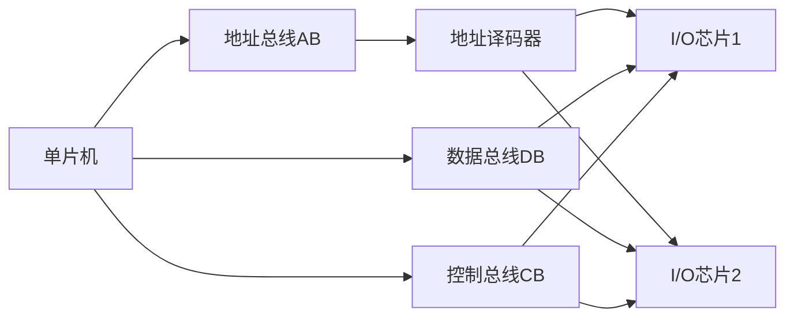

# I/O接口扩展概述（总线结构与扩展方法）

单片机自带的 I/O 口（如 P0、P1、P2、P3）数量有限，当外部设备较多时根本不够用。怎么办？这就需要通过**外部总线**来扩展 I/O 接口芯片。

## 为什么需要总线扩展

单片机的引脚资源是固定的，但实际系统中往往需要连接键盘、显示器、A/D 转换器等大量外设。

> [!IMPORTANT]
> 核心目的：利用少量引脚，通过==总线复用与地址译码==，挂载多个外部 I/O 芯片，突破单片机自带 I/O 口数量的限制。

## 总线结构是什么

MCS-51 单片机采用**三总线结构**进行系统扩展：



- **数据总线（DB）**：由 ==P0 口== 提供（8位），负责传输读写数据。
- **地址总线（AB）**：低 8 位由 P0 口经锁存器（如 74LS373）分时提供；高 8 位由 ==P2 口== 提供。
- **控制总线（CB）**：包括 $\text{RD}$、$\text{WR}$、$\text{ALE}$、$\text{PSEN}$ 等信号，控制数据传输方向与时序。

> [!NOTE]
> P0 口既作数据线又作低 8 位地址线，属于**分时复用**。必须靠 $\text{ALE}$ 信号的下降沿将地址锁存到外部锁存器中，否则地址和数据会混在一起。

## 怎么做：两种扩展方法

扩展 I/O 接口主要有两种方法，它们的本质区别在于**CPU 用什么指令去访问它**。

| 对比维度 | 存储器映射方式（统一编址） | I/O 映射方式（独立编址） |
| :--- | :--- | :--- |
| **占用空间** | 占用外部 RAM 地址空间 | 不占 RAM 空间，有独立 I/O 地址 |
| **访问指令** | `MOVX` 指令 | x86 用 `IN/OUT`；==51 通常仍用 `MOVX`== |
| **地址译码** | 必须接译码器产生片选 $\overline{\text{CS}}$ | 需专用 I/O 读写控制线 |
| **典型应用** | 8255A、8155 在 51 中的常用接法 | 较少用于 51 系统 |

> [!TIP]
> 南邮课程重点：**MCS-51 没有专门的 I/O 指令**，因此扩展 8255A、8155 等可编程接口芯片时，几乎都采用**存储器映射方式**，把它们当成外部 RAM 的一个单元来读写！

## 地址怎么算：一个完整例子

假设用 74LS138 译码器扩展一片 8255A，译码器输入 C、B、A 分别接 P2.2、P2.1、P2.0，输出 $\overline{Y_0}$ 接 8255A 的片选 $\overline{\text{CS}}$。8255A 的 A1、A0 接 P0.1、P0.0（经锁存）。求 8255A 各端口地址。

**推导步骤**：

1. **确定片选条件**：选中 $\overline{Y_0}$，要求 C B A = 0 0 0，即 P2.2 P2.1 P2.0 = 0 0 0。其余高位 P2.7~P2.3 取 0。故高 8 位地址为 `0000 0000` = $00\text{H}$。
2. **确定端口偏移**：8255A 内部有 PA、PB、PC 和控制口，由 A1、A0（即 P0.1、P0.0）区分。低 8 位其余位取 0。

| 端口 | P0.1(A1) | P0.0(A0) | 低 8 位二进制 | 完整 16 位地址 |
| :---: | :---: | :---: | :---: | :---: |
| PA口 | 0 | 0 | `0000 0000` | ==$0000\text{H}$== |
| PB口 | 0 | 1 | `0000 0001` | ==$0001\text{H}$== |
| PC口 | 1 | 0 | `0000 0010` | ==$0002\text{H}$== |
| 控制口 | 1 | 1 | `0000 0011` | ==$0003\text{H}$== |

向控制口写控制字：
```assembly
MOV DPTR, #0003H
MOV A, #80H      ; 控制字
MOVX @DPTR, A    ; 必须用 MOVX
```

> [!WARNING]
> 常见坑：计算地址时，忘记把**未参与译码的高位地址线默认置 0**，导致算出的地址和标准答案差了几千个单元。考试时若题目未指定无关位取值，一律按 0 处理。

> [!CAUTION]
> 读写扩展的 I/O 芯片时，千万别用 `MOV` 指令（那是访问内部 RAM 的），必须用 `MOVX` 指令触发外部的 $\overline{\text{RD}}$ 或 $\overline{\text{WR}}$ 控制信号！
