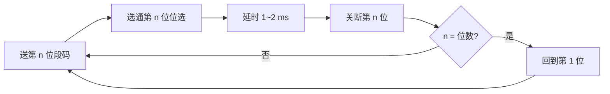

# LED数码管显示接口（静态/动态扫描显示）

## 静态与动态扫描

先想一个问题：单片机要让 4 个数码管同时显示“1234”，最直接的接法是什么？——每个数码管各接一组 I/O 口（8 根段选线 + 1 根公共端），4 个数码管就是 36 根线。51 单片机总共才 32 个 I/O 引脚，显然不够用。于是“静态”和“动态”两种驱动思路由此分化。

### 静态显示：锁存器保持，一管一口

> [!IMPORTANT]
> 静态显示的核心：==每个数码管由具有锁存能力的 I/O 端口单独驱动==，CPU 写入段码后，锁存器持续输出，直到下一次更新前显示内容保持不变。CPU 不需要反复刷新，可以把时间全部让给其他任务。

以 4 位静态显示为例，典型电路是 4 片 74LS373（或 74HC573）各自锁存一位段码，公共端固定接好极性。段码表与共阴/共阳类型有关，共阳数码管相应段输出低电平点亮，如“0”的共阳段码是 0xC0。

**缺点很直观**：N 位数码管需要 N 个锁存器和 N 组端口引线，硬件成本随位数线性上升。所以静态显示通常只用于 **1～2 位** 显示。

### 动态扫描：视觉暂留，分时点亮

如果 4 个数码管的段选线并联在一起，只用一个 8 位端口，再给每个数码管的公共端各接一根位选线，就只需要 8 + 4 = 12 根线。硬件简洁了，但同一时刻所有数码管收到的是同一组段码——怎样让它们显示不同字符？

答案是==分时轮流点亮==：先送出第 1 位的段码，只选通第 1 位的位选线，延时约 1～2 ms；然后关断，送第 2 位段码、选通第 2 位……如此循环。当刷新频率足够高（通常每位扫描一遍的总周期 ≤ 20 ms，即整体刷新率 ≥ 50 Hz），人眼的视觉暂留会“脑补”出所有位同时显示的错觉。

> [!NOTE]
> 动态扫描在任意瞬间其实**只有一位数码管真正点亮**，只是切换得足够快，看起来像全亮。这是“时间换硬件”的典型设计。

### 静态 vs 动态对比

| 项目 | 静态显示 | 动态扫描显示 |
|------|---------|-------------|
| I/O 口需求 | N 位需 N×8 根段选线（或 N 个锁存器控制） | 8 根段选 + N 根位选 |
| CPU 占用 | 写入后不占 CPU，亮度稳定 | 需定时刷新扫描，占用 CPU 或定时器 |
| 亮度 | 高，可长时间点亮 | 每位占空比仅 $1/N$，亮度偏低，需加大电流或缩短循环周期 |
| 硬件成本 | 高，位数多不经济 | 低，适合多位显示 |
| 适用场景 | 显示位数少、CPU 繁忙的系统 | 多位显示、对成本敏感的设计 |

动态扫描的**上限**在于：位数越多，每位分到的点亮时间越短，亮度越低。为保证不闪烁，N 位扫描时总周期需 ≤ 20 ms，即每位导通时间 $\leq 20/N$ ms。例如 8 位数码管每位仅 2.5 ms，此时必须减小限流电阻或选用高亮数码管补偿亮度。

### 易错点

> [!WARNING]
> 动态扫描中每一位切换时必须先关断所有位选（消隐），再更新段码，最后选通对应位。若先切换段码再关位选，上一位的残影会“串”到下一位上，产生**重影**。

> [!CAUTION]
> 共阳与共阴的位选驱动不同：共阳管公共端接驱动电源（如 PNP 三极管或直接由位选口拉高），共阴管公共端需拉低。位选电流是 8 个段的总和，因此位选驱动通常需要三极管或达林顿管扩流，不能直接用普通 I/O 引脚带动多位共阳管。

### 算例

用共阴数码管动态显示“7”和“1”，段码表（a 接最高位，dp 接最低位）：共阴时“7” = 0x07，“1” = 0x06。若 51 单片机 P0 口输出段码（需接上拉电阻），P2.0、P2.1 分别经 PNP 三极管驱动第 1、2 位共阳公共端（高电平选通）。扫描流程为：

1. P0 = 0x07，P2 = 0xFE（仅 P2.0 有效），延时 2 ms；
2. P0 = 0xFF（消隐），短暂关断；
3. P0 = 0x06，P2 = 0xFD，延时 2 ms；
4. 循环。

一个完整扫描周期约 4 ms + 消隐时间，20 ms 内可完成 5 次完整刷新，满足视觉暂留要求。
