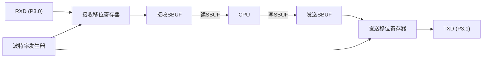
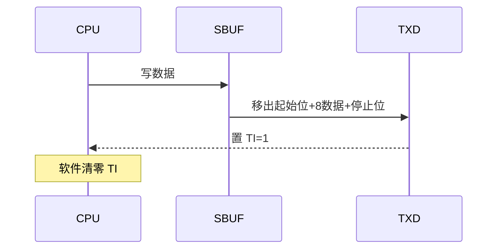
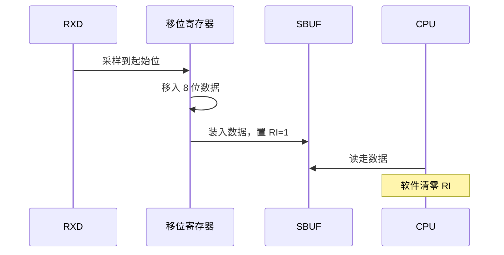

# MCS-51串行口结构及工作原理

## 串行口结构

MCS-51 内部集成一个**全双工异步串行口**（UART），核心是物理上独立的**发送缓冲器 SBUF** 和**接收缓冲器 SBUF**——二者地址相同（99H），靠读写方向区分：CPU 写 SBUF 即装载发送数据，读 SBUF 即取出接收数据。

接收侧有一个关键设计：**接收移位寄存器在接收完一帧后，才把数据并行装入接收 SBUF**。这意味着在接收下一帧期间，CPU 仍可读取上一帧数据，实现“双缓冲”。

串行口的工作由两个特殊功能寄存器控制：

| 寄存器 | 位 7 | 位 6 | 位 5 | 位 4 | 位 3 | 位 2 | 位 1 | 位 0 |
|---|---|---|---|---|---|---|---|---|
| SCON | SM0 | SM1 | SM2 | REN | TB8 | RB8 | TI | RI |
| PCON | SMOD | — | — | — | — | — | — | — |

> [!IMPORTANT]
> `SM0`/`SM1` 决定工作方式，`REN` 控制接收允许，`TI`/`RI` 是发送/接收中断标志，必须由软件清零。

## 为什么需要理解内部结构

串行通信本身对用户只表现为“写 SBUF 发出、中断来了读 SBUF”。但若不清楚 **TI / RI 的标志时序**与**接收双缓冲**，容易写出丢数据或重复发送的程序。理解结构后才能正确编写查询方式或中断方式的收发程序。

## 四种工作方式

| 方式 | SM0 SM1 | 帧格式 | 波特率 |
|---|---|---|---|
| 0 | 00 | 8 位，无起始/停止位 | $f_{osc}/12$（固定） |
| 1 | 01 | 10 位：起始 + 8 数据 + 停止 | 定时器 T1 溢出率 × 分频 |
| 2 | 10 | 11 位：起始 + 8 数据 + TB8/RB8 + 停止 | $f_{osc}/64$ 或 $f_{osc}/32$（由 SMOD 决定） |
| 3 | 11 | 同方式 2 | 同方式 1 |

教学与考试重点集中在**方式 1**：最常用的 8 位异步通信，波特率可调。

## 波特率怎么算

方式 1 的波特率由定时器 T1 的溢出率决定：

$$波特率 = \frac{2^{SMOD}}{32} \times \text{T1 溢出率}$$

若 T1 工作在方式 2（8 位自动重装），则：

$$\text{T1 溢出率} = \frac{f_{osc}}{12 \times (256 - TH1)}$$

代入得：

$$波特率 = \frac{2^{SMOD}}{32} \times \frac{f_{osc}}{12 \times (256 - TH1)}$$

> [!TIP]
> 考试先判断题目给的是“溢出率”还是“振荡频率”。给溢出率就直接乘 $\frac{2^{SMOD}}{32}$；给 $f_{osc}$ 就再除以 $12(256-TH1)$。

### 算一个对的例子

设 $f_{osc}=11.0592\text{ MHz}$，SMOD=0，要求波特率为 9600，求 TH1 初值。

$$9600 = \frac{1}{32} \times \frac{11059200}{12 \times (256 - TH1)}$$

$$9600 = \frac{11059200}{384 \times (256 - TH1)} = \frac{28800}{256 - TH1}$$

$$256 - TH1 = \frac{28800}{9600} = 3$$

$$TH1 = 253 = \text{FDH}$$

对应的 TMOD 中 T1 应设为方式 2，即 `TMOD = 0x20`。

## 发送与接收流程

**发送**（方式 1）：

**接收**（方式 1，REN=1）：

> [!WARNING]
> RI 置 1 时接收 SBUF 只是**被装入数据**，CPU 必须**读 SBUF 后手动清 RI**。若不清 RI，后续帧到达时程序无法判断“有新数据”，且多帧后会丢失。

## 与并行通信、同步串行的区别

| | 异步串行（方式 1/2/3） | 同步串行（方式 0） | 并行通信 |
|---|---|---|---|
| 连线数 | 2（TXD+RXD，地） | 2（RXD 数据 + TXD 时钟） | 8 数据线 + 控制线 |
| 有无时钟线 | 无 | 有 | 无 |
| 同步方式 | 靠起始位对齐 | 靠移位脉冲 | 靠控制信号 |
| 典型场景 | PC、模块间 | 扩展移位寄存器 | 系统内总线 |

方式 0 的“串行”是**同步移位寄存器**方式，不用于传统 UART 通信。

## 常见坑

> [!CAUTION]
> **SBUF 读写方向不同**：写 SBUF 是写发送缓冲器，读 SBUF 是读接收缓冲器——同一个地址 99H、两个物理寄存器，不要试图“读刚写入 SBUF 的值验证发送”。

> [!CAUTION]
> **TI/RI 不会自动清零**：MCS-51 中 TI 和 RI 置 1 后必须由软件写 0。中断服务程序里用了 `if (TI)` 却忘了 `TI=0`，会陷入不断进入中断的循环。

> [!NOTE]
> **TB8/RB8 的作用**：方式 2/3 中可用于多机通信的地址/数据标志位，或奇偶校验位。方式 1 不用 TB8/RB8。

## 小结

串行口 = SBUF（发送/接收物理分离） + SCON（方式与标志位） + 波特率发生器（T1 或固定分频）。考试核心是：==方式 1 波特率公式代入计算、TI/RI 必须软件清零、接收双缓冲的意义==。
