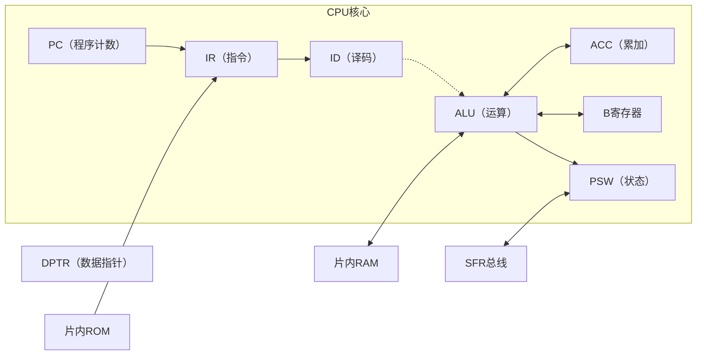

# MCS-51内部结构框图及CPU组成

## 内部结构框图与CPU组成

MCS-51单片机并非单一芯片，而是一个集成在硅片上的微型计算机系统。面对复杂的内部结构框图，我们不妨先思考：如果让你设计一个能自动执行指令的系统，除了负责运算的“大脑”，还需要哪些器官来配合它完成数据的存取、时序的控制以及与外界的沟通？

### CPU核心部件解析

CPU是单片机的指挥中枢，其内部由==运算器、控制器和寄存器阵列==三大核心部分组成。

-   **运算器**：以ALU为核心，配合ACC、B寄存器和PSW。ACC是最常用的工作寄存器；B仅在乘除指令中专用；==PSW中的CY位既是算术进位标志，也是布尔处理器的累加器==。
-   **控制器**：包含PC、IR、ID及定时控制逻辑。PC始终指向下一条待取指令的地址，复位后自动清零为`0000H`；ID将IR中的操作码翻译成具体的微操作控制信号。
-   **寄存器阵列**：除上述专用寄存器外，还包括R0~R7工作寄存器组（通过PSW.RS1/RS0切换）、SP（堆栈指针，复位初值`07H`）和16位的DPTR（唯一可访问64KB外部数据存储器的寄存器）。

> [!IMPORTANT]
> ==MCS-51采用哈佛结构==，程序存储器与数据存储器空间独立编址，这是理解其寻址方式和总线时序的前提。

### 与通用微处理器的区别

| 对比维度 | MCS-51单片机 | 通用微处理器（如8086） |
| :--- | :--- | :--- |
| 存储结构 | 哈佛结构（程序/数据分开） | 冯·诺依曼结构（统一编址） |
| 集成度 | 内含ROM/RAM/I/O/定时器 | 仅CPU，外设需扩展 |
| 指令系统 | 面向控制，位操作丰富 | 面向数据处理，字长灵活 |
| 寻址方式 | 支持直接位寻址 | 通常不支持位寻址 |

### 常见误区与典型例题

> [!WARNING]
> SP复位值为`07H`，意味着堆栈实际从==`08H`单元开始使用==。若未重新设置SP就进行中断或调用子程序，可能覆盖工作寄存器区的数据。

**【例题】** MCS-51复位后，PC和SP的值分别是多少？若执行一条`PUSH ACC`指令后，SP变为多少？

**解析：**
复位后 $PC = 0000H$，$SP = 07H$。MCS-51的堆栈操作遵循==“先加后压”==原则：执行`PUSH ACC`时，SP先自增为`08H`，再将ACC内容存入`08H`单元。因此执行后 $SP = 08H$。

> [!TIP]
> 记忆口诀：“入栈先加后存数，出栈先取后减一”。这与部分ARM架构“满递减”堆栈相反，是考试中极易混淆的细节。
