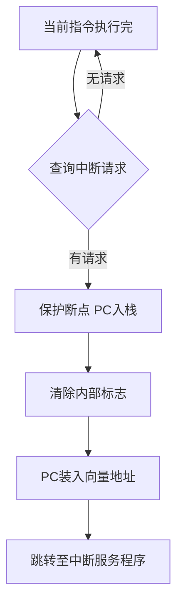

# MCS-51中断系统结构及中断响应过程

# MCS-51中断系统结构及中断响应过程

## 为什么需要中断？

想象你在写作业（主程序），突然电话响了（外部事件）。你是每写一个字就去看一眼手机（查询方式），还是等电话响再起身去接（中断方式）？显然，后者效率更高。==中断的核心价值==在于让CPU能实时响应紧急事件，同时保持主程序的连续执行。

## 中断系统的五大来源

MCS-51共有5个中断源，通过特殊功能寄存器进行控制：

| 中断源 | 默认优先级 | 入口地址 | 触发标志位 |
| :--- | :---: | :---: | :---: |
| 外部中断0 ($\overline{INT0}$) | 最高 (0) | 0003H | IE0 |
| 定时器0溢出 (T0) | 1 | 000BH | TF0 |
| 外部中断1 ($\overline{INT1}$) | 2 | 0013H | IE1 |
| 定时器1溢出 (T1) | 3 | 001BH | TF1 |
| 串口收发 (RX/TX) | 最低 (4) | 0023H | RI/TI |

> [!IMPORTANT]
> 两个关键寄存器：
> *   **IE (Interrupt Enable)**：总开关 $EA$ 必须为1，且对应位允许，中断才有效。
> *   **IP (Interrupt Priority)**：决定同级竞争时的胜出者，或不同级间的抢占关系。

## 中断响应全过程

当满足响应条件时，硬件自动完成以下“三部曲”：

1.  **采样与锁存**：在每个机器周期S5P2采样引脚电平或内部标志。
2.  **查询优先级**：若多个中断同时到达，按自然优先级或IP设定排队。
3.  **硬件自动操作**：
    *   ==PC压入堆栈==：保存下一条指令地址（断点）。
    *   ==关闭同级/低级中断==：防止嵌套混乱（除非手动重开）。
    *   **跳转**：PC指向对应的入口地址（如0003H）。

> [!WARNING]
> 常见坑：中断响应后，**硬件不会自动恢复现场**（如累加器A、PSW等）。必须在ISR开头手动 `PUSH`，结尾 `POP`，否则主程序数据会出错。

## 典型例题解析

**题目**：设 $EA=1, EX0=1, ET0=1$，其余屏蔽。此时T0和$\overline{INT0}$同时发出请求，CPU响应哪个？若正在执行T0中断时，$\overline{INT0}$请求到来，会发生什么？

**解析**：
1.  **同时请求**：查自然优先级表，$\overline{INT0}$ (0级) > T0 (1级)。故响应 **$\overline{INT0}$**。
2.  **嵌套情况**：T0正在服务（低级），$\overline{INT0}$（高级）到来。因高级可打断低级，CPU会**暂停T0 ISR**，保护断点后转去执行 $\overline{INT0}$ 的ISR。待 $\overline{INT0}$ 返回后，再回到T0 ISR继续执行。

> [!TIP]
> 记忆口诀：**“外零定时一，外一定时串”**。这是5个中断源的自然优先级顺序，考试常考同级竞争判断。
