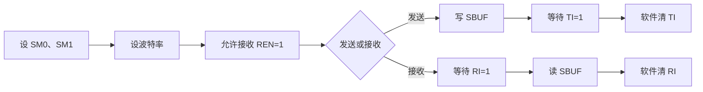

# 串行口四种工作方式（方式0～方式3）

## 四种方式，先抓两条主线

MCS-51 串行口有方式 0～3。判断它们，先问两个问题：**数据按同步移位还是异步帧传输？每帧多少位、波特率由谁决定？**

> [!IMPORTANT]
> ==方式 0 是同步移位寄存器方式；方式 1～3 是异步串行通信方式。==方式 1、3 波特率可变，方式 0、2 波特率固定。

| 工作方式 | 数据格式与用途 | 波特率 |
|---|---|---|
| 方式 0 | 8 位同步移位，RXD 收发数据，TXD 输出移位脉冲；常用于扩展并行 I/O | $f_{\mathrm{osc}}/12$ |
| 方式 1 | 10 位异步帧：1 起始位＋8 数据位＋1 停止位；常用双机通信 | 定时器 1 溢出率决定 |
| 方式 2 | 11 位异步帧：1 起始位＋8 数据位＋TB8＋1 停止位；可带校验或多机通信 | $f_{\mathrm{osc}}/64$ 或 $f_{\mathrm{osc}}/32$ |
| 方式 3 | 帧格式同方式 2，但波特率可变 | 定时器 1 溢出率决定 |

## 怎么配置与收发

通过 **SCON 的 SM0、SM1** 选择方式：00、01、10、11 分别对应方式 0、1、2、3。REN 置 1 允许接收；SM2 用于方式 2、3 的多机通信筛选；发送前把第 9 位写入 TB8，接收后在 RB8 中读取。

方式 1、3 常让定时器 1 工作在**方式 2 自动重装**，并启动 T1：

$$
\text{波特率}=\frac{2^{SMOD}}{32}\times\text{T1 溢出率}
$$

定时器 1 方式 2 时：

$$
\text{T1 溢出率}=\frac{f_{\mathrm{osc}}}{12(256-TH1)}
$$

发送时写入 `SBUF`，完成后硬件置 TI；接收完成后硬件置 RI。CPU 查询或响应中断后，==TI、RI 必须由软件清零==。发送和接收共用 `SBUF` 地址，但对应不同缓冲寄存器。

## 一个算对的例子

已知 $f_{\mathrm{osc}}=11.0592\ \mathrm{MHz}$，采用方式 1，$SMOD=0$，要求波特率 $9600\ \mathrm{bit/s}$。由公式：

$$
9600=\frac{1}{32}\times\frac{11.0592\times10^6}{12(256-TH1)}
$$

所以 $256-TH1=3$，即

$$
TH1=TL1=253=\mathrm{FDH}
$$

因此定时器 1 设为方式 2，装入 `TH1=TL1=0FDH`，启动 T1，即可获得 9600 bit/s。

> [!WARNING]
> 方式 1 的“10 位”不包含奇偶校验位；方式 2、3 的第 9 位是 TB8/RB8，不要把它当成停止位。方式 0 也不是普通异步串口通信，不能套用“起始位＋数据位＋停止位”。

> [!TIP]
> 记忆：**0 同步扩口，1 十位常用，2 固定十一，3 可变十一。**求初值时先写溢出率公式，再代 $2^{SMOD}/32$，可避免漏掉分频系数。
