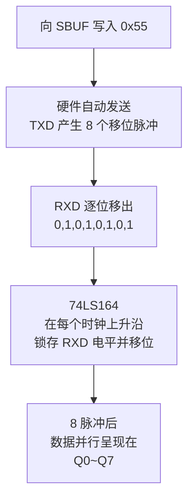

# 利用串行口扩展I/O（方式0扩展并行口）

---

`requires: [单片机IO口结构与不足, 串行通信基础概念]`

单片机自带的并行 I/O 口（如 P0、P1、P2、P3）经常不够用，尤其在连接多个并行外设（如数码管、微型打印机、并口液晶屏）时。直接选用更多引脚的芯片成本会升高，而利用串行口在方式 0 下，仅用 3 根线就能“变”出多个并口，这是非常经典且成本低廉的解决方案。

## 它是什么：一种“串转并”的虚拟端口

串行口工作于方式 0 时，被设定为==同步移位寄存器模式==。此时：
- **RXD（P3.0）** 作为数据线，负责串行地收发数据（低位在前）。
- **TXD（P3.1）** 作为移位时钟线，发出固定频率的脉冲 `fosc/12`。
- 二者严格同步，每来一个时钟，RXD 线上就推出一位或锁存一位数据。

这种模式本身不发异步通信的起始/停止位。若想让数据并行输出，必须外加“串入并出”移位寄存器（如 **74LS164**）；若想并行输入，则外加“并入串出”移位寄存器（如 **74LS165**）。最终效果相当于为主机扩展了廉价的**准双向并行口**。

## 为什么需要：用 3 根线换 8 根甚至更多线

> [!IMPORTANT]
> 核心动机：以 **低速换引脚**。当系统对扩展口的速度要求不高（例如驱动静态 LED、扫描按键），却对引脚占用高度敏感时，方式 0 是首选。传输一个字节耗时 `8 × 机器周期`，比真实并口慢，但极省引脚。

如果在只有一个额外串行引脚的廉价 20 脚 MCU 上，你仍想带一个 8 位数码管，那么方式 0 扩展几乎是最佳出路。

## 怎么做：输出 0x55 的完整过程

以常见的 **74LS164** 扩展 8 位并行输出来举例。

**硬件连接**：
- 单片机的 RXD → 74LS164 的串行输入端 A、B（两个输入端并接）。
- 单片机的 TXD → 74LS164 的时钟端 CLK。
- 74LS164 的 `/CLR`（清零）端接高电平，使其始终有效。

**软件只需做一件事**：向串口数据缓冲器 **SBUF** 写入待发字节。



> [!TIP]
> 记忆口诀：**写 SBUF 就发送，发完 TI 就置位**。方式 0 的一帧总是固定的 8 位数据，没有起始/停止位或 TB8/RB8，用 **TI（发送中断标志）** 或 **RI（接收中断标志）** 判断一帧是否结束。

## 常见误区与辨析

- **方式 0 不是异步串口**：它与方式 1~3 不同，**只在本机板级扩展**，不能直接连 RS-232 设备，因为它是 TTL 电平的同步信号。
- **TXD 才是真正的“节拍器”**：初学者常以为数据只从 RXD 走，写程序时忘了配置 SCON 的 SM0、SM1，串口可能没工作在方式 0。务必让 `SM0=0`、`SM1=0`。
- **波特率固定且唯一**：方式 0 的波特率硬性等于 `fosc/12`，不能用定时器修改。

## 完整算例：发送 0xAA

假设系统时钟 `fosc = 12 MHz`。我们要把二进制 `10101010` (即 0xAA) 发送出来点亮 8 个 LED。

1. **初始设置**：
   - 配置 `SCON = 0x00`（方式 0，SM0=0，SM1=0，TB8/RB8 无效，TI/RI 清零）。
   - **禁止串口中断**：`ES = 0`（若用查询方式）。

2. **发送代码与解析**：
   ```c
   SBUF = 0xAA;      // 启动发送，立即返回
   while(TI == 0);    // 等待 8 位数据发送完毕
   TI = 0;            // 软件清除发送中断标志，为下一帧做准备
   ```

3. **时序估算**：
   - 一个机器周期 = 1 μs。
   - 方式 0 的波特率 = 1 Mbps（1 μs 移 1 位）。
   - 发送一个字节（8 位）耗时 **8 μs**。

4. **结果**：
   8 μs 后，`while` 循环结束，74LS164 的输出管脚 `Q7…Q0` 上会稳定地出现 **1010 1010**（见下表电平）。

| 74LS164 引脚 | Q7 | Q6 | Q5 | Q4 | Q3 | Q2 | Q1 | Q0 |
| :--- | :---: | :---: | :---: | :---: | :---: | :---: | :---: | :---: |
| 位序 | D7 | D6 | D5 | D4 | D3 | D2 | D1 | D0 |
| 数据 (0xAA) | 1 | 0 | 1 | 0 | 1 | 0 | 1 | 0 |

> [!WARNING]
> **发送完千万别漏掉软件清零**：`TI` 在方式 0 下，发送完第 8 位数据由硬件自动置 1。若不清除，下次查询 `while(TI==0)` 会直接跳过，导致后续数据丢失。

> [!CAUTION]
> **极限带宽陷阱**：若 `fosc` 提高，方式 0 的移位速率也正比提高。但普通 74LS164 的时钟频率上限约 25 MHz。一旦超限，必须换成 74HC 系列，否则扩展口数据完全错乱。
