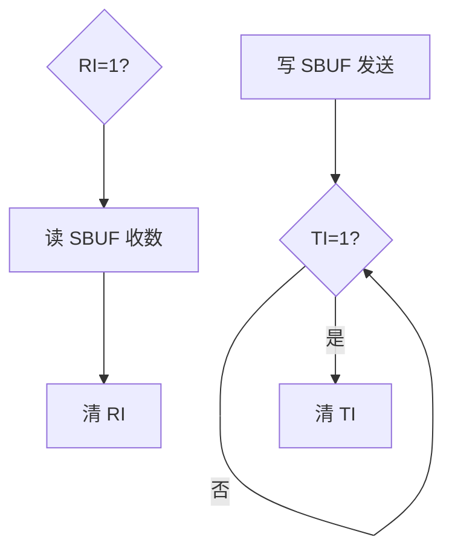
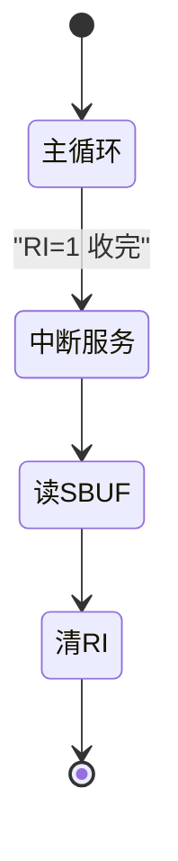

# 串行口通信编程（查询方式与中断方式）

## 什么是串行口通信编程（查询方式与中断方式）

在 MCS-51 单片机中，串行口通过发送标志 ==TI== 和接收标志 ==RI== 来反映一帧数据是否发完或收到。所谓串行口通信编程，就是围绕这两个标志，写出数据发送与接收的控制流程。

为什么需要区分查询和中断？发送通常是“我主动发”，时机可控；接收往往是“对方随时发”，时机随机。于是就有了两种不同的程序组织方式。

## 查询方式：轮询 TI 和 RI

查询方式的核心是 CPU 不断检查标志位。

以发送为例，两种常见写法是：

- 先送数，再等 `TI` 变 1，然后软件清 `TI`；
- 等上一次 `TI` 清完后，再送下一字节。

例如把片内 `30H` 开始的字符串发出去：把首字节写入 `SBUF`，随后“查询 `TI`、清 `TI`、再写下一字节”循环执行，直到发完。

> [!TIP]
> 查询方式口诀：`==发看 TI，收看 RI，用完清零==`。

## 中断方式：随机接收更高效

为什么接收要用中断？因为对方何时发数据单片机并不知道。若一直查询 `RI`，CPU 就被“拴住”了；开串行口中断后，收到一帧才进中断服务程序，平时可执行主任务。

中断方式下，发送常仍可用查询，而 ==接收建议采用中断方式==：

要注意：进入中断后，若判断是接收中断（`RI` 为 1），则读 `SBUF`、清 `RI` 并处理数据。

## 两者的区别与常见坑

| 对比项 | 查询方式 | 中断方式 |
|---|---|---|
| 适用场景 | 主动发送、简单任务 | 随机接收、效率高 |
| CPU 占用 | 高，轮询等待 | 低，事件驱动 |
| 编程关键 | 轮询并清 `TI/RI` | 开 `ES`、`EA` 和中断号 |

> [!WARNING]
> 最典型的坑：==忘记用软件清 `TI` 或 `RI`==。硬件只置位、不清零，不清就会反复误判或丢失下一帧。

> [!CAUTION]
> 发送中断和接收中断共用入口 `0023H`，必须在服务程序里靠 `TI/RI` 标志区分，别默认就是接收。

一个算对了的例子：主程序初始化串口方式 1、开中断并启动发送；接收采用中断方式，中断里读 `SBUF` 后清 `RI`，再回存缓冲区——这样既保证随机接收不丢帧，又让主程序空出来做别的事。
