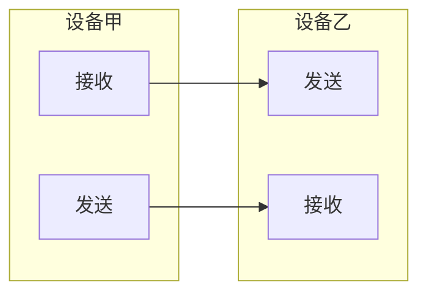

# 串行通信基本概念（同步/异步、波特率、双工方式）

## 基本概念

串行通信是指数据按**位顺序**在一条线路上逐位传送。与并行通信相比，它使用线路少、适合远距离传输，但相同传输速率下所占用的时间更长。51 系列单片机的串行口在通信前必须初始化，使双方的**帧格式和波特率完全一致**。

> [!IMPORTANT]
> 波特率表示每秒传送的符号数。串行通信中一个符号通常对应一位，因此常写作 bit/s；它不是“每秒传送多少个字符”。

## 同步与异步

| 对比项 | 异步通信 | 同步通信 |
|---|---|---|
| 同步依据 | 每帧自带起始位 | 依靠共享时钟 |
| 字符间隔 | 不要求连续 | 位连续传送 |
| 额外位 | 有起始位、停止位，可有校验位 | 帧结构中通常另设控制字段 |
| 适用场景 | 少量、不定期数据 | 大量、连续数据 |
| 实现难度 | 较简单 | 需严格同步时钟 |

典型异步帧为“**起始位 + 数据位 + 可选校验位 + 停止位**”。例如 8N1 表示 8 位数据、无校验、1 位停止位；若包含起始位，则一帧共 10 位。

## 波特率与初始化

波特率决定位传送速度。双方必须采用相同波特率，否则接收端无法正确判断每一位的起止位置。单片机通常由定时器产生波特率，并设置串行口工作方式、发送/接收方式、数据位数、校验方式和停止位数。

> [!TIP]
> 记忆口诀：**先定工作方式，再定帧格式，最后核对波特率。**

波特率发生器是串行口正常收发的核心。传统 8051 中，串行口每位至少检测 16 次，因此定时器初值不能任意设置；使用 T2 作为波特率发生器时，在相同晶振下可得到比 T1 更高约 6 倍的波特率。

## 双工方式

- **单工**：数据只能沿一个方向传送，如键盘向主机输入。
- **半双工**：双方都能收发，但不能同时进行，通常共用一对信号线。
- **全双工**：双方可以同时发送和接收，通常需要两对独立信号线或等效通道。

## 算例

某通信采用 10 位异步帧，其中数据位为 8 位，另含 1 位起始位和 1 位停止位，无校验位。波特率为 $9600\ \text{bit/s}$，则：

$$
t_{\text{frame}}=\frac{10}{9600}\approx 1.042\ \text{ms}
$$

因此，每秒最多传送约：

$$
N=\frac{9600}{10}=960\ \text{帧/s}
$$

> [!WARNING]
> 实际帧可能包含校验位、地址位或控制位，不能看到“10 位”就一律套用上述结论。若使用 16 倍时钟，接收或移位一个位的标称时间为 $16T_{\text{bit}}$。

## 常见坑

1. 把波特率误当成字符速率，忽略帧中起始位、停止位和校验位。
2. 只设置接收或发送中断，遗漏串行口使能和对应中断允许位。
3. 更换晶振或定时器工作方式后，没有重新计算波特率初值。
4. 使用 T2 产生较高波特率时，长时间禁止串行中断可能造成 overrun；中断关闭时间应不超过一个串行帧的传输时间。
5. `DLAB=1` 时访问的是波特率除数锁存器，而不是接收/发送缓冲寄存器；切换 `DLAB` 后必须重新配置波特率。
