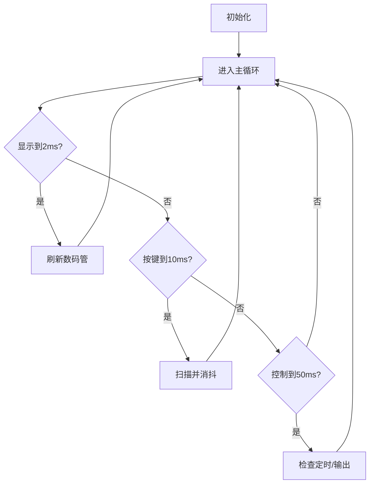

# 主函数整体调度设计

## 主函数整体调度设计是什么

在市电定时开关这类MCS-51应用实例中，主函数整体调度设计是指==在 `main()` 的 `while(1)` 循环中，以非阻塞方式协调按键扫描、显示刷新、继电器控制等任务==的执行顺序与时序。它不是简单的代码堆砌，而是将系统功能拆解为多个轻量级子任务，在主循环中按固定节奏轮询执行，避免某个任务独占CPU导致其他功能失效。

为什么不能把所有逻辑写成一个长流程？因为定时开关需同时响应按键、维持数码管动态扫描、判断市电通断，若某段代码延时过长，显示就会闪烁或按键失灵。

## 如何实现非阻塞调度

核心思路是“时间片轮询+标志位驱动”。先问自己：哪些任务对时间敏感？显示刷新通常需 ≤2ms 调用一次，按键消抖需 10~20ms 间隔，而继电器状态检查可放宽到 50ms。据此设定各任务的执行周期，并用定时器中断提供基准时基。



> [!IMPORTANT]
> ==主循环内严禁使用 `delay_ms()` 等阻塞延时==，所有时序依赖定时器中断更新的计数标志位判断。

具体做法：定义全局变量如 `tick_display`、`tick_key`，在定时器中断（如1ms）中递增；主循环仅做 `if (tick_display >= 2) { ...; tick_display = 0; }` 这类条件判断与清零操作。

## 与裸机顺序执行的区别

| 对比维度 | 顺序执行 | 主函数调度设计 |
| :--- | :--- | :--- |
| CPU占用 | 阻塞等待，利用率低 | 轮询空闲，利用率高 |
| 多任务响应 | 串行延迟，易丢事件 | 准并行，响应及时 |
| 可扩展性 | 新增任务需重排延时 | 仅需增加调度项 |
| 显示稳定性 | 易受其他代码影响 | 独立时基，稳定可靠 |

## 常见陷阱与规避

> [!WARNING]
> 标志位未在中断外及时清零，会导致任务重复执行或漏执行。务必在 `if` 块内完成“判断+处理+清零”三步原子操作。

> [!CAUTION]
> 定时器中断频率与主循环执行速度不匹配。若主循环单次耗时超过最小任务周期（如2ms），显示仍会闪烁。需用示波器或GPIO翻转实测主循环最大耗时。

## 正确调度示例

假设系统使用1ms定时中断，要求数码管2ms刷新、按键10ms扫描、继电器50ms检查。主循环关键代码如下：

```c
while (1) {
    if (flag_display >= 2) {
        Display_Scan();      // ≤100μs
        flag_display = 0;
    }
    if (flag_key >= 10) {
        Key_Process();       // ≤200μs
        flag_key = 0;
    }
    if (flag_ctrl >= 50) {
        Relay_Check();       // ≤300μs
        flag_ctrl = 0;
    }
}
```

> [!TIP]
> 验证方法：在 `Display_Scan()` 入口翻转一个测试IO，用示波器测得周期严格为2ms±5%，且无毛刺，即说明调度正确。若周期抖动大，则需优化子函数执行时间或提高中断优先级。
