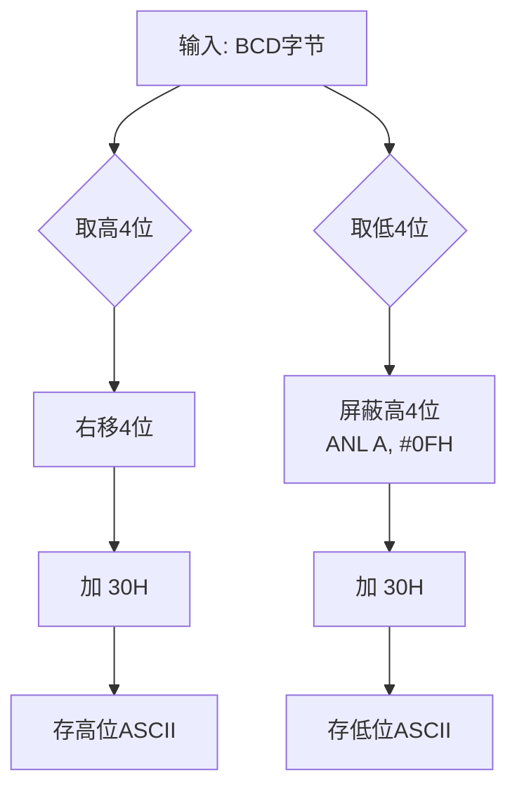

# 代码转换程序设计（BCD与ASCII转换等）

# 代码转换程序设计（BCD与ASCII转换等）

在MCS-51单片机系统中，硬件采集的数据通常是二进制或BCD码，而人机交互（如LCD显示、串口打印）需要ASCII码。**代码转换**即实现这两种数据格式间的映射。掌握其本质是理解“数值”与“字符”区别的关键。

## 核心原理与必要性

计算机内部运算使用二进制/BCD，但显示器只能识别ASCII字符。例如，数字 `9` 在内存中可能是 `09H` (BCD) 或 `00001001B` (Binary)，但在屏幕上显示为字符 `'9'` 时，其ASCII码为 `39H`。

> [!IMPORTANT]
> ==核心结论==：BCD转ASCII只需**加偏移量**；多位十进制数需**逐位分离**后转换。

若不进行转换，直接发送二进制值 `09H` 到终端，显示的将是不可见控制字符而非数字 `9`。

## 转换算法流程

### 1. BCD码 $\rightarrow$ ASCII码
对于单个压缩BCD字节（如 `35H` 表示十进制35），需拆分为高4位和低4位，分别加上 `30H`。

### 2. ASCII码 $\rightarrow$ BCD码
逆向操作，减去 `30H`，再合并高低位。需注意输入合法性检查（是否在 `30H-39H` 之间）。

## 典型实例解析

**题目**：将内部RAM `30H` 单元中的压缩BCD码转换为两个ASCII码，分别存入 `31H`（高位）和 `32H`（低位）。假设 `(30H) = 58H`。

**解题步骤**：
1.  **取高位**：`MOV A, 30H` $\rightarrow$ `SWAP A` (A=85H) $\rightarrow$ `ANL A, #0FH` (A=05H) $\rightarrow$ `ADD A, #30H` (A=35H, 即 `'5'`) $\rightarrow$ `MOV 31H, A`。
2.  **取低位**：`MOV A, 30H` $\rightarrow$ `ANL A, #0FH` (A=08H) $\rightarrow$ `ADD A, #30H` (A=38H, 即 `'8'`) $\rightarrow$ `MOV 32H, A`。

最终结果：`(31H)=35H`, `(32H)=38H`。

> [!TIP]
> **技巧**：利用 `SWAP` 指令快速交换高低半字节，避免繁琐的移位循环。

## 常见误区与辨析

| 特性 | BCD码 | ASCII码 | 二进制真值 |
| :--- | :--- | :--- | :--- |
| **用途** | 精确十进制运算 | 显示/通信 | 算术逻辑运算 |
| **范围** | 0-9 (每4位) | 30H-39H (数字) | 00H-FFH |
| **转换关键** | 加/减 `30H` | 减/加 `30H` | 需除法分离数位 |

> [!WARNING]
> **易错坑**：
> 1. 忘记 `ANL A, #0FH` 屏蔽无关位，导致高位垃圾数据参与运算。
> 2. 混淆 **压缩BCD**（一个字节存两位）与 **非压缩BCD**（一个字节存一位，高4位通常为0）。本题默认为压缩BCD。
> 3. 对大于9的十六进制数（A-F）直接加30H会得到错误ASCII，需先判断是否为合法BCD。

> [!NOTE]
> 若涉及多位数（如16位二进制转十进制ASCII），需先用“除10取余法”分离出个、十、百位，再对每一位单独执行上述BCD转ASCII操作。
