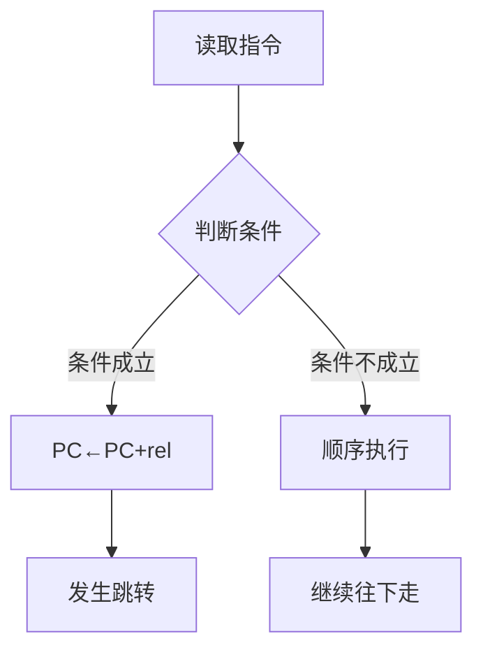

# 位操作类指令（SETB、CLR、CPL、JB、JNB、MOV C等）

> [!IMPORTANT]
> 位操作类指令是 MCS-51 ==布尔处理机== 的核心，专门对内部 RAM 的位寻址区（20H~2FH）和可位寻址的特殊功能寄存器（SFR）进行单比特级别的读写、逻辑运算与条件跳转。

## 为什么需要位操作？

如果你只想让 P1.0 引脚输出高电平来点亮一个 LED，用字节指令 `MOV P1, #01H` 行不行？可以，但这样会把 P1 口其他 7 个引脚的状态全部覆盖掉。在单片机控制中，我们往往只需要改变某一位而不影响其余位——这就是位操作类指令存在的意义。

## 怎么做：三类核心指令

### 位传送

以进位标志 Cy（即 C）为“中转站”，实现任意位与 C 之间的数据传递。

| 指令 | 操作说明 | 周期 |
|---|---|---|
| `MOV C, bit` | $(C) \leftarrow (bit)$ | 1 |
| `MOV bit, C` | $(bit) \leftarrow (C)$ | 1 |

> [!WARNING]
> `MOV A, 60H` 是将内部 RAM **字节地址** 60H 的内容送 A；而 `MOV C, 60H` 是将 **位地址** 60H 的值送 Cy。两者操作数长度和目的寄存器完全不同！

位地址有四种表示形式：直接写位地址（如 `00H`）、字节地址加位序号（如 `20H.0`）、位符号名（如 `P1.0`），以及 SFR 字节名称加位序号（如 `PSW.0`）。

### 位置位、清零与取反

| 指令 | 操作说明 | 周期 |
|---|---|---|
| `SETB C` / `SETB bit` | $(C) \leftarrow 1$ / $(bit) \leftarrow 1$ | 1 |
| `CLR C` / `CLR bit` | $(C) \leftarrow 0$ / $(bit) \leftarrow 0$ | 1 |
| `CPL C` / `CPL bit` | $(C) \leftarrow \overline{(C)}$ / $(bit) \leftarrow \overline{(bit)}$ | 1 |

> [!NOTE]
> 注意区分：`CLR A` 和 `CPL A` 是**字节**操作指令，针对累加器 A；而 `CLR bit` 和 `CPL bit` 是**位**操作指令。`CLR A` 执行后不影响 Cy、AC、OV 标志，但会使奇偶标志 P 为 0。

### 位条件转移

根据 C 或某一位的状态决定程序流向。PC 先加上指令字节数，若条件满足再加上相对偏移量 $rel$。



| 指令 | 操作说明 | 周期 |
|---|---|---|
| `JC rel` | 若 $(C)==1$，则 $(PC) \leftarrow (PC)+rel$ | 2 |
| `JNC rel` | 若 $(C)==0$，则 $(PC) \leftarrow (PC)+rel$ | 2 |
| `JB bit, rel` | 若 $(bit)==1$，则跳转 | 2 |
| `JNB bit, rel` | 若 $(bit)==0$，则跳转 | 2 |
| `JBC bit, rel` | 若 $(bit)==1$，则 $(bit)\leftarrow 0$ 并跳转 | 2 |

> [!TIP]
> `JB`/`JNB` 是三字节指令，计算跳转目标地址时基准是 $(PC)+3$；`JC`/`JNC` 是两字节指令，基准是 $(PC)+2$。

## 常见坑与辨析

> [!CAUTION]
> `JBC bit, rel` 是唯一一条 ==测试并自动清零== 的指令，常用于中断标志位的检测与清除（读完就清，防止重复响应）。不要把它和 `JB` 搞混。

## 算对了的例子

**题目要求**：将位地址 60H 的状态取反，若取反后为 1 则跳转到标号 `LOOP`，同时将该位清零。

**分析步骤**：
1. 取反位地址 60H：使用 `CPL 60H`。
2. 判断是否为 1，为 1 则跳转且清零：直接使用 `JBC 60H, LOOP`。

**正确代码**：
```assembly
CPL 60H          ; 将位地址60H中的值按位取反
JBC 60H, LOOP    ; 若(60H)==1，则(60H)←0，且PC←(PC)+3+rel跳转到LOOP
```

如果不用 `JBC`，而是写成 `JB 60H, LOOP` 后再手动 `CLR 60H`，一旦中间被打断，状态就可能出错。这就是 `JBC` 这种“原子化”位操作指令的价值所在。
