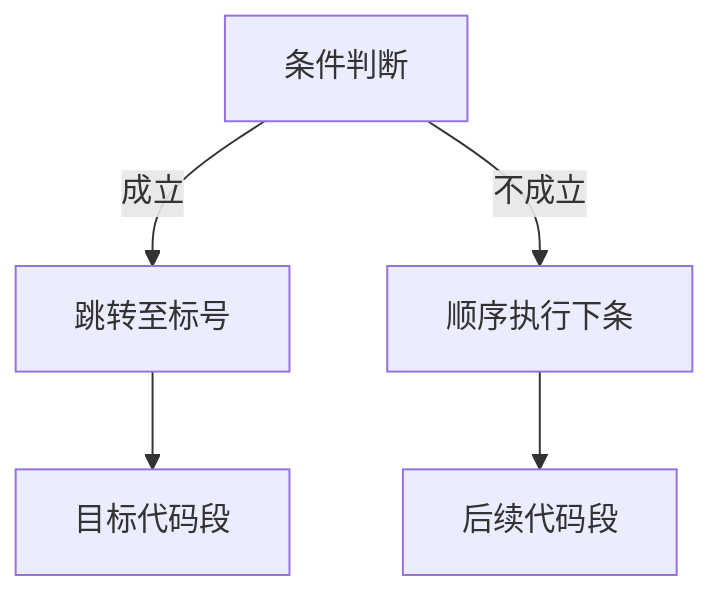

# 分支结构程序设计

## 什么是分支结构

在顺序执行的基础上，程序如何根据运行时的状态“做选择”？分支结构就是依据条件判断结果，==改变程序计数器 PC 的值==，使 CPU 跳转到不同代码段执行的程序设计方法。它是实现按键响应、状态机切换、数据分类处理等交互逻辑的基础。

> [!IMPORTANT]
> MCS-51 没有高级语言的 `if-else` 关键字，所有分支都依赖 **条件转移指令** 与 **标号** 配合实现。

## 核心实现机制

MCS-51 的条件转移均为 ==相对短转移==（偏移量 -128～+127），常用指令如下：

| 指令 | 测试条件 | 典型用途 |
| :--- | :--- | :--- |
| `JZ / JNZ` | A = 0 / A ≠ 0 | 运算结果判零 |
| `JC / JNC` | Cy = 1 / Cy = 0 | 比较大小、多字节运算 |
| `JB / JNB / JBC` | bit = 1 / 0 / 1且清零 | I/O 引脚、标志位检测 |
| `CJNE` | 两操作数不等 | 数值比较并跳转 |
| `DJNZ` | 减 1 后 ≠ 0 | 循环兼分支 |



[!TIP]
> 记忆口诀：“判零用 JZ，进位看 JC，位操 JB/JNB，比较 CJNE 带借位”。

## 与相近概念的区别

- **分支 vs 循环**：循环本质是“向后跳转的分支”，但 `DJNZ` 同时完成减量和判断；纯分支只负责单次路径选择。
- **条件转移 vs 无条件转移**：`LJMP/AJMP/SJMP` 不受任何标志位影响，仅用于固定跳转；条件转移必须先设置或检测标志位。
- **CJNE vs SUBB**：`CJNE` 只比较不修改操作数，但会影响 Cy；`SUBB` 会改变累加器内容，适合需要差值的场景。

## 常见陷阱与避坑指南

> [!WARNING]
> `CJNE` 执行后 ==Cy 表示大小关系==：若第一操作数 < 第二操作数，则 Cy=1；否则 Cy=0。这与减法借位方向一致，但初学者常误认为“相等才跳”。

- **偏移超限**：条件转移仅 ±128 字节，超出范围需改用 `LJMP` 配合反向条件跳转（如 `JZ` 改 `JNZ` + `LJMP`）。
- **标志位未预设**：使用 `JC/JNC` 前必须确保 Cy 已被正确设置（如通过 `CLR C` 或比较指令），否则跳转不可预测。
- **bit 地址混淆**：`JB/JNB` 的操作数是 ==位地址==（如 `P1.0`、`20H.3`），不是字节地址，写错将编译报错。

## 实例：双键分支判断

设 P1.0 接 KEY_A，P1.1 接 KEY_B，按下为低电平，编写分支处理：

```assembly
        MOV     C, P1.0      ; 读 KEY_A 到 Cy
        JNC     HANDLE_A     ; Cy=0 即 KEY_A 按下
        MOV     C, P1.1      ; 再读 KEY_B
        JNC     HANDLE_B     ; Cy=0 即 KEY_B 按下
        SJMP    NO_KEY       ; 均未按
HANDLE_A:                    ; KEY_A 处理代码
        ; ...
        RET
HANDLE_B:                    ; KEY_B 处理代码
        ; ...
        RET
NO_KEY:                      ; 无键处理
        RET
```

[!CAUTION]
> 此例未含消抖！实际工程中必须在 `JNC` 前加延时或状态机消抖，否则机械抖动会导致多次误触发分支。

该例展示了 ==位条件转移的典型用法==：利用 `JNC` 检测低电平有效信号，避免额外取反操作，代码简洁且符合 MCS-51 硬件特性。
