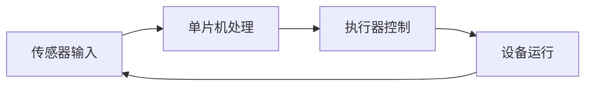

# 单片机发展与应用领域

## 单片机是什么

单片机（Single Chip Microcomputer，SCM）是把计算机的基本功能部件集成在一块芯片上的微型计算机，通常包括：

- **CPU**：执行指令、进行运算和控制；
- **存储器**：保存程序和数据；
- **I/O 接口**：连接按键、显示器、传感器等外部设备；
- **定时/计数器、中断系统等**：完成定时、计数和事件响应。

因此，单片机不是单纯的 CPU，也不是一块只能完成固定逻辑的数字芯片，而是能够运行程序、处理信息并控制外部设备的“芯片级计算机”。

> [!IMPORTANT]
> 单片机的核心特点是：==集成度高、体积小、成本低、控制功能强，适合嵌入式应用==。

## 为什么需要单片机

许多设备并不需要通用计算机那样强大的计算能力，却需要长期、稳定、低成本地完成特定任务。例如，电饭锅需要检测温度并控制加热，电子秤需要采集重量并显示结果，智能水表需要计量并上传数据。

如果用通用计算机实现，往往体积大、功耗高、成本高；如果完全用硬件电路实现，又可能缺乏灵活性。单片机通过“硬件接口＋软件程序”完成任务，修改程序即可调整功能，因而特别适合控制场合。

## 单片机的发展脉络

学习发展过程时，重点不是死记年份，而是理解其演进方向：

| 发展方面 | 主要表现 |
|---|---|
| 集成度提高 | 更多功能模块集成到芯片内部 |
| 性能增强 | 主频提高，数据处理能力增强 |
| 存储器改进 | 程序存储器容量增大，擦写更方便 |
| 外设丰富 | 定时器、串口、ADC 等模块逐步集成 |
| 功耗降低 | 更适合便携设备和电池供电 |
| 系列化发展 | 不同型号面向不同性能与成本需求 |

可以概括为：==由简单到复杂、由低性能到高性能、由单一控制到多领域应用==。

## 单片机的应用领域

单片机应用广泛，常见领域如下：

| 应用领域 | 典型实例 | 主要任务 |
|---|---|---|
| 智能仪器仪表 | 数字万用表、电子秤 | 数据采集、处理与显示 |
| 工业控制 | 电机控制、生产线控制 | 实时检测与自动控制 |
| 家用电器 | 洗衣机、空调、微波炉 | 按键输入、状态控制 |
| 通信与网络设备 | 智能终端、数据采集节点 | 数据收发与协议处理 |
| 汽车电子 | 车窗控制、仪表系统 | 状态监测与执行控制 |
| 医疗电子 | 血压计、监护设备 | 信号采集与结果显示 |
| 消费电子与玩具 | 遥控器、电子玩具 | 人机交互与功能控制 |

这些应用虽然外观不同，但基本工作过程相似：单片机先通过输入接口获取信息，再按程序进行处理，最后通过输出接口控制显示、报警或执行机构。

## 相近概念辨析

| 概念 | 与单片机的区别 |
|---|---|
| 微处理器 | 主要指 CPU，通常还需外接存储器和接口 |
| 微型计算机 | 完整系统概念，通常包含主机、外设和软件 |
| 通用计算机 | 强调通用计算，性能强，但成本和功耗通常较高 |
| 嵌入式系统 | 面向特定任务的计算机系统，单片机可作为其核心 |

> [!WARNING]
> 不要把“单片机”与“微处理器”混为一谈。微处理器侧重运算与控制核心，单片机则强调在单芯片上集成较完整的计算机功能。

## 常见误区与判断方法

- 认为单片机只用于工业控制：错误，家电、仪表、汽车电子等同样大量使用。
- 认为性能越高越好：错误，实际选型还要考虑成本、功耗、接口和可靠性。
- 认为单片机只能做简单任务：不准确，其能力取决于具体型号和系统资源。
- 看到“体积小、成本低”就判断为单片机：不充分，还应看它是否运行程序并完成信息处理与控制。

> [!TIP]
> 判断应用题时抓住三个关键词：**采集信息、程序处理、输出控制**。同时具备这些特征，通常就是典型的单片机应用。

## 例子：自动温控风扇

某系统要求：温度高于 $30^\circ\mathrm{C}$ 时启动风扇，低于 $28^\circ\mathrm{C}$ 时关闭风扇，并实时显示温度。

正确分析如下：

1. 温度传感器采集温度信号；
2. 单片机读取并处理温度数据；
3. 当 $T>30^\circ\mathrm{C}$ 时，输出控制信号启动风扇；
4. 当 $T<28^\circ\mathrm{C}$ 时，关闭风扇；
5. 显示模块显示当前温度。

例如测得 $T=32^\circ\mathrm{C}$，因为 $32>30$，所以应启动风扇。该系统属于单片机在**智能控制与家电领域**的应用，而不是单纯的温度测量电路。
