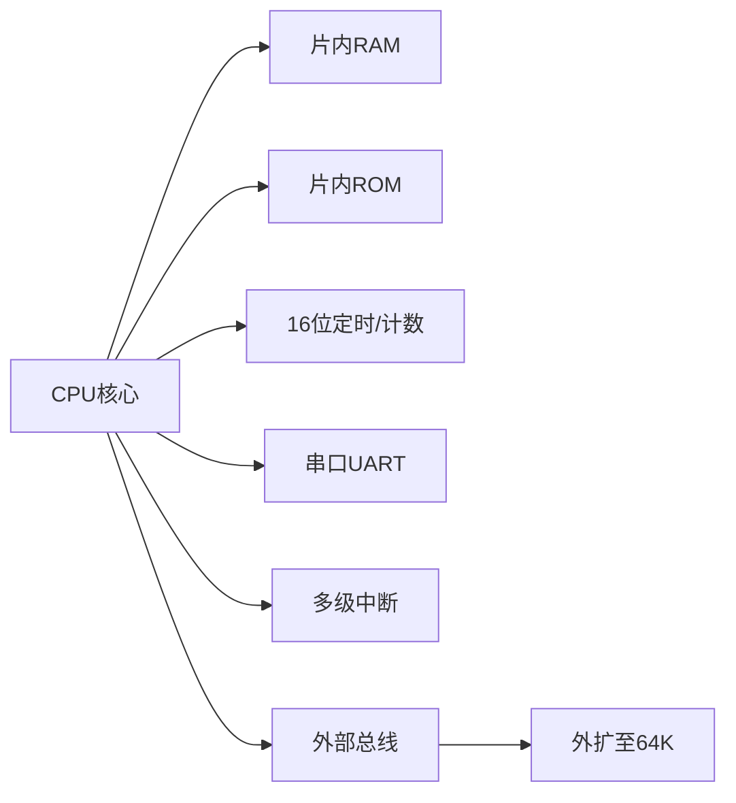

# 单片机定义与特点

如果我们要控制一个温度传感器，用一台完整的台式电脑显然“杀鸡用牛刀”。那么，能不能把计算机的核心部件浓缩到一块芯片里？这就是单片机诞生的起点。

## 什么是单片机

> [!IMPORTANT]
> 单片机（Single-Chip Microcomputer）是将 CPU、RAM、ROM、定时器/计数器及 I/O 接口等集成在==单一芯片==上的微型计算机。

它不是“简化的电脑”，而是专为==嵌入式控制==设计的芯片级计算机。典型架构如下：

## 为什么需要它

通用微机擅长海量数据计算，而工业控制、家电、仪表等场景真正需要的是：体积小、功耗低、成本低且能直接驱动外设的控制器。单片机正是为满足这些需求而生。

## 单片机的核心特点

结合南邮课件，其特点可归纳为以下几点：

- **片内集成且可扩充**：内置 RAM/ROM，当片内资源不足时，可通过外部总线扩充，最大可扩充容量达 ==64KB==。
- **丰富的外设资源**：自带串口（UART）、多级中断处理系统、16 位定时/计数器等，无需外接专用芯片即可构成最小应用系统。
- **技术不断下移演进**：将已在微型机、16 位/32 位单片机等成熟应用的先进技术，下移到单片机上，不断推动单片机技术与性能的发展。

## 与相近概念的区别

初学者极易混淆以下三个概念：

| 比较维度 | 单片机（MCU） | 微处理器（MPU） | 通用微型计算机 |
| :--- | :--- | :--- | :--- |
| **集成度** | ==单芯片集成== CPU+RAM+ROM+I/O | 仅含 CPU，需外接存储与 I/O | 多芯片/板卡组合 |
| **主要用途** | 实时控制、数据采集 | 复杂运算、通用处理 | 办公、多媒体、科学计算 |
| **寻址空间** | 通常较小（如外扩 64K） | 极大（GB 级别） | 极大（GB 级别） |

> [!NOTE]
> 微处理器是单片机的“前身”与“核心”，但微处理器本身不能独立工作，必须搭配外围电路；单片机则是一个“自给自足”的最小系统。

## 常见误区与避坑

> [!WARNING]
> “64K”指的是==字节数==（$64\text{KB} = 2^{16}\text{B}$），由 16 位地址总线决定，而不是 64 个存储单元或 64Kb（千比特）。

> [!CAUTION]
> 不要认为单片机只能做简单控制。随着 16 位/32 位先进技术的下移，现代单片机已具备 DSP 运算、网络通信等高级能力。

## 算对了的例子

**题目**：某基于 8051 内核的单片机系统，片内 ROM 仅有 4KB，现需运行一段大小为 10KB 的程序代码。请问能否实现？若能，最大还能再扩充多少字节的程序存储器？

**解答**：
可以实现。根据单片机特点，片内 ROM 不足时可通过外部总线扩充。该架构地址总线为 16 位，最大寻址空间为：

$$S_{max} = 2^{16} \times 1\text{B} = 65536\text{B} = 64\text{KB}$$

因此，外部最多可扩充 64KB 的程序存储器。运行 10KB 的代码绰绰有余，扩充后剩余可用最大容量为 $64\text{KB} - 10\text{KB} = 54\text{KB}$。

> [!TIP]
> 记忆口诀：“==片内不够片外凑，十六地址六四K，串口定时加中断，一芯搞定控制端==。” 答题时踩准“片内集成”、“外扩 64K”、“多级中断”、“16 位定时/计数器”这几个得分关键词即可。
