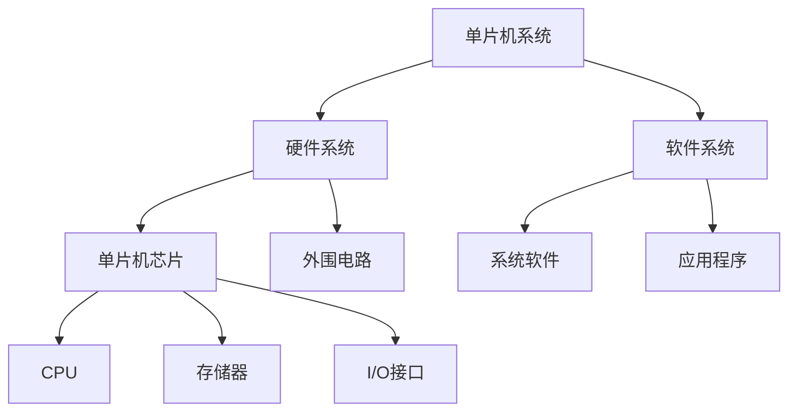
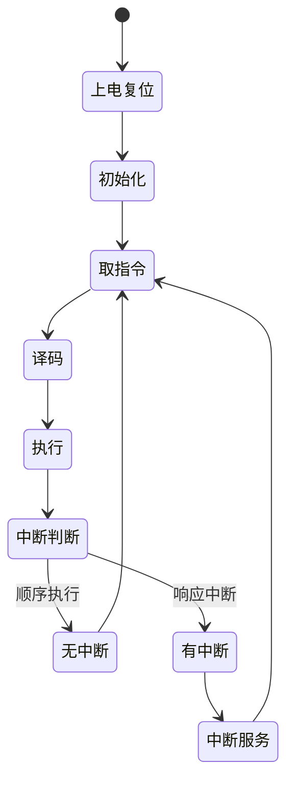

# 单片机系统的基本组成

## 单片机系统的基本组成

在我们开始学习单片机原理之前，有一个问题值得先想清楚：**单片机芯片本身就等同于一个完整的计算机系统吗？**

答案是否定的。单片机芯片本身只是一个高度集成的核心部件，它包含了 CPU、存储器和各种接口电路，但要让它真正工作起来、完成一个有意义的任务，还需要外围电路与软件的共同配合。这就引出了本章的核心内容——单片机系统的基本组成。

### 单片机系统的层次结构

单片机系统从逻辑上可以分为三个层次：**硬件层**、**软件层**和**应用层**。我们通常讨论的“单片机系统”主要聚焦于硬件和软件两部分。

### 硬件系统

硬件系统是单片机系统的物理基础，主要由以下两部分构成：

| 组成部分 | 功能 | 典型实例 |
|---------|------|---------|
| **单片机芯片** | 集成 CPU、存储器（ROM/RAM）、I/O 接口、定时器/计数器、中断系统等于一体的核心器件 | AT89C51、STM32F103、MSP430 等 |
| **外围电路** | 为芯片提供工作条件，并扩展其输入/输出能力 | 电源电路、晶振电路、复位电路、键盘、LED 显示、传感器接口等 |

在硬件组成中，有三个电路是任何单片机系统**缺一不可**的最小系统核心：

> [!IMPORTANT]
> 单片机最小系统 = **电源电路 + 晶振电路 + 复位电路**。缺少任何一个，芯片都无法正常启动和运行。

**① 电源电路**：为芯片提供稳定、额定的直流电压（如 51 系列通常为 +5V）。电源电压不正常，芯片可能不工作，甚至损坏。

**② 晶振电路**：提供时钟信号。单片机内部所有的时序——取指令、执行指令、定时计数——都由时钟节拍驱动。晶振频率决定了单片机的机器周期长度。

**③ 复位电路**：在系统上电或需要重新启动时，使 CPU 从确定的状态（PC = 0x0000）开始执行程序。复位电路通常由 RC 电路或专用复位芯片构成。

### 软件系统

软件系统指运行在单片机硬件上的程序及其相关数据，分为两类：

- **系统软件**：如监控程序、汇编器、C 编译器、仿真调试软件等，主要在开发阶段运行在 PC 端，帮助开发者生成和调试目标代码。
- **用户应用程序**：开发者编写、最终烧录到单片机 ROM 中运行的程序，是实现具体控制功能的核心。

### 单片机系统的工作流程

一个典型的单片机系统，其运行流程可以概括为：

### 常见误区

- **误区一：把单片机芯片当作完整系统。** 芯片只是核心，离了电源、晶振和复位电路，它什么也做不了。
- **误区二：认为“最小系统”只要接晶振就行。** 复位电路同样必须。如果复位引脚悬空或接法不当，芯片上电后内核可能处于不定状态。
- **误区三：混淆“存储器”的归属。** 单片机芯片内部集成的 ROM 用于存放程序，RAM 用于存放数据，这些是**片内存储**；当内部不够用时，才需要外部扩展存储芯片。

> [!WARNING]
> 考试中常给出一个“最小系统”电路图让你判断缺少什么，或者给出几个元件让你选择哪些属于最小系统必需。常见的陷阱是：**把 LED 显示电路、按键电路也算作“最小系统”的必要组成**——它们属于应用外围电路，不是最小系统必需的。

### 一个算对了的例子

**题目**：某同学设计一个基于 AT89C51 的温控系统，系统需要采集温度、显示温度值，并根据温度控制继电器。请指出该系统的硬件组成中，哪些属于“最小系统”，哪些属于“应用外围电路”。

**分析**：按照前面的定义，逐项归类。

- **最小系统**：AT89C51 芯片本身、+5V 电源电路、12MHz 晶振电路（含两个 30pF 电容）、RC 复位电路。
- **应用外围电路**：DS18B20 温度传感器及其接口电路、LED 数码管显示电路、继电器驱动电路、键盘电路等。

**结论**：题目里如果问“该系统的最小系统由哪些部分组成”，答案就是 ==电源 + 晶振 + 复位 + 单片机芯片==，温度传感器、数码管等**不算**最小系统组件。
